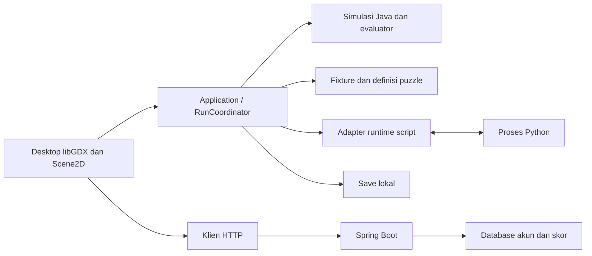
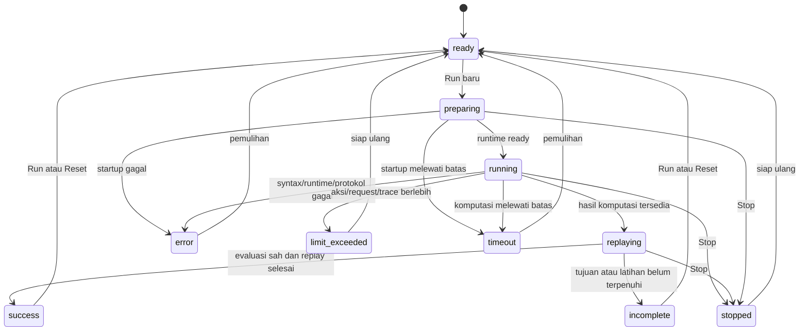

# ARCHITECTURE — mars_reboot.py

Status diperbarui 22 November 2026. Kandidat puzzle 1 tetap terhubung ke terminal Python nyata, robot/replay/hasil, Run/Stop/Reset dan progres sesi. Paket Windows x64 menyertakan CPython 3.15.2; Java 21+ masih diperlukan. Source Home/login/tamu, setelan, backend Spring lokal dan scoreboard P1 kini ditambahkan. Kompilasi `javac --release 21` berhasil untuk core dan backend pada sesi ini; Gradle Wrapper gagal start karena `native-platform.dll`, jadi belum ada verifikasi build penuh atau UI aktual sesi ini. Puzzle 2–9, save lintas restart dan komputer kedua belum diverifikasi. Rancangan lengkap di bawah tetap Usulan kecuali bagian yang sudah dipilih/diimplementasikan; kontrak p1 terkini ada di [kontrak runtime](docs/mars/PYTHON_RUNTIME.md). Java/libGDX dan versi existing dipertahankan.

## 1. Status dan pilihan stack

| Area | Dasar | Status |
| --- | --- | --- |
| Game Java/libGDX | PROJECT §2, §6 | Root MarsReboot, modul `core`/`lwjgl3`; habitat dan kandidat domain puzzle 1 tersedia. Task robot/kontrol, kompilasi desktop dan JAR melalui Wrapper lulus 13 Nov pada mesin ini. |
| Simulasi otoritatif Java | PROJECT §6 | Rancangan kerja; jangan menyalin aturan ke renderer atau Python. |
| UI Scene2D / editor TextArea | PROJECT §6 | Kandidat; perlu uji keyboard, indentasi, seleksi, scrolling, dan error. |
| Bahasa pemain Python | PROJECT §10 / PRD KT-01 | Menunggu konfirmasi aslab. |
| CPython proses terpisah | PROJECT §6 | Opsi eksperimen awal untuk source tepercaya; bukan sandbox. |
| Spring Boot | SOP / PROJECT §6 | Backend akun dan skor lokal diimplementasikan; verifikasi server berjalan dan akses dari komputer lain belum dilakukan pada sesi ini. |
| JDK 21, Gradle Wrapper 9.8.0, Spring Boot 4.1.2, Spring Security/JPA, H2 | Konfigurasi aktif | Source core dan backend kompilasi langsung dengan JDK 21; Wrapper build terkini terhambat `native-platform.dll`. |

Prototype web berada di `prototype-web/`; root ini adalah repository Java/libGDX MarsReboot. Command Wrapper: `.\gradlew.bat :lwjgl3:run`, `:lwjgl3:jar`, `:core:robotTest`, `:core:controlTest` dan `:lwjgl3:desktopSmokeTest`. Pada 13 November, robotTest/controlTest, compileJava desktop dan JAR berhasil melalui Wrapper dengan cache tersedia (VERIFICATION); desktopSmokeTest belum diulang melalui Wrapper. Struktur modul domain/backend berikut tetap usulan; tidak perlu menjalankan generator ulang atau memindahkan proyek existing.

## 2. Modul dan arah dependensi



| Usulan modul | Isi / pemilik | Batas |
| --- | --- | --- |
| game-domain | WorldState, aksi/sensor, evaluasi, metrik; peran 1–2 | Java tanpa dependensi libGDX, HTTP, atau proses Python. |
| game-content | PuzzleDefinition, fixture/target, starter, petunjuk; peran 2 | Data diberi versi; tidak menghitung state renderer. |
| game-app | RunCoordinator, progres, pembatalan, save, runtime adapter; peran 1, integrasi peran 4 | Satu penulis state percobaan. |
| desktop | Dunia astronaut, terminal, replay, input, aset; peran 3 | Mengonsumsi snapshot immutable; UI tidak memutuskan sukses sendiri. |
| backend | Akun, sesi, validasi dan persistensi skor; peran 4 | Tidak menerima atau mengeksekusi source/output pemain. |

Dependency diteruskan melalui konstruktor pada interface yang diperlukan. Tidak menambahkan ECS, plugin system, event bus global, atau repository buatan untuk domain tanpa kebutuhan. Folder/modul final dipilih saat bootstrap; daftar ini bukan status file aktual.

### 2a. Struktur habitat dasar yang diimplementasikan

- Versi generator dipertahankan: source/target Java 21, libGDX 1.14.2, LWJGL 3.4.3, Wrapper Gradle 9.8.0. JDK yang benar-benar digunakan untuk pemeriksaan langsung: Oracle 25.0.4.1 dengan `javac --release 21`; ini bukan bukti eksekusi pada JDK 21. Daemon Gradle tetap meminta 21 sesuai file existing.
- `core/src/main/java/com/marsreboot/MarsRebootGame.java`: `Game` membuka `habitat/HabitatScreen`, melepas layar ketika dispose. Launcher existing `lwjgl3/.../Lwjgl3Launcher.java` dipertahankan, judul dan ukuran awal menjadi Mars/1280×720.
- Package `com.marsreboot.habitat`: `HabitatWorld` memegang posisi, collider, fasilitas, jangkauan serta mode `EXPLORING / INSPECTION / TERMINAL`, tanpa dependensi rendering. Gerak 180 unit/detik, hitbox 24×28, kanvas 960×600, jangkauan 60 dari pusat astronaut ke titik terdekat bounds objek adalah parameter blockout sementara, bukan angka robot/puzzle yang dipilih.
- `HabitatInput` memetakan keyboard dan melacak press/release; `InputMultiplexer(input, stage)` memastikan Esc diproses sebelum editor. E dilatch sampai release; karakter E pembuka tidak masuk ke editor. Modal mengunci gerak melalui state dunia, termasuk ketika fokus widget berpindah.
- `HabitatRenderer` hanya membaca dunia; `HabitatUi` memiliki Stage, Skin existing `assets/ui/uiskin.json`, TextArea dan Window. `HabitatScreen` menghubungkan input/update/render, viewport dunia dan UI `FitViewport` terpisah, resize, pause/hide/dispose. Tidak menambahkan modul, dependency, ECS, physics engine atau backend.
- `core:controlTest` merupakan `JavaExec` tanpa dependency test baru, ikut `check`. `lwjgl3:desktopSmokeTest` merupakan task opt-in untuk OpenGL/Scene2D, tidak ikut `check` agar tidak memaksa window di lingkungan headless. Test desktop menggunakan input processor antar-frame; bukan otomatisasi penahanan tombol OS. Kontrol/desktop telah diuji langsung dengan Java; task controlTest melalui Wrapper juga lulus 13 November, desktopSmokeTest belum diulang melalui Wrapper.

### 2b. Domain robot/puzzle 1 yang diimplementasikan

- Package `com.marsreboot.robot` tetap di modul `core`; `RobotSimulation` adalah Java murni tanpa libGDX, Python, HTTP atau clock. Satu pemilik memutasi state; renderer nantinya hanya membaca `Snapshot` immutable. Tidak menambah modul/dependency/abstraksi runtime.
- `Fixture.puzzleOne()` adalah kandidat `p1-a` di RULES, bukan persetujuan final. Record `Fixture` menyalin dan memvalidasi grid, tanaman, penghalang, target serta batas; record `Snapshot` menyalin state/metrik/hasil. Aksi/sensor, evaluasi akhir normal dan reset berada di domain ini.
- `finish()` hanya menyelesaikan skenario domain. Coordinator kelak bertanggung jawab membedakan akhir normal/error/Stop, menolak hasil Run lama dan menerapkan progres setelah replay. Pada tahap domain sebelum integrasi belum ada adapter terminal/Python, trace/replay atau identitas Run; implementasi terbaru ada di bagian 12; jangan memanggil `finish()` pada Stop atau error interpreter.
- `:core:robotTest` adalah `JavaExec` tanpa dependency test tambahan, ikut `check`. Test referensi/negatif serta isolasi snapshot/reset lulus 81 assertion melalui Wrapper; batas bukti di VERIFICATION. Implementasi ini tidak mengklaim multi-skenario, siram, skor atau penerimaan gameplay lengkap.

## 3. Kontrak simulasi dan aplikasi — Usulan

| Data / interface konseptual | Isi minimum |
| --- | --- |
| PuzzleDefinition | puzzleId, rulesVersion, fixtureVersion, skenario wajib, tujuan, batas, latihan konsep, starter dan petunjuk. |
| ScenarioFixture | scenarioId, dimensi, petak/robot awal, persediaan, target; immutable. |
| WorldSnapshot | scenarioId, posisi, petak, persediaan, actionCount/apiCallCount, target/pelanggaran; immutable. |
| RobotCommand / SensorQuery | Jenis + argumen tervalidasi sesuai RULES; tidak membawa logic Python. |
| CommandResult | Nilai balik, alasan gagal, metrik, snapshot setelah aksi. |
| RunRequest | runId, generation, puzzle/rules/fixture version, satu snapshot source lokal. |
| ScenarioResult | outcome, target tersisa, pelanggaran, metrik, error/line jika ada. |
| RunResult | Seluruh hasil skenario yang sempat dievaluasi, allRequiredPassed, latihan, finalSequence. Tidak menyatakan sukses final UI sebelum replay selesai. |

Domain menerapkan satu command atomik lalu menghasilkan hasil. Evaluator membaca state/tujuan, bukan gambar. RunCoordinator menggabungkan hasil dan progres; UI hanya menerima data render. API Python meneruskan request dan menggunakan response Java, bukan memiliki salinan aturan.

Kontrak domain diuji melalui interface yang sama dengan aplikasi. Mock UI memakai fixture/DTO yang sama; keberhasilan mock tidak membuktikan integrasi runtime/backend. Hindari dependency pada format serialisasi dalam domain.

## 4. Eksekusi dan lifecycle — Usulan

Satu coordinator menjalankan perubahan state pada executor berurutan; render thread menerima event/snapshot immutable. Network, pembacaan pipe, dan menunggu proses tidak memblokir render thread. Perubahan widget/aset dilakukan pada thread yang sesuai lifecycle libGDX.



Diagram adalah rancangan transisi, bukan bukti runtime. Reset dari fase apa pun membatalkan runId/generation aktif, mengosongkan trace/output dan kembali ke fixture awal ketika runtime siap. Error/startup/timeout mempertahankan source; Run disabled sementara resource lama dibersihkan, lalu dapat dicoba lagi dengan pesan pemulihan yang jelas.

Urutan Run: validasi source dan versi → buat runId baru → salin fixture → mulai proses/namespace per skenario → terapkan request berurutan → evaluasi saat program berakhir → lanjut skenario atau fail-fast → selesaikan replay → terapkan sukses/progres satu kali. UI boleh menyajikan trace ketika komputasi berjalan, tetapi terminal result tetap menunggu finalSequence yang sah. Kecepatan replay tidak menahan komputasi atau mengubah skor; buffer penuh menjadi limit_exceeded, bukan tumbuh tanpa batas.

## 5. Runtime Python dan protokol — kandidat CPython

Sebelum memilih: buktikan startup, satu aksi, satu sensor, syntax/runtime error, Stop loop tanpa API, timeout, dan Run ulang. Jika opsi gagal, tinjau runtime lain melalui eksperimen; jangan mengubah bahasa/stack otomatis.

**Usulan transport:** ProcessBuilder dengan executable/argumen terpisah tanpa shell; pipe UTF-8 NDJSON dua arah. Runner menerjemahkan print ke event output; stdout transport hanya frame protokol, stderr proses didrain terpisah dan dibatasi. Ini pemisahan konvensi untuk source tepercaya, bukan penghalang terhadap script yang sengaja memalsukan frame.

Setiap frame memiliki protocolVersion, generation, runId, scenarioId, sequence, type, payload. sequence bertambah per arah per proses. Request aksi/sensor memiliki requestId dan menerima response berkorelasi; maksimal satu request domain menunggu. Ready, command/query, response, output, error, finished adalah jenis kandidat. Tipe/versi/ID/urutan/domain angka diperiksa sebelum mutasi; frame invalid menghentikan percobaan sebagai error.

Contoh bentuk, bukan kode yang sudah diimplementasikan:

```json
{"protocolVersion":1,"generation":1,"runId":"run-example","scenarioId":"p1-a","sequence":1,"type":"command","payload":{"requestId":1,"name":"harvest","args":[]}}
```

Source dikirim sebagai data ke runner, tidak disisipkan ke shell command. Semua input/stdout/stderr/line frame memiliki batas; request/query/trace memakai batas RULES. Batas frame kandidat 16 KiB per baris, diputus dari akumulasi byte sebelum JSON parsing. Snapshot disusun Java, tidak dipercaya dari Python. Pengecualian implementasi p1: frame start/source maksimal 128 KiB agar escaping source 16 KiB muat; frame lain tetap 16 KiB. Request sensor dibaca dari state yang sama setelah request sebelumnya selesai.

**Pembatalan:** UI lebih dahulu membatalkan identitas dan membuang event pending; coordinator meminta terminasi proses, menutup I/O, dan memeriksa exit. Kandidat grace 500 ms sebelum destroyForcibly dan wait terbatas 1 detik; jika masih hidup, blok Run dan jelaskan pemulihan. Detail terminasi/anak proses harus diuji di OS target. Jangan mengasumsikan destroyForcibly mengakhiri proses seketika atau mematikan seluruh keturunan. Tidak ada secret layanan di environment proses pemain; jangan mewariskan environment aplikasi secara buta.

Jika runtime crash, frame terpotong, output banjir, atau proses macet menulis pipe, coordinator menutup runId aktif dan mempertahankan source. Watchdog wall clock tidak disetel ulang oleh output. Proses terpisah tidak membatasi file/jaringan/memori secara otomatis; distribusi source bermusuhan di luar jaminan rancangan awal.

## 6. Progres, replay, dan save lokal — Usulan

Save memuat schemaVersion, identitas profil (lokal atau userId), puzzle/rules/fixture version, source per puzzle, puzzle lulus, pemulihan habitat, dan rekor. Source/output tidak dikirim ke server. Jangan menyimpan password atau session token dalam save progres. Progres antarakun tidak bercampur; kebijakan migrasi mode lokal ke akun bergantung PRD KT-02.

Sukses adalah commit aplikasi setelah allRequiredPassed dan replay mencapai finalSequence tanpa pembatalan. Tampilkan status simpan skor terpisah; kegagalan HTTP tidak membatalkan pemulihan yang sah. Pengulangan puzzle tidak merusak progres. Kandidat save: JSON lokal, tulis file sementara lalu ganti setelah sukses; simpan cadangan terakhir dan validasi skema saat load. Uji kemampuan atomic replace pada filesystem target, jangan klaim crash-safe sebelum dibuktikan.

File rusak/versi lebih baru: jangan timpa atau menghapus diam-diam; tawarkan mulai sesi baru dan pertahankan cadangan. Migrasi hanya dibuat ketika ada versi nyata yang perlu didukung. source log eksekusi tidak dimasukkan ke laporan error jaringan. Penyimpanan progres dan retry score tetap fitur Usulan PRD, belum keputusan final.

## 7. Backend dan kontrak HTTP — Implementasi lokal

Backend lokal menggunakan Spring Boot + Spring Security + JPA + H2 file. Login username/password memakai cookie sesi dan CSRF; desktop berbicara lewat klien HTTP yang menyimpan cookie. Jangan menonaktifkan proteksi secara global. Kredensial dipakai saat login, bukan dikirim ulang pada setiap skor. Endpoint ini hanya untuk pengembangan loopback; server publik membutuhkan HTTPS dan konfigurasi produksi.

| Endpoint kandidat | Input / hasil minimum | Kasus gagal |
| --- | --- | --- |
| POST /api/auth/register | username, password → 201 userId, username; tidak auto-login | 400 field tidak valid; 409 username sudah dipakai. |
| POST /api/auth/login | username, password → 200 identitas dan sesi cookie | 401 kredensial salah; 503 layanan gagal. |
| GET /api/auth/me | sesi aktif → 200 identitas | 401 sesi habis. |
| POST /api/auth/logout | sesi dan token CSRF bila diperlukan → 204, sesi diinvalidasi | 401 bila tidak aktif. |
| POST /api/scores | submissionId, puzzleId, rulesVersion, fixtureVersion, score, metrik → 201/200 hasil tersimpan | 400/422 payload/versi/metrik salah; 401 sesi habis; 409 ID dipakai dengan payload berbeda. |
| GET /api/scores/me | sesi; filter puzzle/version opsional → 200 rekor sendiri | 401 sesi habis. |
| GET /api/scores/me/best | sesi dan puzzle/versi → skor pribadi terbaik | 401 sesi habis. |
| GET /api/scores/leaderboard | puzzle/versi → sampai 10 pemain unik dengan skor terbaik (publik) | 400 filter tidak valid. |

Score tidak menerima userId dari body sebagai otoritas; backend mengambil identitas sesi. Validasi integer nonnegatif, puzzle/version dikenal, sukses, bentuk metrik dan kesesuaian score dengan formula yang dipilih. Menolak source/output/field tambahan di kontrak skor agar privasi tidak bergantung pada kebetulan klien. Validasi ini belum membuktikan aksi robot benar karena server tidak menjalankan ulang source.

submissionId dibuat sekali untuk hasil sukses lokal; retry memakai ID dan payload yang sama. Unik per userId+submissionId: pengiriman ulang sama tidak menambah duplikasi; payload berbeda ditolak. Rekor dibandingkan hanya pada userId+puzzleId+rulesVersion+fixtureVersion; skor lebih kecil dianggap lebih baik dan disimpan. Papan skor mengambil skor terbaik tiap akun dan membatasi tampilan ke 10 pemain. Belum ada sinkronisasi source/progres server. Aturan kompetisi ini merupakan pilihan implementasi atas permintaan pengguna, belum persetujuan kelompok.

Response error kandidat: code, message aman untuk pemain, requestId; tanpa stacktrace/credential. 401 membuka alur login ulang, 403 menunjukkan akses/proteksi ditolak, timeout/5xx menawarkan retry eksplisit tanpa retry tanpa batas. Status simpan tidak mengubah outcome puzzle.

Entitas aktif ada di `backend/src/main/java/com/marsreboot/backend/`: `UserEntity`, `ScoreEntity`, controller, service, repository dan `SecurityConfig`. Bentuk API dicatat di `backend/openapi.yaml`. H2 menyimpan data lokal; login tidak otomatis memulihkan sesi setelah aplikasi dibuka ulang. Pengguna perlu login lagi. Backend memakai localhost sehingga belum membuat papan skor bersama lintas komputer.

## 8. OOP dan design pattern

| Pilar / kandidat | Penerapan yang masuk akal | Bukti yang harus disiapkan |
| --- | --- | --- |
| Enkapsulasi | WorldState berubah hanya melalui aturan tervalidasi | Test aksi invalid tidak memutasi. |
| Abstraksi | Interface runtime, command dan evaluator | Pemakai tidak mengetahui pipe/proses. |
| Pewarisan | Kelas dasar evaluasi jika memang ada alur umum | Subkelas menambah perilaku nyata, bukan hanya mengganti nama. |
| Polimorfisme | Evaluator berbagai puzzle dipanggil melalui kontrak sama | Fixture berbeda dievaluasi tanpa switch tersebar. |
| Command | Aksi robot sebagai objek tervalidasi | Move/harvest/water mengikuti interface dan metrik yang sama. |
| State | Perilaku coordinator di ready/running/replaying/outcome | Run/Stop/Reset dibatasi sesuai state. |
| Observer | Snapshot/event memutakhirkan renderer/HUD | HUD merespons hasil Java, tidak menghitung aturan. |
| Factory Method | Pembuat misi khusus jika struktur creator benar-benar dibutuhkan | Override pembuatan produk melalui creator; switch factory saja belum membuktikan pattern ini. |
| Strategy | Pemilihan aturan penilaian pada kebutuhan nyata | Dua aturan yang diperlukan; bukan variasi rekaan untuk memenuhi jumlah. |
| Template Method | Kerangka evaluasi dengan langkah khusus misi | Urutan tetap, hook berbeda yang dipakai demo. |

Keenam kandidat mengikuti PROJECT §8; cocokkan dengan materi kelas/aslab. Adapter runtime tambahan tidak otomatis menggantikan pattern yang diajukan. Singleton/ECS/Object Pool tidak wajib. Bukti implementasi berupa lokasi kelas, diagram relasi, test, dan perilaku demo; tabel rancangan tidak memenuhi tenggat implementasi SOP.

## 9. Build, resource, dan distribusi

Kandidat satu build Gradle multi-modul dengan wrapper, dependency pin, dan test JUnit. Pilih kombinasi JDK/libGDX/Spring Boot yang kompatibel saat bootstrap melalui dokumentasi versi resmi. Jangan menganggap JDK yang tersedia berarti seluruh build sudah siap. CI baru dinyatakan aktif setelah konfigurasi serta run aktual ada.

Desktop memiliki aset bersama yang dimuat dan dilepas oleh pemilik lifecycle; Screen yang ditutup tidak meninggalkan input/listener/proses aktif. Backend endpoint dikonfigurasi dari luar kode; tidak ada credential layanan di paket klien. Paket .jar atau jpackage serta bundling Python dipilih setelah uji komputer kedua. Panduan distribusi harus menyebut cara menyalakan backend, mengubah endpoint, izin file, serta pemulihan error runtime yang hilang.

## 10. Eksperimen dan keputusan

| ID | Eksperimen / keputusan | Kriteria sebelum dipilih |
| --- | --- | --- |
| EXP-01 | Bahasa/aslab dan runtime | Satu aksi/sensor, error, Stop loop, timeout, Run ulang; pilih bahasa/runtime setelah hasil. |
| EXP-02 | Editor Scene2D | Multiline, indentasi, seleksi, scrolling, fokus keluar/masuk; uji ukuran target. |
| EXP-03 | Paket desktop | Komputer lain dapat memainkan satu puzzle dan mengakses backend sesuai panduan. |
| EXP-04 | Autentikasi/skor | Akun A/B terisolasi, sesi invalid ditolak, retry tidak menduplikasi, buka ulang membaca skor. |
| EXP-05 | Latihan konsep | Solusi sah diterima, dead code/teks palsu ditolak; konfirmasi metode. |

Keputusan terbuka: konfirmasi bahasa ke aslab, penerimaan kontrak/batas produk, backend/database/deployment/sesi/CSRF/save dan paket final lintas mesin. Runtime eksperimen p1 sudah dipilih/teruji: CPython 3.15.2 Windows x64 dibundel. Catat keputusan material di PROJECT §11; update dokumen pemilik dan test terkait sebelum integrasi.

## 11. Sumber teknis resmi

- [Lifecycle libGDX](https://libgdx.com/wiki/app/the-life-cycle): create/resize/render/pause/resume/dispose; kelola resource sesuai lifecycle.
- [Scene2D UI](https://libgdx.com/wiki/graphics/2d/scene2d/scene2d-ui): kandidat Table/ScrollPane/TextArea; tetap perlu uji editor nyata.
- [Java ProcessBuilder](https://docs.oracle.com/en/java/javase/21/docs/api/java.base/java/lang/ProcessBuilder.html) dan [Process](https://docs.oracle.com/en/java/javase/21/docs/api/java.base/java/lang/Process.html): pipe proses harus didrain, pembatalan dan exit harus diperiksa.
- [Spring Security Password Storage](https://docs.spring.io/spring-security/reference/features/authentication/password-storage.html): gunakan PasswordEncoder adaptif, bukan password teks biasa atau hash cepat buatan sendiri; biaya dikalibrasi.

Sumber diperiksa 12 November 2026 untuk kelayakan rancangan; tidak menetapkan versi dependency rilis. Tidak ada eksperimen/runtime Mars yang dijalankan pada sesi dokumentasi ini.

## 12. Implementasi integrasi p1 — 13 November 2026

Package `com.marsreboot.runtime`: `PythonRuntime` membuat proses/fixture per Run, `RuntimeProtocol` memvalidasi envelope/byte/urutan sebelum aksi, `RunCoordinator` mengelola satu worker/result, pembatalan dan replay. Trace maksimal 256 snapshot dan output dibatasi; tidak ada antrean event tanpa batas. Worker tidak memutasi widget; UI menyajikan View immutable di render thread. `HabitatScreen` memiliki lifecycle coordinator; `HabitatUi` mengirim Run/Stop/Reset dan membaca View, `HabitatRenderer` menggambar rover/tanaman dari snapshot. Pengaturan preview visual terpisah dari progres p1.

Python runner ada di assets/python/runner.py, memakai standard library dan tidak memiliki aturan dunia. Run/test/package memilih executable bundel secara eksplisit; manifest ada di runtime/python-runtime.json. Kontrak wire, proses, state, timeout/cleanup, perbedaan outcome domain/aplikasi, serta batas paket dijabarkan dalam [kontrak runtime](docs/mars/PYTHON_RUNTIME.md). Tidak ada dependency JSON/interpreter Java baru. Backend kini berada di `backend/`; baca §7 untuk akun/skor lokal dan batas integrasinya.
