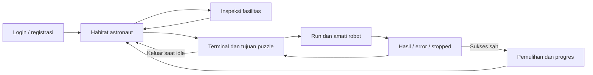

# DESIGN — mars_reboot.py

Status: spesifikasi UX/visual diperbarui 12 November 2026; arah visual (**crisp pixel art 2D top-down 3/4** + pencahayaan 2D ringan ala *MewnBase*/*Pathway*) dan tata letak **floating draggable terminal** (*The Farmer Was Replaced* style) berstatus **Dipilih** berdasarkan acuan blueprint Figma (`z5Q44g0NLnulWXFMaA4Hlz` & FigJam `1cSWTDnhTvzMJjk8jb15vI`), dan kini satu adegan habitat representatif beserta panel inspeksi serta terminal sementara telah diimplementasikan pada proyek desktop libGDX dengan aset pixel-art placeholder konsisten (`assets/habitat/`). Skala tile kandidat (`32×32`), palette, dan aset placeholder masih berstatus **Usulan** (menunggu review pengguna sebelum produksi aset penuh). Kebutuhan: [PRD](PRD.md); perilaku: [RULES](RULES.md); implementasi kandidat: [ARCHITECTURE](ARCHITECTURE.md).

## 1. Pengalaman dan arah visual

Pemain memahami masalah lewat inspeksi, mengubah program, lalu melihat akibatnya pada habitat. Robot dan kondisi fasilitas harus terbaca sebelum dekorasi. Terminal adalah meja kerja; ruang habitat membawa suasana sci-fi yang tenang ala *The Martian* (terdampar dan memulihkan habitat). Tidak ada timer oksigen/kelaparan, combat, atau perjalanan wajib berulang setelah Run gagal.

**Arah visual yang dipilih:** **Crisp pixel art 2D top-down 3/4 ortogonal** (sumbu N/E/S/W tegak lurus dengan grid simulasi) yang memadukan struktur modul putih-abu dan pipa penghubung ala *MewnBase*, tanah/debu Mars sebagai aksen luar, tanaman sebagai penanda pemulihan, serta **shading 3/4 + pencahayaan 2D ringan ala *Pathway*** (ambient tint tipis + cahaya lembut di sekitar terminal, panel, rover, dan pipa aktif; tanpa membangun *custom voxel lighting engine* penuh). Render pixel memakai `TextureFilter.Nearest`. Jangan menyalin aset/source game referensi.

## 2. Alur pemain dan layar



Login sebagai pintu masuk adalah usulan PRD KT-02. Jika mode lokal dipilih, alurnya perlu ditambahkan bersama kebijakan akun/skor; belum ada tombol mode lokal wajib. Tiga permukaan utama: habitat, terminal, hasil. Inspeksi berupa panel singkat di atas habitat, bukan cutscene panjang. Ringkasan temuan dan bantuan bertahap mengikuti status Usulan PRD.

## 3. Wireframe habitat — Usulan

```text
+---------------------------------------------------------------+
| mars_reboot.py    Misi 1 / Puzzle 1       Profil   Pengaturan   |
| Tujuan singkat: periksa panel kebun                            |
|                                                               |
|              Peta habitat dan astronaut                       |
|        [panel air]     [kebun]       [terminal robot]           |
|                                                               |
| Dekat panel: [E] Periksa                                       |
| Temuan / petunjuk singkat                     Status fasilitas |
+---------------------------------------------------------------+
```

HUD tidak menutupi jalur atau objek interaksi. Area dekat objek memiliki label teks. Usulan kontrol awal: WASD/panah untuk gerak, E untuk interaksi, Esc menutup panel; saat editor fokus, input gerak tidak aktif. Tidak ada rebind/gamepad yang ditambahkan sebagai fitur wajib.

**Implementasi adegan representatif 12 November 2026 (di atas baseline kontrol Codex):**
- **Kontrol & kontrak collider tetap utuh:** WASD/panah mengikuti sumbu layar ortogonal dengan normalisasi diagonal; `FLOOR = Box(40,40,880,520)`, `PARTITION = Box(480,160,32,200)`, `GARDEN = Box(620,160,180,100)`, `PANEL = Box(240,400,100,40)`, `TERMINAL = Box(720,400,100,52)`, dan astronaut `24×28` di `(160,200)` dipertahankan 1:1 tanpa menggeser collider atau jangkauan `INTERACT_MARGIN = 18f`.
- **Hierarki visual dunia habitat (`HabitatRenderer`):** Eksterior tanah Mars (`#5A2D22`), dinding hull 3/4 titanium di sekeliling lantai, ubin lantai teknis `32×32` (`#1D2935`), pipa saluran air/hidroponik di lantai yang menghubungkan Panel Air → Terminal → Kebun, dan pencahayaan 2D lembut ala *Pathway* di sekitar fasilitas. Objek interaktif (`PANEL AIR [E]` dan `TERMINAL ROBOT [E]`) dibedakan secara tegas lewat bracket sudut interaktif, glow, dan badge `[E]` yang menyala cyan terang saat astronaut berada dalam jangkauan. Objek solid non-interaktif (`SEKAT MODUL` dan `KEBUN: 2 Kering [!] | 2 Lembap [~]`) tidak memakai bracket interaktif; kebun menampilkan indikator non-warna (`[!]` retak kering, ikon tetesan air, tunas muda, dan tanaman matang).
- **HUD, Panel Inspeksi, dan Floating Terminal (`HabitatUi`):**
  - Top bar (`y=566..600`) dan bottom bar (`y=0..34`) ditempatkan di luar area jalan `FLOOR` (`y=40..560`) sehingga 100% lantai dan dinding bebas dari tutupan UI. Menampilkan badge `HABITAT | PLACEHOLDER`, tujuan singkat, indikator mode (`MODE: EKSPLORASI` / `INSPEKSI PANEL` / `TERMINAL EDITOR`), prompt kedekatan dinamis, dan legenda kontrol.
  - **Panel Inspeksi (`Window` modal `590×384`)**: menyusun temuan fasilitas dalam 3 kartu terstruktur (status aliran air & kandidat jatah, kondisi 2 petak kering `[!]` & 2 lembap `[~]`, serta kandidat sensor API), dilengkapi badge `FOKUS KEYBOARD: PANEL INSPEKSI [Esc]` dan tombol `Kembali ke habitat [Esc]`.
  - **Floating Draggable Terminal (`Window` modal `556×492` di kiri, `x=36, y=54`)**: membiarkan area kebun dan astronaut di kanan (`x=600..920`) tetap terlihat sesuai pola *The Farmer Was Replaced*. Dilengkapi badge jujur `[!] Kode belum dieksekusi`, `Robot/Python belum aktif`, dan `FOKUS: EDITOR AKTIF`, ringkasan temuan + kandidat API, gutter nomor baris `1..8`, `TextArea` berbingkai fokus cyan `2px` (`#67C5D6`), catatan konsol pasif, serta tombol `Kembali ke habitat [Esc]`. Tidak ada tombol Run/evaluasi semu; draf kode bertahan selama layar aktif.

World/UI memakai `FitViewport(960,600)` terpisah agar proporsi dan koordinat tetap saat resize; ruang kosong di pinggir normal, dan posisi window di-clamp agar tidak keluar dari kanvas virtual. Pemeriksaan desktop otomatis dan screenshot aktual pada `1280×720`, `1440×900`, `900×600`, dan `640×480` dicatat di [VERIFICATION](VERIFICATION.md). Pada `640×480` teks mengecil karena downscaling bitmap font bawaan; ukuran minimum jendela, font produksi beresolusi tinggi, keyboard fisik tahan, clipboard/seleksi/scroll panjang, dan drag manual oleh pengguna belum dinyatakan lolos final.

## 4. Wireframe terminal — Dipilih (Floating Window) / Usulan Rincian

Mengadaptasi pola *The Farmer Was Replaced*, kanvas dunia game (habitat & kebun percobaan dengan robot aktif) tampil penuh di layar, sementara **terminal coding berupa floating draggable window** (`Scene2D Window`) yang default berada di **kiri** dan dapat digeser bebas ke posisi mana saja agar tidak menutupi petak atau robot di **kanan**:

```text
+-------------------------------------------------------------------+
| mars_reboot.py   Misi 2 / Puzzle 4            [Profil] [Tutup Esc]|
+-------------------------------+-----------------------------------+
| [=] terminal.py       [-][□][x]|  Dunia Puzzle (2D Top-Down 3/4)  |
| [Run] [Stop] [Reset] [1x]     |  Grid (0,0)..(3,0), koordinat,    |
| ● RUNNING (p4-a)              |  Robot Rover, dry/lembap, legenda |
|-------------------------------|                                   |
| 1  # solution_puzzle4.py      |  Monitor Sensor & Aksi Real-Time  |
| 2  for x in range(4):         |  Aksi: 3/12 · Air: 1/2 · API: 4   |
| 3      if needs_water():      |                                   |
| 4          water()            |  Tujuan, Referensi API, Bantuan,  |
|-------------------------------|  Skenario p4-a / p4-b             |
| Output Teks / Error (lipat)   |                                   |
+-------------------------------+-----------------------------------+
```

Tujuan, batas, latihan konsep, dan skenario wajib diketahui sebelum Run. Label skenario membedakan yang ditampilkan dan yang sedang dievaluasi; pergantian tampilan tidak berarti source diuji hanya pada skenario itu. Mode uji satu skenario belum dipilih. Source adalah snapshot per Run; usulan awal editor read-only saat preparing/running/replaying agar tidak membingungkan versi yang dinilai.

Jangan tampilkan sukses ketika trace masih diputar. Metrik yang tampak pada replay mengikuti snapshot terlihat; hasil akhir berada di panel hasil setelah replay selesai. Kecepatan adalah kontrol tampilan dan tidak menambah/mengurangi biaya aksi.

## 5. State dan perilaku kontrol

| Fase | Informasi pemain | Run / Stop / Reset |
| --- | --- | --- |
| ready | Tujuan, source, status runtime siap | Run aktif; Stop nonaktif; Reset aktif. |
| preparing | Menyiapkan runtime; tidak menjanjikan waktu unduh yang belum diukur | Run nonaktif; Stop/Reset aktif. |
| running | Skenario aktif, aksi dan output terbatas | Run nonaktif; Stop/Reset aktif. |
| replaying | Menyajikan trace; evaluasi belum menjadi progres sah | Run nonaktif; Stop/Reset aktif. |
| success | Semua syarat wajib lulus; ringkasan metrik dan pemulihan | Run ulang jika replay dipilih; Reset tidak menghapus rekor. |
| incomplete | Target tersisa, skenario gagal, atau latihan belum terpenuhi | Edit/Run ulang; source tetap. |
| stopped | Dibatalkan; snapshot terakhir terlihat dipertahankan | Run setelah cleanup siap; Reset ke fixture awal. |
| error / timeout / limit_exceeded | Penyebab dan tindakan pemulihan; lokasi error bila ada | Run setelah runtime siap; tawarkan coba pulihkan jika gagal. |

Reset aktif membatalkan sebelum mengembalikan fixture. Keluar terminal saat percobaan aktif: usulan awal sediakan dialog “Hentikan percobaan dan keluar?”; Batal kembali ke percobaan, Hentikan mengikuti Stop lalu kembali habitat. Source tidak dihapus. Jangan membuat konfirmasi untuk Stop biasa.

Status simpan skor terpisah: belum dikirim / menyimpan / tersimpan / gagal. Retry eksplisit memakai submissionId sama. Sesi habis meminta login ulang tanpa menghapus kode/hasil lokal. Tidak memberi pesan “tersimpan” sebelum response sah diterima.

## 6. Editor, output, dan bantuan

Kandidat editor Scene2D TextArea diuji pada multiline, empat spasi, selection, clipboard, scrolling, dan teks panjang. Usulan Ctrl+Enter menjalankan ketika ready; Tab keluar editor dan Shift+Tab kembali, sementara indentasi memakai spasi. Jika ingin Tab untuk indentasi, sediakan cara keluar yang jelas dan uji ulang; jangan membuat keyboard trap. Syntax highlighting/autocomplete/debugger per baris tidak wajib tahap awal.

Output dibatasi sesuai RULES dan dirender sebagai teks, tidak sebagai markup atau perintah UI. Error menunjukkan kategori, skenario, baris jika tersedia, dan saran singkat; bukan stacktrace internal. Contoh: “Petak (1,0) belum matang; periksa can_harvest().” Source pemain tetap terlihat.

Usulan bantuan bertahap: tujuan masalah → sensor terkait → contoh sebagian. Solusi referensi lengkap disimpan untuk tim/test, tidak otomatis menjadi tombol jawaban. Bantuan dan latihan loop/fungsi harus jelas dipisahkan dari tantangan optimasi opsional.

## 7. Layout, fokus, dan aksesibilitas — Usulan

Target desktop awal untuk inspeksi: 1280×720 dan 1440×900. Pada jendela lebih kecil, gunakan panel yang dapat discroll/ditata ulang; jangan menutupi Stop. Angka ini ukuran uji kandidat, bukan bukti dukungan semua perangkat. Habitat memakai kamera/viewport sendiri, UI memakai layout container agar resize tidak mengubah koordinat simulasi.

Urutan fokus terminal: kembali → tujuan/bantuan bila interaktif → editor → Run → Stop → Reset → kecepatan → referensi/output yang dapat discroll. Saat membuka terminal fokus ke editor; saat error fokus tidak direbut berulang; saat panel inspeksi ditutup fokus kembali ke kontrol sebelumnya. Fokus terlihat dan state disabled dibedakan dari fokus aktif.

Usulan target kontras: teks normal 4,5:1; teks besar/indikator penting 3:1. Ukur pada warna hasil render; jangan menyatakan lulus dari nama token. Crop ripe memakai bentuk/ikon selain warna; dry/lembap memakai tekstur/label. Robot ditandai bentuk/arah/koordinat. Editor memakai font monospace dan ukuran yang tetap dapat dibaca pada ukuran uji.

Reduced motion meniadakan gerak kamera/flash berlebihan dan mempersingkat transisi tanpa mengubah trace/skor. Tidak menggunakan getaran/screen shake sebagai satu-satunya tanda gagal. Dukungan pembaca layar penuh pada libGDX belum dibuktikan; jangan menyalin klaim aksesibilitas DOM prototype.

## 8. Token dan aset — kandidat arah

| Peran visual | Kandidat nilai / prinsip | Kontras terukur terhadap `#111A24` / `#14202C` (Usulan) |
| --- | --- | --- |
| Background terminal / inspeksi | `#111A24` / `#14202C` | Basis permukaan gelap utama (editor `#0B1219` / fokus `#0D1620`). |
| Surface panel / kartu | `#1C2936` / `#0F1A24` | Dibedakan dengan border NinePatch `1px`–`2px` tajam (`TextureFilter.Nearest`). |
| Teks utama | `#F1F5F9` | ~`15.2:1` pada `#111A24` (melampaui target usulan 4,5:1). |
| Teks sekunder / muted | `#CBD5E1` / `#94A3B8` | ~`11.1:1` / ~`5.9:1` pada `#111A24`. |
| Aksen Mars | `#CB795B` | ~`4.7:1` pada `#111A24` (dipakai bersama label/badge, bukan warna tunggal). |
| Air / interaksi / fokus | `#67C5D6` | ~`8.4:1` pada `#111A24` (bingkai fokus aktif `2px` + badge `[E]`). |
| Tanaman pulih | `#8DBD75` | ~`7.6:1` pada `#111A24` (didampingi ikon tunas/tanaman & teks). |
| Error / warning | `#E06C53` + `[!]` + teks | ~`4.6:1` pada `#111A24`; selalu disertai prefix `[!]` dan label eksplisit. |

Palette di atas telah diterapkan pada adegan representatif desktop namun tetap berstatus **Usulan** sampai disetujui final oleh pengguna. Blueprint layout, token awal, dan contoh floating terminal tersedia di Figma (`z5Q44g0NLnulWXFMaA4Hlz`) dan FigJam (`1cSWTDnhTvzMJjk8jb15vI`) sebagai referensi alur/layout/aset.

| Keluarga aset | Kebutuhan minimum | Status adegan representatif (`assets/habitat/` & `assets/ui/`) |
| --- | --- | --- |
| Astronaut | Idle/jalan empat arah | **Aset 2× sprite sheet (`astronaut_eva_sheet.png`, `192×224`, 4 arah × 4 frame `48×56`) + `astronaut_eva.png`**: selaras 1:1 dengan collider `PLAYER_WIDTH/HEIGHT` (`24×28`). |
| Robot | Idle/gerak/panen/siram | Belum diimplementasikan (menunggu kontrak runtime/puzzle). |
| Habitat & Outpost | Lantai/dinding/kawah/batu/walkway/panel/terminal/pompa/rover | **Aset 2× crisp pixel art (`TextureFilter.Nearest`)**: `mars_soil_0..3.png` (`64×64`), `floor_tile.png` (`64×64`), `mars_crater_sm/lg.png`, `mars_rock_a/b.png`, `cargo_crate.png`, `walkway_h/v.png`, `solar_array_dusty/clean.png`, `partition_wall(_restored).png` (`64×400`), `water_panel.png` (`200×80`), `robot_terminal.png` (`200×104`), `hab_airlock.png` (`288×224`), `pump_station.png` (`192×176`), `biodome_deck(_restored).png` (`576×304`), `biodome_canopy.png` (`576×304`), `mars_rover.png` (`72×64`), dan `light_glow.png` (`128×128`). |
| Tanaman/petak | Empty/young/ripe, dry/lembap | **Aset 2× (`hydro_garden.png` & `hydro_garden_restored.png`, `360×200`)** + **render lokal 2×1 P1 (`74×64` per petak di `HabitatRenderer`)**: bed hidroponik dengan pemisahan petak kiri `roverTexture` dan petak kanan crop matang/kosong, label `(0,0)`/`(1,0)`, serta penanda lokal `PANEN P1 SELESAI (SESI)` tanpa menutupi rover maupun tanaman. |
| UI | Tombol, fokus, status, ikon air/aksi, font | **Hi-DPI BMFont (`ui_sans.fnt`, `ui_sans_bold.fnt` `36px` skala `0.50f`; `ui_mono.fnt` `34px` skala `0.53f` → `~18` unit UI / `~12px` di `640×480`, `MipMapLinearLinear`)** + **NinePatch 3× supersampled mipmapped** (`HabitatUi` pada stage `960×600`): panel inspeksi (`680×424`), terminal kiri geser (`556×518` di `(12,42)`) berurutan tujuan/status → API 2 kolom → editor scroll dgn gutter baris terlihat → kontrol `Run`/`Stop`/`Reset` → output scroll berbatas → ringkasan sukses (`Coba lagi` + `Kembali ke habitat`), Peta Misi P1 berbasis `RunCoordinator.View` + P2–9 `BELUM TERSEDIA`, serta `Preview Visual` dipindahkan ke `[O] Setelan`. |
| Audio | Interaksi, gerak/aksi, hasil, ambience opsional | Belum ada aset audio pada tahap ini. |

Aset adegan Outpost Mars di `assets/habitat/` dan font/UI di `assets/ui/` dibuat secara prosedural oleh proyek (tanpa aset pihak ketiga; tanpa dependensi Gradle baru) dengan skala sprite `2×` untuk raster `TextureFilter.Nearest`, serta didokumentasikan lengkap di `assets/habitat/asset-manifest.json` dan `assets/assets.txt`. Skala tile final, tata letak terminal `556×518` (~`18` unit UI), indikator lokal Bio-Dome P1, serta frame animasi robot/tanaman lanjutan berstatus **Usulan / implementasi kandidat** sampai review tim/pengguna final.

## 9. Pemeriksaan dan keputusan desain

Lihat UI-01–05 dan PLAY-01 di [TEST_PLAN](TEST_PLAN.md). Urutan kerja: flow/wireframe (acuan Figma selesai sebagai blueprint awal) → uji editor & floating `Window` libGDX → satu adegan contoh pixel art + lighting 2D ringan (**diimplementasikan pada desktop libGDX dan diverifikasi pada 1280×720, 1440×900, 900×600, 640×480**) → integrasi satu puzzle → iterasi visual → aset keluarga → playtest. Fitur yang belum bekerja tidak ditutupi dengan mockup final.

**Dipilih:** gaya visual **crisp pixel art 2D top-down 3/4** (referensi struktur *MewnBase*, premis *The Martian*, lighting ringan ala *Pathway*) dan terminal **floating draggable window** ala *The Farmer Was Replaced*. **Usulan (diimplementasikan sebagai kandidat adegan representatif, belum keputusan final):** skala tile `32×32`, palette terukur di §8, aset placeholder konsisten di `assets/habitat/`, serta tata letak HUD top/bottom bar di luar area lantai `FLOOR`. **Belum dipilih:** ukuran minimum jendela, font produksi untuk resolusi kecil (`640×480`), shortcut final, jumlah bantuan, penyimpanan temuan/progres, dan mode lokal/login wajib. Dokumen ini menjadi acuan review untuk peran 3 dan lintas AI.

## 10. Outpost Permukaan Mars & Referensi Visual (`docs/mars/design-refs/`)

Sesuai persetujuan rencana desain *Outpost Permukaan Mars* (12 November 2026), arena bermain diarahkan dari satu ruangan tertutup menjadi **kompleks pos Mars ringkas di ruang terbuka**:

- **Tiga zona terhubung pipa & jalur jalan:** `Hab Utama / Airlock` (titik awal & panel surya berdebu) ↔ `Bio-Dome / Base Tanaman` (platform hidroponik terbuka **Opsi A** dengan kubah transparan parsial agar grid `4×4`, tanaman, tangki air, dan rover tetap terbaca jelas) ↔ `Stasiun Pompa Utama` (terkunci untuk Misi 3). Tanpa timer oksigen/lapar *real-time* atau *open-world* besar.
- **Layar & state UI lengkap (Figma `z5Q44g0NLnulWXFMaA4Hlz`):** selain alur awal (`01`–`06` dan `05c`/`05d`), desain dilengkapi perbandingan *Before vs After* pemulihan pipa/base (`07`), *Floating Terminal* bergaya HUD sci-fi (`08`), *Error / Timeout / Stopped* + *Drawer Bantuan 3 Langkah* (`09`), *Field Log* `[J]` + *Peta Misi & Rekor 1–9* (`10`), serta *Modal Pengaturan & Aksesibilitas* (`11`). Fitur-fitur ini berstatus **Rancangan kerja / target visual** sampai diimplementasikan di libGDX dan Spring Boot.

Seluruh ekspor gambar referensi disimpan lokal di `docs/mars/design-refs/` agar dapat dibaca langsung oleh Codex maupun kontributor tanpa akses Figma MCP:

| Berkas di `docs/mars/design-refs/` | Peran / Layar |
| --- | --- |
| [00_art_direction_mars_outpost.jpg](docs/mars/design-refs/00_art_direction_mars_outpost.jpg) | Target *Art Direction* pixel art top-down 3/4 (*MewnBase* × *Pathway*) Outpost Mars & Bio-Dome terbuka |
| [01_foundations.png](docs/mars/design-refs/01_foundations.png) | Token warna, skala, dan *sprite* dasar |
| [02_login.png](docs/mars/design-refs/02_login.png) | Layar Login bertema *The Martian* |
| [03_habitat.png](docs/mars/design-refs/03_habitat.png) | Blueprint awal habitat top-down |
| [04_inspection.png](docs/mars/design-refs/04_inspection.png) | Overlay inspeksi fasilitas |
| [05_terminal.png](docs/mars/design-refs/05_terminal.png) | Wireframe awal terminal coding |
| [05c_tfwr_left.png](docs/mars/design-refs/05c_tfwr_left.png) | *Floating Draggable Terminal* di kiri (*The Farmer Was Replaced* style) |
| [05d_tfwr_dragged.png](docs/mars/design-refs/05d_tfwr_dragged.png) | *Floating Draggable Terminal* saat digeser |
| [06_result.png](docs/mars/design-refs/06_result.png) | Layar hasil & pemulihan misi |
| [07_outpost_before_after.png](docs/mars/design-refs/07_outpost_before_after.png) | Perbandingan Outpost Mars *Before vs After* pemulihan pipa & tanaman |
| [08_scifi_floating_terminal_hud.png](docs/mars/design-refs/08_scifi_floating_terminal_hud.png) | Upgrade HUD sci-fi *Floating Terminal* + *Bio-Dome Base Platform* (`4×4`) |
| [09_terminal_error_and_help_drawer.png](docs/mars/design-refs/09_terminal_error_and_help_drawer.png) | State *Error / Timeout / Stopped* di terminal + *Drawer Bantuan 3 Langkah* (`FR-020`) |
| [10_field_log_and_mission_map.png](docs/mars/design-refs/10_field_log_and_mission_map.png) | *Field Log Astronaut* `[J]` + *Peta Misi & Rekor Skor (Puzzle 1–9)* |
| [11_settings_modal.png](docs/mars/design-refs/11_settings_modal.png) | Modal Pengaturan Audio, *Reduced Motion* (`UI-05`), & Akun Spring Boot |

## Integrasi puzzle 1 — 13 November 2026

Floating terminal kini M1-P1 Panen, berisi tujuan dua tanaman/6 aksi, empat API nyata, editor, output scroll serta Run/Stop/Reset. State preview error/timeout diganti hasil runtime nyata; bantuan akhir membuka referensi tiga aksi. Robot memakai tekstur rover existing pada grid 2x1 di kebun, indikator ripe hilang setelah panen. Seluruh gerak/collider astronaut, font, aset dan viewport existing dipertahankan.

Run memakai source saat ditekan; editor tetap dapat diubah untuk percobaan berikutnya. Esc menutup tanpa Stop; buka kembali menampilkan hasil/draf sama. Penanda selesai p1 hanya progres sesi, bukan pemulihan seluruh habitat. Peta misi tidak lagi menampilkan rekor/kelulusan palsu; konten lain diberi status belum tersedia/rancangan. Preview Before/After berlabel visual dan tidak mengubah progres. Empat ukuran existing diperiksa pada build desktop; teks pada 640x480 tetap kecil karena skala FitViewport, sehingga penerimaan keterbacaan/playtest manusia masih terbuka. Detail perilaku di [kontrak runtime](docs/mars/PYTHON_RUNTIME.md).

## 11. Desain ulang Outpost 1680×1040, Follow Camera, Interaksi Rover & Terminal Resizable — 15 November 2026

Menindaklanjuti masukan pengguna atas desain visual awal yang masih terasa sempit (seluruh peta terlihat sekaligus), kotak-kotak, terpisah antara terminal dan Rover, serta penuh di terminal:

- **Ekspansi dunia & aset vektor halus (`HabitatWorld`, `AssetBaker`, `assets/habitat/`):** Arena diperluas ke `1680×1040` (`FLOOR = (64,64,1552,912)`) dengan zona `HAB_AIRLOCK` `(110,480,190,140)`, `SOLAR_WING` `(150,760,220,92)`, `PARTITION` `(650,340,44,300)`, `PANEL` `(510,680,96,52)`, `GARDEN` / `ROVER` `(960,360,360,200)`, dan `PUMP_STATION` `(1390,760,140,116)`. Aset `assets/habitat/` (`asset-manifest.json` v3) dibake ulang memakai Java2D `Graphics2D` anti-aliased (`TextureFilter.Linear`, tanpa batas kotak tajam) dan `biodome_deck(_restored).png` / `biodome_canopy.png` `960×640` berdesain konservatori organik melengkung; petak panen 2×1 tetap digambar prosedural di `HabitatRenderer` sehingga posisi robot, crop, dan penanda `PANEN BIO-DOME SELESAI` terbaca jelas.
- **Follow Camera dinamis (`FollowCamera`):** Kamera dunia memakai `ExtendViewport(720, 450)` sehingga pemain melihat area sekitar astronaut, bukan seluruh peta sekaligus. Kamera mengikuti astronaut memakai deadzone horizontal/vertikal (`24×15`), *velocity look-ahead* (`0.16s`), peredaman eksponensial (`1 - exp(-rate * dt)`), *clamping* batas dunia `[0..1680, 0..1040]`, efek getar trauma kuadratik (`reducedMotion` otomatis menonaktifkan getar/look-ahead dan langsung mengunci kamera), serta *smart terminal framing* yang menggeser pusat kamera ke Bio-Dome saat editor terminal terbuka agar kebun tampak utuh di sisi kanan.
- **Klik langsung Rover & penyederhanaan booth (`HabitatWorld`, `HabitatInput`, `HabitatRenderer`):** Booth `TERMINAL` terpisah dihapus dari dunia. Untuk membuka editor Python, pemain berjalan ke area Bio-Dome (`INTERACTION_RANGE = 82`) lalu **mengklik langsung** sprite Rover di dalam dunia (menggunakan `ExtendViewport(720, 450)` hit-test `isRoverHit(...)`, diblokir jika pointer berada di atas elemen HUD/overlay Scene2D) atau menekan `[E]` dekat Bio-Dome; klik langsung pada `PANEL` dalam jangkauan juga membuka inspeksi telemetri.
- **UI kapsul lembut & terminal sederhana resizable (`HabitatUi`):** Stage UI memakai `ExtendViewport(960, 600)` dengan HUD top-bar/bottom-hint berbentuk pill mengambang transparan (`24px` / 3× supersampled anti-aliased SDF rounded drawables). Terminal default terbuka lebih ringkas di kiri (`430×470`, dapat digeser dan di-**resize** bebas dari tepi/sudut dengan border hit `14px` dan grip diagonal, batas minimal `350×280`), menyembunyikan referensi API ke popover `[?] API` (`336×294`) serta otomatis melipat boks `[Log]` ketika kosong saat mode standar. Tombol `Stop` memakai warna teks krem kontras tinggi di atas kapsul amber.
- **Animasi halus berbasis presentasi (`HabitatWorld`, `HabitatRenderer`):** Gerak astronaut memakai percepatan/perlambatan deterministik sub-step (`1/120s`, `ACCEL_RATE = 18f`, `DECEL_RATE = 15f`) + jejak debu langkah EVA (`StepParticle`). Saat replay Python berjalan, `HabitatRenderer` melakukan interpolasi posisi dan rotasi haluan Rover ke snapshot `RunCoordinator.View`, menyalakan sinar pemindai panen (*harvest beam*), animasi ring spora panen (`+1 PANEN`), dan denyut halo emerald/amber/koral pada perubahan state—tanpa menyentuh aturan simulasi Java, fixture, biaya aksi, maupun protokol runtime Python.

Status: diimplementasikan & diverifikasi di build desktop LWJGL3/OpenGL per 15 November 2026 (`VERIFICATION.md` §10); penyesuaian gaya visual/palette final serta playtest manual pengguna tetap terbuka.
