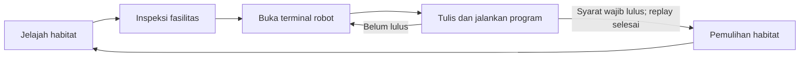

# PRD — `mars_reboot.py`

Status dokumen: draft kebutuhan Mars, diperbarui 12 November 2026. Acuan keputusan: [PROJECT.md](PROJECT.md). Sumber SOP dan batas pemeriksaannya ada di [bagian 10](#10-kewajiban-sop-dan-luaran). Pembaruan ini mempertahankan ID kebutuhan dari draft yang sudah ada; bukan persetujuan baru atas rincian produk.

**Status aktual (12 November 2026):** source/test root ini tetap prototype web Farm Code Lab. Proyek Java/libGDX existing ditemukan terpisah di `C:\Users\abdie\OneDrive\Desktop\Folder_Abdiel\PRAKTIKUM\FINDIH\MarsReboot`; habitat, gerak, collision, inspeksi dan terminal sementara sudah diimplementasikan. Pemeriksaan Java dan desktop dasar dicatat di [VERIFICATION.md](VERIFICATION.md); build Wrapper terhalang unduhan Gradle. Backend, robot/Python, evaluasi puzzle serta penerimaan alur lengkap belum selesai. Bukti historis [prototype](docs/prototype/VERIFICATION.md) tetap terpisah.

**Cara membaca status:** **Dipilih** berarti keputusan yang tercatat di PROJECT.md; **Wajib SOP** berarti ketentuan tugas; **Rancangan kerja** berarti perilaku yang dijabarkan PROJECT.md tetapi rincian finalnya belum seluruhnya dipilih; **Usulan** berarti tambahan yang belum disepakati; **Belum diputuskan** berarti perlu keputusan sebelum bagian terkait menjadi kontrak final. **Diimplementasikan** dan **Terverifikasi** memerlukan bukti kode dan pemeriksaan aktual, terpisah dari status keputusan. Status pada tabel berlaku juga untuk kriteria penerimaan yang merujuknya.

Dokumen utama di root sekarang khusus Mars: [RULES.md](RULES.md), [ARCHITECTURE.md](ARCHITECTURE.md), [DESIGN.md](DESIGN.md), [TEST_PLAN.md](TEST_PLAN.md), dan [TASKS.md](TASKS.md). Referensi prototype dipisahkan ke [PROTOTYPE.md](PROTOTYPE.md); arsipnya tidak menetapkan aturan Mars. Perubahan lokasi dokumentasi diminta pengguna pada 12 November 2026.

## 1. Masalah dan pengalaman yang dituju

**Hipotesis produk, belum diuji:** melihat akibat instruksi pada dunia permainan membantu orang yang belajar coding memahami dan memperbaiki program. `mars_reboot.py` dirancang sebagai game puzzle pemrograman 2D top-down: robot memanen, menyiram, dan menavigasi, sementara astronaut menyelidiki masalah habitat Mars. Habitat pulih setelah solusi lulus.

Kalimat yang diharapkan muncul dari pemain (**Dipilih**, PROJECT.md §1):

> “Saya menyelidiki masalah di habitat, lalu program robot saya berhasil memperbaikinya.”

Prinsip pengalaman:

- Temuan inspeksi harus berguna untuk memahami tujuan atau merancang program (**Dipilih**).
- Percobaan gagal tidak merusak habitat; pemain dapat memperbaiki dan mengulang kode (**Rancangan kerja**, PROJECT.md §4 Transisi).
- Program yang sama dievaluasi pada semua skenario wajib puzzle. Puzzle yang menguji generalisasi memakai variasi kondisi; lulus kumpulan itu tidak membuktikan benar untuk semua peta (**Rancangan kerja**, PROJECT.md §4).

## 2. Pemain sasaran dan platform

| Aspek | Isi | Status |
| --- | --- | --- |
| Pemain | Orang yang suka coding atau ingin belajar coding, dengan suasana sci-fi. Tutorial dimulai dari satu perintah. | Dipilih |
| Bahasa pemain | Python sebagai kandidat; judul `.py` tidak membuktikan persetujuan aslab atau pilihan runtime | Belum diputuskan ([KT-01](#9-keputusan-produk-terbuka)) |
| Bahasa antarmuka | Indonesia. Nama API robot dan sintaks Python memakai bahasa Inggris. | Usulan (mengikuti contoh PROJECT.md) |
| Platform | Klien desktop Java/libGDX; keyboard/mouse sebagai rancangan kontrol awal | Wajib SOP (Java), Dipilih (libGDX), Rancangan kerja (desktop/kontrol). OS/mesin target dan paket: [KT-03](#9-keputusan-produk-terbuka). |
| Pengumpulan | Game jam itch.io. SOP menerima `.exe`, `.jar`, atau build HTML; opsi SOP bukan keputusan memakai web. | Wajib SOP |
| Gamepad, ponsel, multiplayer | Tidak masuk target desktop saat ini; penambahan memerlukan keputusan cakupan | Batas rancangan saat ini |

## 3. Siklus inti

1. **Jelajah.** Astronaut berjalan di area habitat kecil (**Dipilih**).
2. **Inspeksi.** Pemain memeriksa fasilitas untuk mendapat informasi yang berguna bagi program, seperti jatah air (**Dipilih** sebagai arah; rincian objek dan penyajian masih **Usulan**).
3. **Terminal.** Pemain membaca tujuan, peta, koordinat, temuan, dan referensi perintah, lalu menulis kode (**Rancangan kerja**).
4. **Program robot.** Run memakai satu versi kode pada seluruh skenario wajib, masing-masing dari kondisi awal tetap. Pemain mengamati dan memperbaiki kegagalan (**Rancangan kerja**, PROJECT.md §4 diagram C).
5. **Pemulihan.** Setelah evaluasi dan replay selesai serta syarat wajib lulus, hasil diterapkan ke habitat dan puzzle berikutnya terbuka. Kontrol kembali ke astronaut pada akhir misi besar (**Rancangan kerja**).

**Istilah acuan:** misi besar adalah bab pemulihan habitat; puzzle adalah level di dalam misi; skenario adalah fixture/variasi kondisi dalam puzzle; percobaan adalah satu Run atas satu versi kode untuk penilaian skenario wajib. Jika kode diubah untuk Run baru, seluruh skenario wajib dinilai ulang untuk versi itu. Habitat menyimpan hasil pemulihan; dunia percobaan dapat diulang tanpa merusak habitat. Astronaut melakukan inspeksi, sedangkan panen, siram, dan navigasi puzzle dilakukan robot melalui kode.

Aturan rinci dimiliki [RULES.md](RULES.md). PRD menetapkan perilaku yang dibutuhkan, bukan ukuran grid, biaya API, atau formula skor.

## 4. Konten dan tahap pengerjaan

**Dipilih:** target game lengkap adalah 9 puzzle dalam 3 misi. Tahap pertama mengerjakan puzzle 1–4. Tahap pertama ini adalah urutan kerja, bukan pengurangan target.

| Misi | Puzzle | Konsep | Tahap |
| --- | --- | --- | --- |
| 1 — Pulihkan persediaan makanan | 1 Bangunkan Robot · 2 Panen Satu Baris · 3 Jangan Panen Sembarangan | Pemanggilan fungsi, `for`/`range()`, boolean/`if` | Tahap 1 |
| 2 — Selamatkan kebun | 4 Setiap Tetes Berharga | Variabel, perbandingan, sensor | Tahap 1 |
| 2 | 5 Kebun Berubah · 6 Rutinitas Perawatan | Generalisasi, `def`/parameter | Game lengkap |
| 3 — Pulihkan pompa | 7 Periksa Jalur Pompa · 8 Lorong Buntu · 9 Pulihkan Pompa Utama | List/tuple, grid/`set`, antrean/pencarian rute | Game lengkap |

Jumlah dan urutan tahap pengerjaan **Dipilih**; nama, materi, serta rincian konten di tabel adalah **Rancangan kerja** PROJECT.md §4. Ukuran peta, jumlah skenario, fixture, biaya, dan ambang lulus numerik belum dipilih. Kandidat baru dijabarkan sebagai Usulan pada RULES; angka ilustrasi PROJECT.md tidak otomatis menjadi kontrak.

**Kriteria lulus yang dirancang untuk tahap 1:** puzzle 1 menyelesaikan urutan aksi tutorial; puzzle 2 memanen seluruh target satu baris dan menilai latihan loop terpisah; puzzle 3 memanen semua target matang tanpa percobaan panen tanaman muda; puzzle 4 menyiram semua petak kering dalam jatah air pada skenario wajib. Puzzle 4 sudah mencakup variasi kondisi dasar; puzzle 5 memperluas generalisasinya. Metode penilaian latihan loop/fungsi tetap terbuka di bagian 9.

## 5. Kebutuhan fungsional

Kolom **Tahap**: `1` = puzzle 1–4/demo, `L` = tambahan untuk game lengkap. Game lengkap mencakup semua kebutuhan tahap 1 yang sudah dipilih. ID bersifat stabil. Kebutuhan yang dihapus ditandai *dihapus* dan tidak dipakai ulang. Penempatan Usulan pada tahap 1 menunjukkan target usulan, bukan persetujuan fitur.

| ID | Kebutuhan | Status | Tahap | Sumber |
| --- | --- | --- | --- | --- |
| FR-001 | Pemain dapat registrasi akun. Username/password merupakan usulan field akun, belum kontrak final. | Rancangan kerja; field akun Usulan | 1 | PROJECT.md §4A, §6; SOP III.3 mewajibkan autentikasi, bukan field tertentu |
| FR-002 | Pemain dapat login; kegagalan menampilkan pesan dan memungkinkan mencoba lagi. Logout diusulkan. | Rancangan kerja (login); Usulan (logout) | 1 | PROJECT.md §4A, §6; SOP III.3 |
| FR-003 | Pemain menggerakkan astronaut di habitat 2D top-down dengan keyboard. | Dipilih (berjalan); Rancangan kerja (2D/kontrol) | 1 | PROJECT.md §2–3 |
| FR-004 | Pemain dapat memeriksa objek fasilitas dan menerima temuan yang relevan untuk puzzle (misalnya jatah air). | Dipilih | 1 | PROJECT.md §3 |
| FR-005 | Temuan inspeksi tersimpan dan dapat dibaca dari terminal tanpa mengulang perjalanan. | Usulan | 1 | PROJECT.md §3 tabel interaksi |
| FR-006 | Terminal menampilkan puzzle yang terbuka, tujuan, peta percobaan, koordinat, batas, dan referensi API. | Rancangan kerja | 1 | PROJECT.md §3, §4C |
| FR-007 | Editor menerima program multiline; Python bergantung KT-01. Kode per puzzle dipertahankan selama bermain dan tidak ditimpa contoh baru. Pemulihan lintas sesi mengikuti FR-016. | Rancangan kerja | 1 | PROJECT.md §4 Transisi, §5 |
| FR-008 | Run menjalankan satu snapshot kode pada setiap skenario wajib, masing-masing dari kondisi awal tetap. | Rancangan kerja | 1 | PROJECT.md §4C |
| FR-009 | Kode pemain mengendalikan robot melalui gerak, sensor, panen, dan siram. `move`, `harvest`, `can_harvest`, `water`, `needs_water`, dan `get_pos` masih nama kandidat. | Rancangan kerja; kontrak API belum diputuskan | 1 | PROJECT.md §4, §10 |
| FR-010 | Stop membatalkan percobaan, termasuk saat loop tanpa akhir atau replay, tanpa menunggu kerja sama script. Tidak menghasilkan rekor sukses; kode dan state terakhir yang terlihat dipertahankan. | Rancangan kerja | 1 | PROJECT.md §4C, §5 |
| FR-011 | Reset mengembalikan dunia percobaan dan log ke awal. Kode dan rekor tetap. Hasil percobaan lama tidak mengubah percobaan baru. | Rancangan kerja | 1 | PROJECT.md §4C, §5 |
| FR-012 | Hasil menampilkan tindakan robot dan informasi kegagalan yang relevan: aksi/skenario gagal, target tersisa, batas tercapai, lokasi error jika tersedia. Output ditampilkan sebagai teks. | Rancangan kerja | 1 | PROJECT.md §3, §4C |
| FR-013 | Kecepatan animasi dapat diubah tanpa mengubah hasil simulasi. | Rancangan kerja | 1 | PROJECT.md §3, §4C |
| FR-014 | Puzzle lulus hanya jika semua skenario wajib dan latihan konsep wajib yang berlaku terpenuhi, setelah replay selesai. Syarat latihan disampaikan sebelum Run. | Rancangan kerja; metode latihan belum diputuskan | 1 | PROJECT.md §4 Materi, §4C |
| FR-015 | Setelah lulus, perubahan habitat diterapkan dan puzzle berikutnya terbuka. Percobaan gagal tidak mengubah habitat atau mewajibkan inspeksi ulang. Puzzle baru dimulai secara eksplisit. | Rancangan kerja | 1 | PROJECT.md §4 Transisi, §4C |
| FR-016 | Progres puzzle, kode per puzzle, dan rekor tersimpan lokal dan dipulihkan saat game dibuka ulang. | Usulan (penyimpanan progres) | 1 | PROJECT.md §4A |
| FR-017 | Hasil puzzle yang lulus dikirim ke backend sebagai skor. Kegagalan simpan skor diberi pesan dan opsi coba lagi. | Wajib SOP (skor); Usulan (coba lagi) | 1 | SOP III.3, PROJECT.md §4A |
| FR-018 | Pemain dapat melihat skor/rekornya dari backend setelah membuka ulang game. | Rancangan kerja | 1 | PROJECT.md §5, §7 peran 4 |
| FR-019 | Puzzle selesai dapat diulang untuk memperbaiki rekor tanpa mengunci ulang akses atau merusak habitat. | Usulan | 1 | PROJECT.md §4A |
| FR-020 | Bantuan bertahap: masalah → sensor terkait → potongan contoh, tanpa langsung memberi solusi lengkap. | Usulan | 1 | PROJECT.md §3 |
| FR-021 | Batas jumlah aksi, ukuran kode, output, antrean event, dan waktu eksekusi diberlakukan. | Rancangan kerja; angka belum diputuskan | 1 | PROJECT.md §5 |
| FR-022 | Konten puzzle 1–4 tersedia berurutan dalam satu area habitat kecil. | Dipilih (tahap 1–4 dan area kecil); rincian konten Rancangan kerja | 1 | PROJECT.md §2, §4–5 |
| FR-023 | Konten puzzle 5–9 dan penutup cerita (pompa aktif) tersedia. | Dipilih (target 9); rincian konten Rancangan kerja | L | PROJECT.md §4–5 |
| FR-024 | Pada akhir misi besar, kontrol kembali ke astronaut agar pemain melihat pemulihan dan masalah berikutnya, atau penutup setelah misi terakhir. | Rancangan kerja | 1 (misi 1), L (misi 2–3) | PROJECT.md §4 Transisi |

## 6. Kebutuhan nonfungsional

Target angka performa (FPS, waktu muat), ukuran uji UI, dan ambang respons Stop belum dipilih. Tetapkan berdasarkan komputer target serta eksperimen awal sebelum pengujian penerimaan numerik; PRD ini tidak mengklaim pengukuran sudah dilakukan.

| ID | Kebutuhan | Status |
| --- | --- | --- |
| NFR-001 | **Determinisme.** Fixture dan kode yang sama, dalam batas eksekusi, menghasilkan state, hasil, dan metrik yang sama. Biaya simulasi tidak berasal dari FPS, animasi, atau waktu membaca/editor. Watchdog memakai waktu untuk pengamanan, bukan metrik skor. | Rancangan kerja (PROJECT.md §3–5) |
| NFR-002 | **Responsif saat script berjalan.** Script dijalankan di luar render loop. Window dan tombol Stop tetap bereaksi, termasuk saat script tidak menghasilkan aksi. | Rancangan kerja (PROJECT.md §5–6) |
| NFR-003 | **Keyboard.** Semua alur tahap 1 dapat diselesaikan dengan keyboard, dengan fokus terlihat. | Usulan; rincian mengikuti DESIGN Mars |
| NFR-004 | **Keterbacaan.** Keadaan petak dan hasil tidak dibedakan hanya dengan warna. Editor/output dapat dibaca dan kontrol tidak terpotong pada ukuran uji yang disepakati. | Usulan; ukuran uji belum dipilih |
| NFR-005 | **Keamanan dan privasi.** Jika memakai password, simpan hash di backend. Source dan output pemain tetap di klien. Secret layanan tidak disertakan dalam build klien atau repository. | Rancangan kerja (hash/source: PROJECT.md §4A, §6); Usulan (pengelolaan secret) |
| NFR-006 | **Kejujuran batas jaminan.** Skor yang dikirim klien tidak diklaim bebas manipulasi. Runtime script tidak diklaim sebagai sandbox aman untuk script bermusuhan. | Usulan; batas runtime perlu dibuktikan (PROJECT.md §6) |
| NFR-007 | **Ketahanan.** Stop, Reset, error, dan timeout mempertahankan kode. Penanganan kegagalan jaringan, backend, dan penyimpanan lokal agar tidak crash atau menghapus kode diusulkan. | Rancangan kerja (preservasi kode: PROJECT.md §5); lainnya Usulan |
| NFR-008 | **Keterujian.** Aturan, fixture, dan evaluasi dapat diuji tanpa window libGDX dan tanpa runtime Python nyata. | Usulan; pemisahan implementasi mengikuti ARCHITECTURE Mars |
| NFR-009 | **Portabilitas.** Build desktop dapat dimainkan di komputer anggota lain, dengan kebutuhan Java/Python/backend dan cara menjalankan tercatat. | Rancangan kerja (PROJECT.md §5–6) |
| NFR-010 | **Bukti OOP.** Empat pilar dan minimal enam design pattern terlihat pada relasi kelas dan perilaku yang dapat didemokan. | Wajib SOP |
| NFR-011 | **Hak aset.** Setiap aset pihak ketiga memiliki lisensi dan kredit yang tercatat. | Dipilih (PROJECT.md §1), Wajib SOP (kredit itch.io) |

## 7. Cakupan

**Tahap 1 (demo gameplay):** satu area habitat kecil dan puzzle 1–4 merupakan cakupan yang dipilih. Rancangan deliverable meliputi registrasi/login, inspeksi dan terminal yang relevan, Run/Stop/Reset, umpan balik kegagalan, pemulihan habitat setelah panen/penyiraman, serta penyimpanan skor backend. Penyimpanan progres/kode lintas sesi, bantuan bertahap, dan replay puzzle selesai tetap Usulan menurut FR-016/019/020; belum menjadi janji wajib hanya karena masuk draft ini.

**Integrasi pertama** (subset tahap 1, PROJECT.md §5): login → jalan ke panel → baca petunjuk → buka terminal → `harvest()` → tanaman terpanen → simpan hasil.

**Game lengkap:** puzzle 5–9, misi pompa, dan penutup cerita.

**Ditunda atau di luar cakupan saat ini:** NPC, dialog bercabang, inventory, crafting, combat, timer oksigen/kelaparan, serta leaderboard kompetitif tidak ditambahkan ke demo oleh PROJECT.md. Multiplayer, gamepad, ponsel, dan beberapa robot bukan target rancangan sekarang. Rekursi, kompleksitas formal, greedy, divide and conquer, DP, geometri, dan silabus kompetitif lengkap ditunda sesuai PROJECT.md §4.

**Usulan batas editor:** syntax highlighting, autocomplete, dan debugger per baris tidak menjadi syarat tahap 1. Editor multiline, fokus, indentasi, seleksi, scrolling, dan keterbacaan error tetap perlu diuji. Penambahan fitur atau perubahan pattern mengikuti keputusan tim/aslab dan dicatat di PROJECT.md; tidak ditetapkan oleh PRD ini sendiri.

## 8. Kriteria penerimaan

Kriteria berikut adalah **rencana pemeriksaan**, belum hasil test. Statusnya mengikuti FR/NFR: bagian Usulan baru menjadi syarat penerimaan setelah dipilih. Penerimaan tidak dapat ditutup untuk bagian yang masih menunggu aturan, fixture, angka batas, atau keputusan terkait; catat sebagai menunggu keputusan. Pemetaan ke kasus uji ada di [TEST_PLAN.md](TEST_PLAN.md); nama test implementasi dicatat setelah bootstrap.

| ID | Kriteria | FR/NFR |
| --- | --- | --- |
| AC-01 | Setelah field akun dipilih, akun baru dapat registrasi lalu login; kredensial salah ditolak dengan pesan. Jika memakai password, penyimpanan tidak berisi password teks biasa. Jika logout dipilih, sesi tidak dapat dipakai lagi untuk akses skor terlindungi. | FR-001, FR-002, NFR-005 |
| AC-02 | Dari habitat, pemain dapat berjalan ke panel, memeriksa, membuka terminal, menjalankan `harvest()`, dan melihat tanaman terpanen di dunia percobaan. | FR-003, FR-004, FR-006, FR-009 |
| AC-03 | Setelah fixture dan metode latihan dipilih, solusi referensi puzzle 1–4 lulus semua skenario wajib. Solusi dengan satu skenario gagal atau latihan wajib belum terpenuhi tidak dinyatakan lulus. Penilaian memakai versi kode yang sama dan menunggu replay selesai. | FR-008, FR-014, FR-022 |
| AC-04 | `while True: pass` dapat dihentikan dengan Stop. Run berikutnya dapat dijalankan tanpa restart game, dan kode tetap ada. | FR-010, NFR-002 |
| AC-05 | Kode yang sama pada kecepatan animasi berbeda menghasilkan hasil dan metrik identik. | FR-013, NFR-001 |
| AC-06 | Lulus puzzle mengubah habitat dan membuka puzzle berikutnya yang dimulai secara eksplisit. Gagal tidak mengubah habitat atau mewajibkan inspeksi ulang. Pada akhir misi, kontrol astronaut tersedia untuk mengamati pemulihan. | FR-015, FR-024 |
| AC-07 | Jika penyimpanan lintas sesi dipilih, setelah game ditutup/dibuka, progres, kode tiap puzzle, dan rekor lokal dipulihkan. Membuka puzzle lain atau contoh baru tidak menimpa kode yang sudah ditulis. | FR-007, FR-016 |
| AC-08 | Skor puzzle lulus tersimpan di backend dan terbaca lagi setelah login ulang. Untuk usulan pemulihan jaringan, saat backend mati game menampilkan pesan, tidak crash, dan menyediakan coba lagi jika fitur itu dipilih. | FR-017, FR-018, NFR-007 |
| AC-09 | Hasil percobaan lama, termasuk yang di-Stop/Reset/error, tidak mengubah dunia, tampilan, rekor, atau skor percobaan baru. Stop ketika replay juga membatalkan sukses; kode dan state terakhir yang terlihat tetap tersedia. | FR-010, FR-011 |
| AC-10 | Build desktop dapat dijalankan dan puzzle 1 dapat diselesaikan di komputer anggota lain. | NFR-009 |
| AC-11 | Demo dapat menunjukkan empat pilar OOP dan minimal enam pattern pada kode beserta perilakunya. | NFR-010 |
| AC-12 | Reset dari percobaan berjalan maupun selesai mengembalikan fixture dan log ke awal tanpa menghapus kode atau rekor. Run ulang memakai fixture skenario yang sama. | FR-008, FR-011 |
| AC-13 | Uji syntax/runtime error, timeout, aksi gagal, dan tujuan belum lengkap: kode tetap ada, informasi kegagalan relevan ditampilkan, dan Run baru dapat dilakukan setelah pemulihan runtime bila perlu. Output berupa teks. | FR-007, FR-012, NFR-007 |
| AC-14 | Setelah angka batas disepakati, uji pada batas dan melewati batas aksi, source, output, antrean, serta waktu eksekusi. Setiap pelampauan ditangani sesuai kontrak, dijelaskan, dan tidak menghasilkan sukses di luar batas. | FR-021, NFR-002 |
| AC-15 | Jika usulan aksesibilitas dipilih, jalankan alur tahap 1 dengan keyboard, periksa fokus terlihat, serta baca editor/output pada ukuran uji. Keadaan petak/hasil dapat dibedakan tanpa warna saja; tujuan, koordinat, batas, dan referensi tersedia sebelum Run. | FR-006, NFR-003, NFR-004 |
| AC-16 | Inspeksi request autentikasi/skor dan paket distribusi memastikan source/output pemain tidak dikirim dan secret layanan tidak dibundel. Panduan tidak mengklaim skor klien bebas manipulasi atau runtime sebagai sandbox aman. | NFR-005, NFR-006 |
| AC-17 | Jika usulannya dipilih: temuan tetap terbaca di terminal setelah gagal; bantuan muncul bertahap; replay puzzle selesai tidak mengunci ulang akses, menghapus kode, atau merusak habitat yang pulih. | FR-005, FR-019, FR-020 |
| AC-18 | Untuk game lengkap, solusi referensi puzzle 5–9 lulus seluruh skenario/latihan wajib. Ketiga misi dapat dilalui sampai pompa aktif dan penutup cerita, dengan kontrol kembali ke astronaut pada transisi misi. | FR-014, FR-023, FR-024 |
| AC-19 | Jika pemisahan untuk test dipilih, fixture dan evaluator dapat diperiksa otomatis melalui antarmukanya tanpa membuka window atau menjalankan Python nyata. | NFR-008 |
| AC-20 | Inventaris aset pihak ketiga memiliki asal, lisensi yang sesuai penggunaan, dan kredit; kredit tampil pada luaran yang diwajibkan SOP. | NFR-011 |

## 9. Keputusan produk terbuka

| ID | Pertanyaan | Dampak | Langkah berikutnya |
| --- | --- | --- | --- |
| KT-01 | Apakah aslab menyetujui Python sebagai bahasa pemain? | Memengaruhi runtime, API, materi puzzle, dan distribusi. Jika ditolak, kontrak bahasa/materi perlu ditinjau ulang. | Ajukan saat progress interview. Catat jawaban dan tanggalnya di PROJECT.md §11. |
| KT-02 | Apakah login wajib sebelum bermain? Bolehkah bermain tanpa backend (mode lokal) jika server tidak terhubung? | Login wajib membuat demo bergantung pada backend. Mode lokal memerlukan kebijakan akun dan skor saat tidak terhubung. | Usulan sementara: login wajib untuk demo dan penanganan galat jelas, dengan mode lokal ditunda. Belum dipilih pengguna. |
| KT-03 | OS/komputer target dan jenis paket: `.jar`, `.exe` dengan runtime Java, atau keduanya? | Menentukan prasyarat pemain, pengemasan runtime script, dan ukuran uji UI. Opsi HTML dari SOP tidak otomatis menjadi target proyek. | Uji paket minimal di komputer anggota lain sebelum memilih paket final. |
| KT-04 | Seberapa jauh bantuan bertahap (FR-020) masuk tahap 1? | Menambah konten per puzzle dan layar bantuan. | Putuskan setelah puzzle 1–2 dapat dimainkan. |
| KT-05 | Rincian interaksi astronaut (log fasilitas, ringkasan misi) mana yang dipilih? | Menentukan objek habitat dan aset. | Pilih dari usulan PROJECT.md §3. Tahap 1 minimal memakai panel/inspeksi yang dibutuhkan puzzle 1–4. |

Keputusan lanjutan berikut sudah terbuka di PROJECT.md. Dokumen pemilik kini memberikan kandidat rancangan, bukan pilihan final atau bukti implementasi.

| Topik | Dampak pada penerimaan | Langkah berikutnya / dokumen pemilik |
| --- | --- | --- |
| Fixture, API, skenario wajib, biaya sensor/aksi, jatah air, dan formula skor | Menghalangi penutupan AC-03/14 dan evaluasi konten lengkap. Loop dengan aksi sama tidak otomatis lebih hemat tick; optimasi opsional tidak mengunci cerita. | Susun RULES Mars dari solusi referensi, lalu sepakati angka; jangan mewarisi angka prototype. |
| Verifikasi latihan loop pada puzzle 2 dan fungsi pada puzzle 6 | Hasil dunia saja belum membuktikan konstruksi bahasa; syarat harus dijelaskan sebelum Run. | Rancang metode verifikasi pada RULES/ARCHITECTURE Mars, kemudian uji solusi dan kasus gagal. |
| Runtime Python dan batas script | Memengaruhi Stop, timeout, error, akses file/jaringan, dan paket distribusi. CPython proses terpisah hanya opsi uji awal PROJECT.md §6. | Buktikan satu aksi, satu sensor, loop tanpa akhir, pemulihan, dan distribusi; tetapkan kontrak di ARCHITECTURE Mars. |
| Database, autentikasi, dan lokasi backend | Menentukan persistensi, field akun, kegagalan jaringan, serta akses skor pengguna. Kandidat H2/Spring Security/JPA belum pilihan final. | Sepakati kontrak HTTP dan batas kepercayaan skor, lalu uji simpan/ambil lintas sesi; ARCHITECTURE Mars. |
| Progres/kode lintas sesi dan replay | Memengaruhi FR-016/019 serta pemulihan setelah kegagalan penyimpanan. | Pilih perilaku dan data yang disimpan, lalu rancang penyimpanan serta uji buka ulang. |
| Editor, kontrol, aksesibilitas, dan arah visual | Memengaruhi kelayakan terminal serta AC-15. Scene2D TextArea masih kandidat. | Uji multiline, indentasi, seleksi, scrolling, dan fokus pada desktop; susun DESIGN Mars. |
| Lokasi kode Mars, repository, dan nama pemilik peran | Memengaruhi bootstrap, integrasi, dan pembuktian kontribusi tim. | Tetapkan bersama sebelum bootstrap; gunakan pembagian peran PROJECT.md §7 tanpa mengarang nama anggota. |

## 10. Kewajiban SOP dan luaran

Sumber yang dibaca pada sesi ini: render lokal SOP *Praktikum Pemrograman Berorientasi Objek — Proyek Akhir 2026*, [halaman 1](docs/references/sop/assignment-2026-1.png), [2](docs/references/sop/assignment-2026-2.png), [3](docs/references/sop/assignment-2026-3.png), [4](docs/references/sop/assignment-2026-4.png), dan [5](docs/references/sop/assignment-2026-5.png), dicocokkan dengan [PROJECT.md bagian 9](PROJECT.md#9-linimasa-dan-luaran-sop). Ini pemeriksaan salinan lokal, bukan konfirmasi pengumuman terbaru. PDF asli tidak ditemukan dalam daftar file yang diperiksa. SOP menyatakan ketentuan dapat berubah; status pengumpulan dan persetujuan aslab belum dibuktikan.

| Kewajiban | Ketentuan SOP | Pemenuhan yang direncanakan |
| --- | --- | --- |
| Bahasa | Game dalam Java; framework bebas | Java + libGDX |
| OOP | Encapsulation, Inheritance, Polymorphism, Abstraction | Pemetaan kode dan demo dirancang pada ARCHITECTURE Mars; belum implementasi. |
| Design pattern | Minimal 3 rancangan saat pengajuan ide (8 Nov 2026); minimal 6 yang telah dipelajari diimplementasikan pada 22 Nov 2026 | Command, State, Observer, Factory Method, Strategy, Template Method adalah kandidat PROJECT.md §8, bukan bukti implementasi atau persetujuan aslab. |
| Backend | Spring Boot; wajib menyimpan autentikasi dan skor; lokal atau daring; risiko kegagalan ditanggung tim | Kontrak dan persistensi akan dirinci pada ARCHITECTURE Mars. Field akun, database, dan deployment belum dipilih. |
| Perubahan fitur/pattern | Boleh jika dikomunikasikan dan disetujui aslab | Catat di PROJECT.md §11. |
| Pengajuan/revisi | 14 Nov 2026: pengajuan ulang bila ditolak; kelengkapan aslab, repo, GDD; PDF proposal dan Project Management Plan di Emas3 | Tanggal sesuai sumber, bukan status sudah dikumpulkan. |
| Dokumen | Proposal (workflow, project management, project plan), GDD, dan laporan mingguan sebagai berkas berbeda | PRD mendukung penyusunan, tidak otomatis menggantikan luaran wajib. Belum ada bukti pengumpulan. |
| Repositori | GitHub; aslab memeriksa struktur, kode, dan dokumentasi; dosen memeriksa kontribusi | Lokasi repo klien/backend dan nama pemilik peran perlu ditetapkan. |
| Video | YouTube: demo, bedah kode, justifikasi pattern, peran anggota | Direncanakan pada TASKS M-33; belum ada bukti upload. |
| Pengumpulan | itch.io, 6 Des 2026 23.59 WIB; `.exe`/`.jar`/HTML; halaman berisi deskripsi, cara bermain, anggota/peran, link repo, kredit aset | Paket/tautan game jam belum ditetapkan. Belum ada bukti publikasi Mars. |
| Evaluasi | Progress interview; minimal mingguan dengan aslab setelah Modul 10; presentasi UAS Desember (tanggal menyusul), peer review, playtest antarkelompok | Catat bukti aktual; jangan mengisi hasil rekaan. |
| Rubrik | OOP 20%, pattern 20%, demo 45% (tanpa crash 10, gameplay/kontrol 10, UI/UX 10, kreativitas 10, backend 5), dokumentasi 5%, kontribusi 10% | Prioritas: stabilitas dan alur demo. |

## 11. Dependensi

- **Bahasa dan risiko teknis:** KT-01 serta eksperimen runtime/editor/paket mendahului komitmen terhadap mekanisme eksekusi dan distribusi. Habitat, model Java, dan rancangan backend dapat dipelajari tanpa menetapkan runtime Python final.
- **Integrasi empat peran:** peran 1 memegang simulasi/runtime, peran 2 konten/evaluasi, peran 3 dunia/UI, peran 4 backend/distribusi sesuai PROJECT.md §7. Kontrak skenario/aksi/sensor/snapshot/hasil dan HTTP disepakati sebelum kerja paralel; dokumentasi bersama memiliki satu editor per tugas (§12).
- **Dokumen pemilik:** RULES merinci perilaku dan fixture; ARCHITECTURE dan DESIGN memakai kontrak yang sama; TEST_PLAN memetakan AC ke bukti; TASKS mencatat dependensi implementasi. Tidak ada milestone implementasi yang selesai karena dokumen dibuat.
- **Lokasi kode:** struktur modul yang dirancang ARCHITECTURE masih Usulan; PROJECT.md belum menetapkan lokasi kode final. Folder source prototype dipertahankan. PRD di root adalah sumber utama; berkas lama di docs/mars hanya penunjuk.
