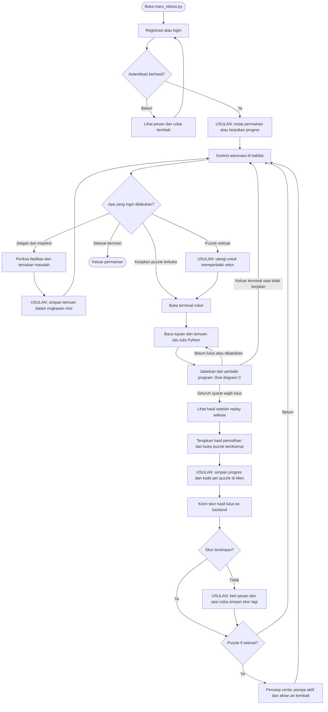
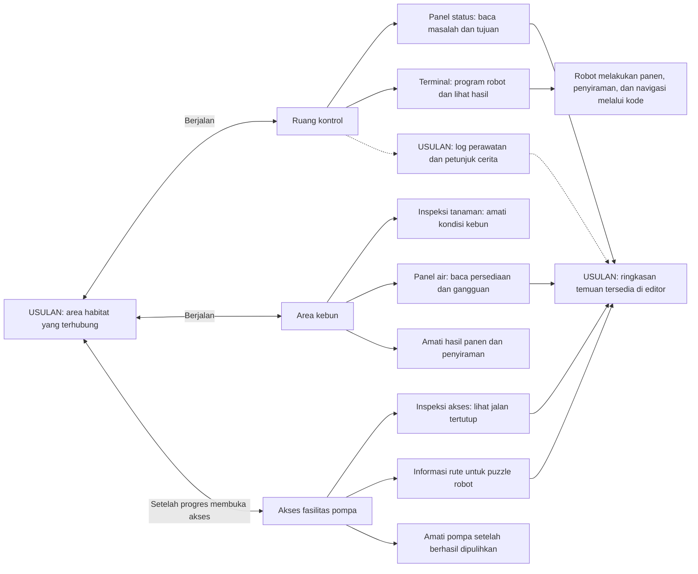
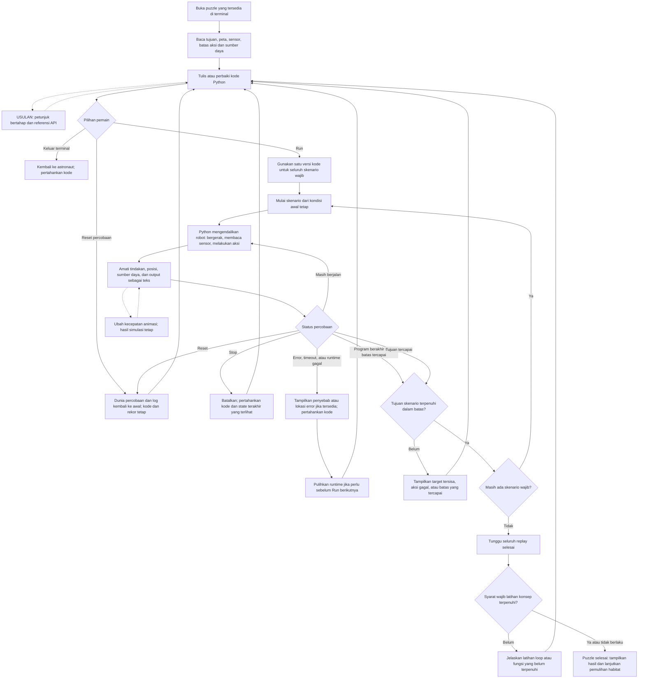
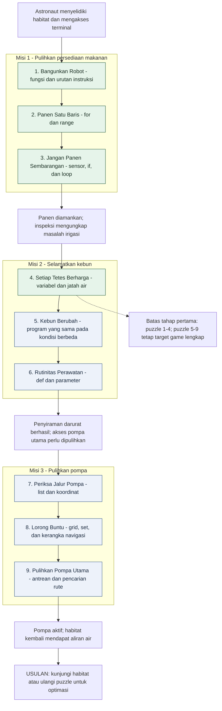

# `mars_reboot.py`

Dokumen acuan internal tim untuk Proyek Akhir OOP 2026. Isinya merangkum keputusan, rancangan gameplay, pembagian kerja, dan pertanyaan yang perlu ditutup sebelum implementasi. Gunakan bagian **Catatan keputusan** saat tim menyepakati perubahan.

## 1. Ringkasan proyek

**`mars_reboot.py`** adalah game puzzle pemrograman 2D top-down tentang astronaut yang terdampar di Mars. Pemain berjalan di dalam habitat untuk menyelidiki masalah, lalu menulis kode yang mengendalikan robot pendamping. Robot membantu memanen tanaman, menghemat air, dan mencapai fasilitas yang sulit dijangkau. Keberhasilan program terlihat langsung dari perubahan habitat.

- **Pemain sasaran** — orang yang suka coding atau ingin belajar coding, dengan suasana sci-fi sebagai konteks. Tutorial dimulai dari satu perintah dan bertahap memperkenalkan loop, kondisi, koordinat, serta pencarian rute.
- **Pengalaman yang dituju** — pemain bisa mengatakan, “Saya menyelidiki masalah di habitat, lalu program robot saya berhasil memperbaikinya.”
- **Peran kontrol langsung** — astronaut berjalan dan memeriksa beberapa objek dalam area kecil. Temuan saat inspeksi harus berguna untuk memahami tujuan atau merancang program.
- **Inspirasi** — *The Martian* untuk premis astronaut terdampar dan *The Farmer Was Replaced* untuk otomatisasi lewat kode. Cerita, peta, visual, dan kode dibuat untuk proyek ini. Catat lisensi serta kredit untuk aset pihak ketiga.

## 2. Keputusan dan status

| Status | Isi |
| --- | --- |
| **Dipilih** | Judul `mars_reboot.py` dan framework libGDX. Target pemain serta porsi jalan dan inspeksi untuk demo sudah dipilih. Target game lengkap adalah 9 puzzle dalam 3 misi besar; pengerjaan awal mencakup puzzle 1–4. Arah visual memakai **crisp pixel art 2D top-down 3/4** (referensi struktur modul *MewnBase*, nuansa terdampar *The Martian*, dan pencahayaan 2D ringan ala *Pathway*) serta **floating draggable terminal** ala *The Farmer Was Replaced*. |
| **Wajib menurut SOP** | Aplikasi game dalam Java, empat pilar OOP, minimal tiga rancangan pattern saat pengajuan awal, minimal enam pattern yang sudah dipelajari pada tenggat implementasi, serta backend Spring Boot untuk autentikasi dan skor. SOP membebaskan framework dan pilihan visual 2D atau 3D. |
| **Rancangan kerja** | Tampilan 2D top-down, misi berurutan dalam satu habitat, tutorial panen diikuti demo irigasi, dan pembagian empat peran pada bagian 7. |
| **Perlu konfirmasi** | Python sebagai bahasa pemain masih perlu konfirmasi aslab. Runtime eksperimen puzzle 1 sudah dipilih pengguna: CPython 3.15.2 dibundel pada paket Windows x64; kelayakan platform/paket final dan deployment backend masih perlu diuji. |
| **Status implementasi** | Per 13 November 2026, kandidat puzzle 1 panen terhubung ke terminal Python nyata, robot/replay/hasil, Run/Stop/Reset dan progres sesi. Paket Windows x64 menyertakan CPython 3.15.2; Java 21+ masih diperlukan. Backend, puzzle 2–9, save lintas restart dan komputer kedua belum terverifikasi. Prototype terpisah di prototype-web/. Bukti aktual di TASKS/VERIFICATION dan [kontrak runtime](docs/mars/PYTHON_RUNTIME.md). |

## 3. Gameplay inti

1. **Berjalan sebagai astronaut.** Pemain melihat habitat dari atas dan mendekati objek seperti panel air, jendela kebun, atau terminal robot.
2. **Periksa fasilitas.** Interaksi mengungkap informasi yang berguna, misalnya jatah air atau akses pompa yang tertutup. Ringkasan misi menyimpan temuan agar tersedia di editor.
3. **Program robot dari terminal.** Peta, koordinat, tujuan, dan referensi perintah tersedia di samping editor. Robot menjalankan perintah gerak, membaca sensor, dan melakukan aksi pada petak yang ditempatinya.
4. **Jalankan dan perbaiki.** Run memulai skenario dari kondisi awal yang ditetapkan. Tampilan memperlihatkan tindakan robot dan alasan kegagalan bila tersedia. Pemain bisa mengedit dan mengulang dari terminal setelah inspeksi awal.
5. **Pulihkan habitat.** Setelah solusi lulus semua skenario wajib, hasil misi diterapkan ke habitat dan misi berikutnya terbuka. Pemain kembali mengendalikan astronaut dan bisa melihat dampaknya, misalnya kebun kembali tersiram.

**Misi besar** adalah bab pemulihan habitat. **Puzzle** adalah level yang dapat diselesaikan di dalam misi besar. **Skenario** adalah variasi kondisi dalam satu puzzle, misalnya petak kering atau susunan batu yang berbeda. Pemain menguji program yang sama pada semua skenario wajib puzzle tersebut. Perjalanan astronaut dan waktu membaca editor berlangsung santai. Biaya puzzle mengikuti aksi robot dan kecepatan animasi tidak mengubah hasil.

### Interaksi astronaut di luar coding

Berjalan, memeriksa fasilitas, memakai terminal, dan melihat perubahan habitat merupakan arah gameplay yang sudah dipilih. Rincian berikut adalah **usulan desain interaksi**, belum keputusan fitur final atau bukti implementasi.

| Aktivitas | Contoh interaksi | Kegunaan untuk pemain |
| --- | --- | --- |
| Menjelajahi habitat | Berjalan di area kebun, ruang kontrol, dan akses pompa yang terbuka sesuai progres. | Memahami hubungan ruang dan menemukan fasilitas bermasalah. |
| Memeriksa objek | Baca panel air, amati tanaman, periksa pintu atau jalur yang tertutup. | Memperoleh jatah air, kondisi tanaman, atau informasi rute yang relevan untuk program. |
| Membaca catatan fasilitas | Buka log perawatan singkat atau petunjuk di terminal. | Mendapat konteks cerita dan penjelasan sensor tanpa dialog panjang wajib. |
| Menggunakan ringkasan misi | Tinjau tujuan dan temuan inspeksi dari editor. | Tidak perlu menghafal angka atau mengulang perjalanan setiap kali percobaan gagal. |
| Mengoperasikan terminal robot | Pilih skenario yang tersedia, jalankan, hentikan, dan periksa hasil program. | Menguji dugaan dan memperbaiki solusi berdasarkan tindakan robot yang terlihat. |
| Meminta bantuan bertahap | Buka petunjuk masalah, sensor terkait, lalu potongan contoh jika diperlukan. | Tetap bisa melanjutkan tanpa langsung diberikan solusi lengkap. |
| Memeriksa hasil pemulihan | Kembali melihat tanaman tersiram, indikator normal, atau akses fasilitas yang terbuka. | Melihat dampak program dan mengetahui alasan misi berikutnya tersedia. |
| Mengulang puzzle | Buka puzzle selesai untuk mencoba strategi lain dan membandingkan rekor. | Menyediakan tantangan tambahan setelah tujuan wajib tercapai. |

Inspeksi harus memberi informasi atau konsekuensi yang bermakna. Astronaut menangani penyelidikan dan interaksi fasilitas; pekerjaan panen, penyiraman, serta navigasi puzzle tetap dilakukan robot melalui kode. Tidak perlu mengulang inspeksi setelah setiap Run. Usulan ini tidak menambahkan NPC, dialog bercabang, inventory, crafting, combat, atau kebutuhan bertahan hidup berbasis waktu nyata ke target demo.

## 4. Progres misi dan puzzle

**Target yang dipilih: 9 puzzle dalam 3 misi besar.** Puzzle 1–4 menjadi tahap pengerjaan pertama, bukan pengurangan target game lengkap. Isi berikut menjadi rancangan kerja; ukuran peta, jumlah skenario, biaya, dan batas kelulusan numerik masih perlu ditetapkan serta diuji.

| Misi besar | Puzzle / level | Situasi dan tujuan | Konsep Python | Kriteria lulus yang dirancang |
| --- | --- | --- | --- | --- |
| **1 — Pulihkan persediaan makanan** | **1. Bangunkan Robot** | Panen satu tanaman dan bergerak ke tanaman berikutnya melalui terminal. | Pemanggilan fungsi, argumen, urutan instruksi. | Rangkaian aksi tutorial selesai. |
| 1 | **2. Panen Satu Baris** | Panen tanaman matang yang berjajar, lalu ringkas instruksi berulang. | `for`, `range()`. | Semua tanaman dalam baris dipanen; latihan loop dinilai terpisah. |
| 1 | **3. Jangan Panen Sembarangan** | Periksa kondisi tanaman pada area berisi tanaman matang dan muda. | Boolean, `if`, loop dan percabangan. | Semua target siap panen diambil tanpa percobaan panen tanaman muda. Fixture harus menetapkan kematangan dan target secara jelas. |
| **2 — Selamatkan kebun** | **4. Setiap Tetes Berharga** | Temukan jatah air lewat panel dan siram hanya petak kering. | Variabel, hitungan sederhana, perbandingan, sensor, kondisi. | Semua petak kering tersiram dalam jatah air pada skenario wajib. |
| 2 | **5. Kebun Berubah** | Terapkan program irigasi pada susunan petak kering yang lebih bervariasi. | Generalisasi loop dan kondisi berdasarkan sensor. | Kode yang sama lulus semua skenario wajib; bukan hanya koordinat satu contoh. |
| 2 | **6. Rutinitas Perawatan** | Gunakan kembali prosedur pemeriksaan dan penyiraman di beberapa bagian kebun. | `def`, parameter, fungsi buatan pemain. | Semua bagian terawat; latihan membuat fungsi dinilai terpisah. |
| **3 — Pulihkan pompa** | **7. Periksa Jalur Pompa** | Kunjungi daftar titik pemeriksaan untuk memperoleh informasi akses pompa. | List, tuple koordinat, iterasi data. | Semua titik wajib dikunjungi dan diperiksa. |
| 3 | **8. Lorong Buntu** | Lengkapi kerangka navigasi pada area kecil bercabang dan catat petak yang dikunjungi. | Grid, `set`, kondisi, debugging. | Robot menemukan akses keluar dalam batas aksi tanpa mengulang jalur tanpa kemajuan. |
| 3 | **9. Pulihkan Pompa Utama** | Temukan rute dan aktifkan pompa pada beberapa susunan penghalang. | Antrean, pencarian rute, fungsi, integrasi konsep. | Kode yang sama mencapai dan mengaktifkan pompa pada semua skenario wajib. BFS diberi bantuan bertahap; strategi lain yang memenuhi tujuan diterima. |

### Materi, bantuan, dan penilaian

- Satu puzzle memperkenalkan satu gagasan utama dan memakai kembali konsep sebelumnya. `print()`, ekspresi, tipe data, membaca error, dan debugging dikenalkan sesuai kebutuhan. List menjadi pengantar koleksi Python; `while` dikenalkan saat pengulangan berbasis kondisi diperlukan, dengan petunjuk penghentian yang jelas.
- Memanggil fungsi dikenalkan sejak puzzle 1; mendefinisikan fungsi sendiri pada puzzle 6. Puzzle 8 menyediakan kerangka navigasi sebelum tantangan gabungan puzzle 9.
- Keberhasilan pekerjaan robot dibedakan dari latihan konsep khusus pada puzzle 2 dan 6. Persyaratan loop/fungsi disampaikan sejak awal; cara verifikasinya masih perlu dirancang. Hasil dunia saja tidak membuktikan penggunaan konstruksi Python tertentu.
- Loop yang menjalankan aksi robot sama tidak otomatis mengurangi tick. Efisiensi gerakan atau air menjadi tantangan tambahan; angka batas dan formula skor harus dibuktikan lewat solusi referensi dan playtest. Jangan menyimpulkan kompleksitas Big O dari skor satu peta.
- Rekursi, kompleksitas formal, greedy, divide and conquer, dynamic programming, geometri, serta silabus kompetitif lengkap ditunda. List, set, antrean, dan pencarian graf dipakai ketika diperlukan oleh puzzle navigasi. Tidak ada leaderboard kompetitif baru yang disepakati.
- Skenario bersifat tetap saat dicoba ulang dan hasil menunjukkan skenario yang gagal. Lulus sekumpulan skenario merupakan bukti terhadap skenario itu, bukan jaminan program benar pada semua kemungkinan peta.

### Transisi dan perubahan habitat

1. Selesaikan replay dan evaluasi seluruh skenario wajib puzzle sebelum menyatakan berhasil.
2. Tampilkan ringkasan hasil serta konsep yang dipakai; pertahankan kode dan hasil per puzzle. Penyimpanan progres puzzle masih perlu diimplementasikan dan diuji.
3. Terapkan perubahan yang menjadi hasil puzzle ke habitat dan buka puzzle berikutnya. Percobaan gagal hanya mengulang skenario; hasilnya tidak merusak habitat permanen.
4. Pada akhir misi besar, kembalikan kontrol astronaut agar pemain melihat pemulihan dan menyelidiki masalah berikutnya. Contoh hubungan cerita yang diusulkan: panen diamankan → ditemukan masalah irigasi → penyiraman darurat berhasil → akses pompa perlu dipulihkan → aliran air kembali.
5. Pemain memulai puzzle baru secara eksplisit. Inspeksi yang sudah ditemukan tetap tersedia di ringkasan; kode sebelumnya tidak ditimpa oleh contoh baru. Tantangan optimasi tidak mengunci kelanjutan cerita.

**Contoh puzzle 2.** Bila robot mulai di petak pertama dari empat tanaman matang yang berjajar ke timur, pemain bisa menulis berikut ini. Puzzle 1 memperkenalkan aksi tunggal sebelum contoh loop ini.

```python
harvest()

for langkah in range(3):
    move("east")
    harvest()
```

Saat sebagian tanaman masih muda, umpan balik seperti “Petak (2, 0) belum matang” memberi alasan untuk memeriksa `can_harvest()` sebelum memanen. Perintah yang sama dipakai untuk belajar konsep yang makin kompleks.

**Contoh misi irigasi.** Panel menunjukkan dua unit air. Setiap skenario contoh memiliki dua petak kering dengan posisi berbeda. Jika satu unit terpakai pada petak yang sudah lembap, persediaan habis sebelum semua petak kering tersiram. Pemain memperbaiki program dengan `if needs_water():` sebelum `water()`, lalu menguji ulang dari terminal. Dua unit air dan jumlah skenario adalah angka ilustrasi yang perlu diuji.

| Kandidat API pemain | Maksud dalam rancangan |
| --- | --- |
| `move(direction)` | Gerakkan robot satu petak ke arah yang diminta jika jalur bisa dilalui. |
| `harvest()` dan `can_harvest()` | Panen atau periksa kesiapan panen pada petak saat ini. |
| `water()` dan `needs_water()` | Siram atau baca kebutuhan air pada petak saat ini. |
| `get_pos()` | Baca koordinat robot. Antarmuka pembacaan peta dan posisi tujuan untuk misi pompa masih terbuka. |

Nama perintah baru, nilai balik, batas aksi, biaya, dan formula skor perlu disepakati sebelum implementasi misi. Ukuran efisiensi yang dibahas meliputi jumlah gerakan dan air yang digunakan. Penyimpanan skor mengikuti hasil misi yang lulus.

### Visual gameplay lengkap — Mermaid

Diagram berikut menjabarkan rancangan bagian 3–4, bukan status implementasi. Target **9 puzzle** dan tahap awal **puzzle 1–4** sudah dipilih. Detail layar awal, tata ruang, interaksi, bantuan, serta penyimpanan progres masih **usulan**; diagram tidak menetapkan fitur baru sebagai keputusan final. Python pemain dan runtime masih mengikuti kebutuhan konfirmasi pada bagian 10.

Empat diagram dipisahkan agar dapat dibaca: alur keseluruhan, ruang jelajah astronaut, siklus coding, dan progres cerita. Kotak bertanda **USULAN** menunjukkan detail tambahan yang belum dipilih. Tata ruang merupakan hubungan akses konseptual, bukan denah final. Semua aktivitas opsional dapat dilewati tanpa mengunci cerita.

#### A. Alur dari membuka game sampai habitat pulih



Registrasi/login dan skor mengikuti kebutuhan backend proyek. Pemulihan progres, perilaku saat simpan skor gagal, dan cara melanjutkan permainan perlu dirancang serta diuji. Hanya hasil skor yang dikirim; source dan log eksekusi tetap di klien. Mengulang puzzle selesai tidak mengunci ulang akses atau mengembalikan habitat ke kondisi rusak; ini usulan aturan replay untuk menjaga progres.

#### B. Ke mana astronaut dapat pergi dan berinteraksi



Pemain dapat kembali mengunjungi area yang sudah terbuka. Target demo memakai satu area kecil; penamaan ruang di diagram tidak mewajibkan banyak peta atau loading antarruang. Astronaut tidak dapat melewati puzzle dengan memanen atau menyiram manual. Waktu menjelajah, membaca, dan menulis kode tidak menghabiskan jatah aksi robot. Tidak ada timer oksigen, kelaparan, combat, crafting, NPC, atau dialog bercabang yang ditambahkan melalui diagram ini.

#### C. Siklus coding, pengujian skenario, dan pemulihan kegagalan



- Run berikutnya memakai kondisi awal yang sama. Skenario berikutnya memakai kode yang sama tetapi fixture skenarionya sendiri. Jika kode diedit, penilaian seluruh skenario wajib harus dimulai ulang untuk versi kode itu.
- Pemeriksaan latihan konsep hanya berlaku pada puzzle yang mensyaratkannya, khususnya 2 dan 6; metode verifikasinya masih terbuka. Syarat itu harus dijelaskan sebelum pemain mulai. Efisiensi opsional bukan penghalang melanjutkan cerita.
- Stop/Reset/error tidak memberi rekor sukses. Stop saat replay juga membatalkan percobaan itu. Hasil atau pesan percobaan lama tidak boleh menimpa percobaan baru. Kontrol Stop harus tetap responsif untuk loop Python tanpa akhir.
- Kegagalan percobaan tidak mengubah habitat permanen atau mewajibkan inspeksi ulang. Diagram menggambarkan penilaian seluruh skenario; pilihan uji satu skenario dan tata letak tombol masih perlu dirancang.
- Pemulihan habitat hanya diterapkan setelah puzzle lulus, termasuk seluruh skenario dan latihan wajib. Batas angka, biaya sensor/aksi, formula skor, dan data peta belum ditetapkan oleh diagram.

#### D. Urutan 9 puzzle, materi, dan transisi cerita



Hijau menandai tahap pengerjaan pertama dan biru tahap selanjutnya; nomor dan catatan tetap membedakan keduanya tanpa bergantung pada warna. Cabang putus-putus setelah puzzle 4 menandai batas demo, bukan akhir cerita atau penghentian target 9 puzzle. Setiap panah antarpuzzle melewati siklus coding pada diagram C; pemain tetap boleh keluar terminal untuk menjelajah area terbuka. Perpindahan antarmisi besar melewati inspeksi astronaut dan perubahan habitat pada diagram A–B. Hubungan cerita dan rincian interaksi masih rancangan kerja, belum hasil playtest.

## 5. Cakupan demo dan kriteria uji

- **Integrasi pertama** — login, berjalan ke panel, baca petunjuk, buka terminal, jalankan `harvest()`, lihat tanaman terpanen, dan simpan hasil. Satu alur ini menyambungkan empat bagian tim.
- **Tahap pertama / demo gameplay** — implementasikan puzzle 1–4 secara berurutan dalam satu area habitat kecil, dengan objek inspeksi dan terminal yang relevan. Puzzle 4 mencakup variasi kondisi dasar untuk menguji pembacaan sensor; puzzle 5 kelak memperluas variasi dan latihan generalisasi. Verifikasi perpindahan puzzle, kode yang tetap tersimpan, umpan balik kegagalan, serta dampak panen dan penyiraman di habitat.
- **Target game lengkap** — lanjutkan puzzle 5–6 untuk menuntaskan misi kebun, lalu puzzle 7–9 untuk misi pompa. Jumlah tetap 9 puzzle; tahap pertama adalah urutan pengerjaan. Status seluruh konten Mars masih rancangan, belum diimplementasikan atau diuji. Penyelesaian empat puzzle tidak berarti sembilan puzzle atau game akhir selesai.
- **Siklus percobaan** — Run mengulang dari kondisi awal skenario. Stop, Reset, timeout, dan error mempertahankan kode pemain. Reset percobaan mempertahankan rekor. Hasil percobaan lama tidak boleh menimpa percobaan baru. Terapkan batas aksi, ukuran kode, output, antrean, dan waktu eksekusi.
- **Pengujian teknis** — buktikan satu aksi robot dan satu pembacaan sensor melalui runtime. Uji penghentian loop tak berujung, kegagalan script, percobaan ulang, serta hasil yang tetap sama walau kecepatan animasi berbeda. Uji login dan skor setelah membuka ulang game. Coba build desktop di komputer anggota lain sebelum distribusi.
- **Playtest** — amati apakah pemain baru bisa menjalankan aksi pertama, memakai temuan dari panel untuk mengubah program, memahami kegagalan dari tampilan, dan melihat hubungan antara programnya dengan perubahan habitat. Catat hasil aktual dan bagian yang memerlukan bantuan.

## 6. Stack dan arsitektur

| Bagian | Pilihan dan batas |
| --- | --- |
| **Klien desktop** | **Java + libGDX**. Gunakan peta 2D top-down, sprite, dan UI dalam game. Scene2D UI `TextArea` adalah kandidat editor awal. Uji indentasi, fokus keyboard, seleksi, scrolling, dan keterbacaan error. JDK 21 adalah kandidat versi awal. |
| **Simulasi dan misi** | **Java** memegang keadaan dunia, memvalidasi perintah, dan menilai hasil skenario. libGDX menerima keadaan dan hasil untuk ditampilkan. Jalankan script di luar render loop agar UI dan Stop tetap responsif. |
| **Runtime kode pemain** | **Python** diusulkan untuk bahasa pemain. **CPython sebagai proses terpisah** dengan `ProcessBuilder` adalah opsi uji awal untuk script tepercaya. Pemisahan proses membantu pembatalan, sementara pembatasan akses file, jaringan, dan sumber daya untuk distribusi masih perlu dirancang dan diuji. |
| **Backend** | **Spring Boot** menangani registrasi, login, penyimpanan skor, dan pengambilan rekor. Spring Web, Spring Security, Spring Data JPA, dan H2 mode file adalah kandidat untuk demo lokal. SOP mengizinkan backend lokal atau daring. Simpan password dengan mekanisme hashing. Kode pemain dan log eksekusi tetap di klien. |
| **Build, test, distribusi** | Ikuti setup libGDX Desktop dan tetapkan versi dependensi bersama. JUnit menjadi kandidat untuk test Java. Target awal berupa build desktop yang dapat diunduh. `jpackage` adalah opsi untuk paket Windows dengan runtime Java. Buktikan juga cara menyertakan runtime Python bila dipakai dan cara build mengakses backend. |

libGDX dipilih untuk dukungan peta, sprite, kamera, dan animasi 2D. JavaFX sempat dipertimbangkan karena kontrol desktopnya cocok untuk editor. Karena pemain akan berjalan dan berinteraksi langsung di habitat, kualitas editor dalam libGDX perlu diuji bersama peta sejak awal. [Panduan libGDX](https://libgdx.com/wiki/), [Scene2D UI](https://libgdx.com/wiki/graphics/2d/scene2d/scene2d-ui)

## 7. Pembagian kerja empat orang

| Peran | Tanggung jawab | Hasil yang dapat diverifikasi |
| --- | --- | --- |
| **1 — Simulasi Java dan runtime Python** | Aturan gerak, aksi robot, sensor, penghubung Python–Java, Run, Stop, batas eksekusi, dan pelaporan error. | Program menjalankan `harvest()`, membaca sensor, dan bisa dihentikan saat loop tak berujung. |
| **2 — Misi dan evaluasi puzzle** | Peta, fixture, temuan inspeksi, tutorial, variasi skenario, tujuan, skor, solusi referensi, dan pengujian puzzle. | Solusi referensi lulus skenario. Solusi yang menghafal petak gagal pada variasi yang mengubah kondisi. |
| **3 — Kontrol pemain, UI, dan visual libGDX** | Gerak astronaut, interaksi panel dan terminal, editor, peta, sprite, animasi, ringkasan misi, dan panel hasil. | Pemain bisa berpindah dari inspeksi ke editor, menjalankan kode, dan kembali melihat hasil di habitat. |
| **4 — Backend dan distribusi** | Autentikasi, penyimpanan skor, integrasi akun dengan klien, build desktop, konfigurasi backend, dan panduan menjalankan game. | Pengguna bisa login dan mengambil skor setelah membuka ulang game. Build dapat diuji di komputer anggota lain. |

**Sambungan kerja.** Peran 1 dan 2 menyepakati format skenario, perintah robot, dan keluaran percobaan. Peran 1 dan 3 menyepakati data posisi, keadaan petak, dan event aksi. Peran 2 dan 3 menyepakati cara menyampaikan temuan inspeksi dan status misi. Peran 2, 3, dan 4 menyepakati hasil misi yang dikirim sebagai skor. Setiap anggota menguji serta mendokumentasikan bagian yang dipegangnya.

## 8. OOP dan design pattern

Penerapan OOP dinilai pada implementasi game dalam Java. Contoh rancangan yang dibahas meliputi **enkapsulasi** lewat validasi perubahan posisi dan jatah air, **abstraksi** lewat kontrak misi, **pewarisan** lewat jenis misi yang berbagi alur, serta **polimorfisme** saat jenis misi berbeda mengevaluasi tujuan lewat kontrak yang sama.

| Kandidat pattern | Penerapan yang perlu dibuktikan | Pemilik usulan |
| --- | --- | --- |
| **Command** | Merepresentasikan dan menjalankan aksi robot seperti bergerak, panen, dan menyiram. | Peran 1 |
| **State** | Menentukan perilaku dan tindakan yang tersedia pada fase siap, berjalan, dibatalkan, dan selesai. | Peran 1, integrasi UI oleh peran 3 |
| **Observer** | Memberi tahu tampilan, log, atau indikator ketika keadaan dunia berubah. | Peran 3 |
| **Factory Method** | Pembuatan misi yang menghasilkan jenis misi sesuai kebutuhan, jika struktur pembuatnya mendukung pattern ini. | Peran 2 |
| **Strategy** | Menukar aturan penilaian, misalnya efisiensi gerak atau penggunaan air. | Peran 2 |
| **Template Method** | Menetapkan urutan evaluasi skenario sambil memberi langkah khusus pada jenis misi. | Peran 2 |

**Command, State, dan Observer** adalah kandidat untuk tiga rancangan awal. Cocokkan keenam pilihan dengan materi kelas dan praktikum. Tunjukkan relasi antarkelas dan perilakunya pada demo.

## 9. Linimasa dan luaran SOP

| Tanggal | Ketentuan |
| --- | --- |
| **8 November 2026** | Batas awal judul, deskripsi singkat, dan minimal tiga rancangan design pattern di spreadsheet proyek akhir. |
| **14 November 2026** | Batas pengajuan ulang jika ditolak, kelengkapan data tim termasuk aslab, repositori, dan GDD, serta pengumpulan PDF proposal dan Project Management Plan di Emas3. |
| **22 November 2026** | Minimal enam design pattern yang telah dipelajari sudah diimplementasikan. |
| **6 Desember 2026, 23.59 WIB** | Kumpulkan build dan halaman game melalui game jam itch.io. SOP menerima `.exe`, `.jar`, atau build HTML yang bisa dimainkan di browser. |
| **Desember 2026, tanggal menyusul** | Presentasi final, peer review tim, dan playtest serta penilaian antarkelompok. |

- **Dokumen dan demo** — proposal dengan workflow dan project plan, GDD, laporan mingguan, repositori GitHub, video YouTube yang menunjukkan gameplay dan kode, serta progress interview. Setelah Modul 10, interview dengan aslab minimal sekali per minggu sesuai SOP.
- **Halaman itch.io** — deskripsi, cara bermain, anggota dan peran, tautan repositori, dan kredit aset internet bila digunakan.
- **Rubrik** — empat pilar OOP 20%, design pattern 20%, demo 45%, dokumentasi 5%, kontribusi tim 10%. Demo mencakup stabilitas, gameplay dan kontrol, UI/UX, kreativitas, serta backend.
- **Perubahan setelah pengajuan** — komunikasikan perubahan fitur atau pattern kepada aslab dan catat persetujuannya sesuai SOP. Tanggal di atas menunjukkan tenggat pada dokumen tugas. Status pengumpulan dan persetujuan tim perlu dicatat dari bukti aktual.

Sumber jadwal dan ketentuan adalah PDF *Praktikum Pemrograman Berorientasi Objek — Proyek Akhir 2026*, bagian I–VI.

## 10. Hal yang masih perlu diputuskan

- **Python** — konfirmasi penggunaan Python sebagai bahasa pemain ke aslab. Uji pemanggilan aksi, sensor, Stop, pembatasan akses, serta distribusi runtime sebelum menetapkan pendekatan akhir.
- **Misi dan API** — sepakati skenario wajib, jumlah petak, biaya aksi, formula skor, nilai balik perintah, dan data yang diperlukan untuk puzzle pompa.
- **Latihan dan interaksi** — tetapkan cara menilai latihan loop/fungsi pada puzzle 2 dan 6, detail interaksi astronaut yang diusulkan, petunjuk navigasi, penyimpanan progres, serta transisi antarpuzzle.
- **UI dan build** — uji editor libGDX dan alur inspeksi pada komputer target. Tetapkan target paket desktop dan cara menyalakan atau mengakses backend untuk praktikan lain.
- **Tim dan pengajuan** — masukkan nama pemilik peran, status pengajuan, dan keputusan aslab saat datanya tersedia.

## 11. Catatan keputusan

Saat ide disepakati, perbarui bagian yang terdampak dan tambahkan satu baris di bawah. Catat **tanggal, keputusan, alasan, dan dampak**. Bedakan status **Usulan**, **Dipilih**, **Diimplementasikan**, dan **Terverifikasi**. Cantumkan bukti test, demo, atau persetujuan bila ada.

| Waktu atau tahap | Status | Keputusan dan alasan | Dampak |
| --- | --- | --- | --- |
| Pembahasan nama | Dipilih | `mars_reboot.py` menggabungkan latar Mars, pemulihan sistem, dan gaya nama file Python. | Gunakan sebagai judul proyek. |
| Pembahasan stack | Dipilih | Gunakan libGDX untuk pengembangan dunia dan interaksi 2D. | Rancang klien desktop dan uji editor di libGDX. |
| Pembahasan gameplay | Dipilih | Sasar pemain yang tertarik belajar atau memakai coding dengan nuansa sci-fi. Untuk demo, astronaut berjalan dan memeriksa objek di area kecil. | Temuan inspeksi harus relevan untuk puzzle. |
| Rancangan saat ini | Usulan | Susun misi berurutan dan demo tutorial panen serta irigasi. Gabungkan kepemilikan simulasi dan runtime agar jalur Python–Java mudah ditelusuri. | Peran 2 memegang konten, evaluasi, dan pengujian puzzle. |
| 11 November 2026 | Dipilih | Pengguna menetapkan 9 puzzle untuk game lengkap dan menyetujui pengerjaan puzzle 1–4 terlebih dahulu. | Bagian 3–5 membedakan misi besar, puzzle/level, dan skenario; rincian konten menjadi rancangan kerja, bukan klaim implementasi. |
| 11 November 2026 | Usulan | Elaborasi interaksi astronaut melalui inspeksi, log fasilitas, ringkasan misi, bantuan, dan pengamatan pemulihan. | Detail pada bagian 3 perlu dipilih sebelum menjadi fitur final; tidak menambah NPC atau sistem survival baru ke demo. |
| 12 November 2026 | Dipilih | Pengguna meminta dokumen utama ditulis ulang untuk Mars dan referensi prototype dijelaskan terpisah. | Root PRD/RULES/ARCHITECTURE/DESIGN/TEST_PLAN/TASKS/VERIFICATION menjadi acuan Mars; PROTOTYPE.md merangkum Farm Code Lab dan docs/prototype/ mengarsipkan dokumen lama. docs/mars/ hanya penunjuk. Keputusan ini mengubah organisasi dokumentasi, bukan mengotorisasi migrasi kode atau menyetujui semua usulan teknis. |
| 12 November 2026 | Dipilih | Pengguna mengunci arah visual **crisp pixel art 2D top-down 3/4** (referensi modul/suasana *MewnBase* dan *The Martian*, serta shading + pencahayaan 2D ringan ala *Pathway* dengan `TextureFilter.Nearest` tanpa membangun *custom voxel lighting engine* penuh) dan tata letak **floating draggable terminal** (*The Farmer Was Replaced* style: IDE di kiri/bebas digeser, dunia puzzle robot di kanan). | [DESIGN.md](DESIGN.md) diperbarui untuk arah visual, wireframe terminal Scene2D `Window`, serta acuan blueprint Figma (`z5Q44g0NLnulWXFMaA4Hlz` & FigJam `1cSWTDnhTvzMJjk8jb15vI`). Skala tile pixel (`16×16`/`32×32`), palet terukur, aset produksi, dan uji libGDX desktop tetap menunggu `M-05`/`M-24`. Tidak menyalin aset/source game referensi. |
| 12 November 2026 | Diimplementasikan; kontrol masih usulan awal | Pengguna meminta dunia/kontrol dasar pada proyek libGDX existing, tanpa generator ulang. Gunakan WASD/panah, E, Esc sebagai fallback yang dicatat, serta placeholder sederhana. | Proyek existing di `C:\Users\abdie\OneDrive\Desktop\Folder_Abdiel\PRAKTIKUM\FINDIH\MarsReboot` dipertahankan. Habitat/inspeksi/terminal sementara teruji parsial; tidak menetapkan shortcut final, aturan robot, backend, atau visual produksi. Bukti dan batas di VERIFICATION; ownership/handoff di TASKS. |
| 12 November 2026 | Dipilih (Desain); implementasi menunggu | Pengguna menyetujui rencana **Outpost Permukaan Mars** (interaksi astronaut dominan di luar ruangan: `Hab Utama` ↔ `Bio-Dome Base` terbuka dengan kubah transparan parsial ↔ `Stasiun Pompa`) serta upgrade UI/UX sci-fi dan sinkronisasi `.png` ke `docs/mars/design-refs/`. | [DESIGN.md](DESIGN.md) §10 dan Figma (`z5Q44g0NLnulWXFMaA4Hlz`) diperbarui dengan *Art Direction* (`00`) serta layar lengkap (`07`–`11`). Tetap menjaga batas tanpa timer survival *real-time* atau *open-world* raksasa; implementasi Java/libGDX menyusul. |

| 13 November 2026 | Dipilih | Pengguna meminta konteks, dokumentasi dan skill disatukan ke repository libGDX supaya tim mendapat konteks yang sama setelah clone. | Root MarsReboot menjadi sumber utama; folder dokumentasi lama cadangan. TEAM_GUIDE/TEAM_PROMPTS memberi urutan kerja dan prompt empat peran; tidak mengotorisasi commit/push/backend otomatis. |
| 13 November 2026 | Dipilih / diimplementasikan / teruji terbatas | Pengguna meminta integrasi terminal sampai Python nyata dan memilih Python dibundel bersama game. | Eksperimen p1-a memakai CPython 3.15.2 Windows x64, domain Java otoritatif, Run/Stop/Reset/replay serta ZIP uji. Bukan persetujuan aslab, backend atau komputer kedua; kontrak dan bukti pada PYTHON_RUNTIME/VERIFICATION. |

## 12. AI Development Strategy & Workflow

Rekomendasi pembagian kerja ini membantu empat anggota pada bagian 7; setiap anggota tetap memahami, menguji, dan menjelaskan kode OOP yang dikumpulkan. Ini strategi kerja, bukan hasil benchmark atau bukti bahwa satu model selalu lebih unggul. Gunakan model yang benar-benar tersedia di akun dan catat model saat membuat handoff penting.

### Peran alat dan model

| Alat / pilihan model | Fokus utama | Penerapan pada proyek |
| --- | --- | --- |
| **Codex, model coding yang tersedia di akun** | Backend, API, database, testing otomatis, dan integrasi. | Untuk target Mars: Spring Boot, autentikasi, skor, validasi, schema/migrasi database setelah dipilih, kontrak Java, serta pengujian simulasi dan runtime. Untuk prototype: Python, Worker, protokol, controller, dan test. |
| **Antigravity + Gemini 4 Argon bila tersedia** | Frontend, UI/UX, iterasi visual, dan visual QA. | Untuk Mars: layar dan interaksi libGDX/Scene2D, editor, HUD, sprite, serta animasi. Untuk prototype: HTML/CSS/Canvas dan aksesibilitas. Periksa build desktop untuk libGDX; preview browser hanya membuktikan tampilan web. |
| **Claude di Antigravity, bila tersedia** | Arsitektur, review independen, dan debugging kompleks. | Tinjau batas simulasi–runtime–UI–backend, penghentian script, autentikasi, konsistensi skor, dan masalah lintas modul. Implementasi perbaikan dapat dialihkan dengan serah-terima ownership yang jelas. |

**Pemeriksaan penamaan, 11 November 2026:** dokumentasi resmi [Choose a model — Antigravity](https://antigravity.google/docs/models) mencantumkan **Gemini 4 Argon** (bukan “Argon 4”) serta **Claude Opus 5.5 (Thinking)** dan **Claude Sonnet 5.5 (Thinking)**. Akses bergantung pada paket; ketentuan Pro untuk Claude 5.5 mensyaratkan langganan non-trial. Daftar resmi tidak membuktikan akses akun pengguna. Periksa pemilih model sebelum mulai dan gunakan alternatif yang tersedia dengan peran kerja yang sama. Versi model Codex tidak dikunci oleh workflow ini.

### Dokumen bersama dan kontrak integrasi

- [PROJECT.md](PROJECT.md) menjadi acuan arah Mars, pembagian kerja, dan keputusan. [PRD.md](PRD.md), [RULES.md](RULES.md), [ARCHITECTURE.md](ARCHITECTURE.md), dan [DESIGN.md](DESIGN.md) di root sekarang khusus Mars. [TEST_PLAN.md](TEST_PLAN.md) merinci pemeriksaan. Sebutkan target **prototype web** atau **Mars Java/libGDX** pada setiap tugas; usulan dalam dokumen bukan keputusan yang otomatis disetujui.
- [AGENTS.md](AGENTS.md) menyimpan instruksi lintas sesi. [TASKS.md](TASKS.md) menyimpan backlog Mars dan handoff; [VERIFICATION.md](VERIFICATION.md) menyimpan bukti aktual Mars. Bukti lama berada di [arsip prototype](docs/prototype/VERIFICATION.md). Catat keputusan material di bagian 11, dengan status usulan/dipilih/diimplementasikan/terverifikasi.
- Kontrak prototype berada di [arsip RULES](docs/prototype/RULES.md), [arsip ARCHITECTURE](docs/prototype/ARCHITECTURE.md), dan `prototype-web/src/protocol.ts`. Untuk perubahan prototype, ubah bersama validasi/test terkait; renderer tidak mengambil alih aturan Python. Untuk Mars, simulasi otoritatif mengikuti Java sesuai bagian 6.
- Sebelum klien Mars dan backend dikerjakan paralel, tetapkan kontrak HTTP autentikasi/skor: endpoint, metode, request/response, tipe dan field wajib, status/error, mekanisme autentikasi, versi puzzle/aturan, serta batas kepercayaan skor dari klien. Sertakan contoh sukses/gagal dan fixture yang sama untuk mock UI serta integration test. Kontrak ini masih perlu dibuat; endpoint atau schema belum ditetapkan di sini.
- Saat backend mulai dibuat, simpan kontrak HTTP dalam OpenAPI dan rancangan entitas/constraint/migrasi database pada dokumen yang ditautkan dari bagian 6. Untuk Java–Python dan simulasi–UI, sepakati perintah, sensor, snapshot/event, identitas percobaan, error, dan pembatalan sebelum implementasi. Gunakan DTO Java dan pengujian kontrak; shared TypeScript types berlaku untuk prototype TS, bukan pengganti kontrak klien Java.

### Branch, worktree, dan kepemilikan file

Untuk sesi berurutan, satu working directory cukup dengan handoff terbaru. Untuk pengerjaan simultan, gunakan **branch dan worktree terpisah**, misalnya `feature/mars-ui` untuk Antigravity dan `feature/mars-auth-score` untuk Codex. Dua branch dalam folder yang sama tidak mengisolasi edit bersamaan. Tentukan branch dasar/commit dan satu penanggung jawab integrasi; jangan pindah branch atau menimpa perubahan sesi lain.

| Area | Pemilik edit yang disarankan |
| --- | --- |
| Prototype: `index.html`, `prototype-web/src/styles.css`, `prototype-web/src/renderer.ts` | Antigravity untuk visual/UI. Perubahan renderer mengikuti snapshot yang disepakati. |
| Prototype: `prototype-web/src/python/`, `prototype-web/src/python.worker.ts`, `prototype-web/src/controller.ts`, `prototype-web/src/storage.ts` | Codex untuk aturan, runtime, lifecycle, dan persistensi. |
| Prototype: `prototype-web/src/main.ts`, `prototype-web/src/protocol.ts`, konfigurasi, dependency/lockfile, dokumen bersama, dan `tests/` | Tetapkan satu editor per tugas pada handoff; perubahan wiring, kontrak, atau fixture dikoordinasikan sebelum integrasi. |
| Mars: modul UI/visual, simulasi/runtime/misi, backend, dan build | Petakan ke folder nyata setelah bootstrap sesuai peran bagian 7; tabel ini tidak mengklaim folder Java sudah ada. |

Ownership berlaku per tugas, bukan larangan permanen. Reviewer mulai dari membaca diff; jika ikut mengedit, catat pengalihan file terlebih dahulu. Hindari dua agen menulis file bersama secara bersamaan. Perubahan lintas kontrak diintegrasikan berurutan: kontrak dan fixture, implementasi masing-masing sisi, lalu test terpadu. Dokumen dan kode pada worktree lain baru tersedia setelah perubahan dibawa melalui Git atau diserahkan secara eksplisit; chat serta edit yang belum disimpan tidak ikut tersinkron.

### Siklus implementasi, CI, dan review

1. **Planning:** tulis target, kriteria penerimaan, dependensi, file pemilik, dan keputusan terbuka. Claude dapat meninjau arsitektur; Codex merinci kontrak serta test. Keputusan produk tetap mengikuti pengguna/tim.
2. **Implementasi satu alur:** Codex membangun logika/backend; Antigravity membangun UI memakai kontrak dan mock yang sama. Mulai dari satu alur yang dapat diuji, misalnya login → terminal → aksi robot → hasil → simpan skor untuk Mars.
3. **Iterasi visual:** implementasi → jalankan → amati screenshot/interaksi → perbaiki. Periksa loading/error, fokus keyboard, keterbacaan editor, Run/Stop/Reset, dan animasi tanpa perubahan skor. Gunakan runtime desktop untuk Mars dan browser untuk prototype.
4. **Integrasi:** uji request/response nyata, kegagalan autentikasi dan penyimpanan, pesan terlambat, pembatalan, serta fixture deterministik. Mock yang berhasil belum membuktikan integrasi backend.
5. **Cross-review:** Claude meninjau backend/arsitektur Codex; Codex meninjau integrasi, tipe, dan test hasil Antigravity. Tindaklanjuti temuan yang punya bukti dengan test atau dokumentasi resmi; orang tim meninjau diff dan keputusan akhir.
6. **Quality gate sebelum merge:** CI menjalankan pemeriksaan yang tersedia. Prototype: typecheck, unit TS, test Python, build, dan browser test untuk perubahan UI/lifecycle; `lint` belum tersedia di package.json. Mars: tambahkan build/test Java, test Spring Boot, dan test kontrak setelah modul serta toolchain dibuat; visual desktop tetap diperiksa pada build nyata. Catat check yang gagal, dilewati, atau belum dikonfigurasi. Workflow CI belum ditemukan pada pemeriksaan 11 November 2026; langkah ini rencana, bukan klaim CI sudah aktif.
7. **Handoff:** catat hasil, file, branch/commit atau edit belum di-commit, bukti test, risiko, dan langkah berikutnya di TASKS.md. Gabungkan perubahan secara berurutan setelah review dan check yang relevan lulus; commit/push/deployment mengikuti otorisasi pengguna.

### Menjaga konteks Codex dan Antigravity

Riwayat chat lintas alat tidak diasumsikan tersinkron. Simpan ringkasan keputusan dan progres yang diperlukan di repository, lalu minta alat berikutnya membacanya. [Dokumentasi Rules Antigravity](https://antigravity.google/docs/rules) yang diperiksa 11 November 2026 mendukung AGENTS.md/GEMINI.md sebagai aturan workspace; buka root project dan periksa aturan yang dimuat pada versi terpasang. Gunakan AGENTS.md bersama agar instruksi tidak bercabang; prompt eksplisit berikut tetap dapat dipakai jika penemuan otomatis belum sesuai versi lokal.

**Prompt awal untuk Antigravity atau Codex:**

```text
Buka root repository MarsReboot (folder dengan settings.gradle dan AGENTS.md). Baca AGENTS.md, PROJECT.md bagian 2 dan 12,
serta handoff terbaru di TASKS.md. Baca dokumen domain sesuai target tugas.
Periksa branch, perubahan lokal, dan file ownership sebelum mengedit.
Ringkas target, keputusan, status aktual, dan langkah berikutnya yang kamu pahami.
Kerjakan tugas aktif pengguna sesuai batas file yang disepakati.
Sebelum selesai, perbarui handoff dan catat verifikasi aktual.
Jika konteks chat belum ada dalam dokumen, sebutkan bagian yang masih diperlukan.
```

Ringkasan yang disimpan mencakup hasil pembahasan dan alasan keputusan, bukan seluruh transkrip. Handoff harus diperbarui setiap pergantian alat agar keputusan baru dalam chat tersedia untuk sesi berikutnya.

## Referensi prototype

Farm Code Lab menjadi rujukan untuk mekanik panen, fixture yang dapat diulang, dan pengalaman Run/Stop/Reset. Prototype tersebut memakai TypeScript, Vite, Canvas 2D, dan Pyodide dalam Web Worker. Hasil verifikasi lokalnya berlaku untuk prototype itu.

- [Penjelasan dan cara menjalankan prototype](PROTOTYPE.md) dan [bukti verifikasi historis](docs/prototype/VERIFICATION.md).
- [Tujuan prototype](docs/prototype/PRD.md), [aturan dan API](docs/prototype/RULES.md), [arsitektur](docs/prototype/ARCHITECTURE.md), [desain antarmuka](docs/prototype/DESIGN.md), serta [status pekerjaan historis](docs/prototype/TASKS.md). Angka/kontraknya tidak otomatis menjadi aturan Mars.
- [Draf proposal konsep Mars sebelumnya](docs/prototype/Proposal_Mars_Code_Survival.md) untuk riwayat premis, puzzle, dan rencana empat minggu. Stack web dan pembagian peran di draf itu berasal dari fase sebelumnya.
