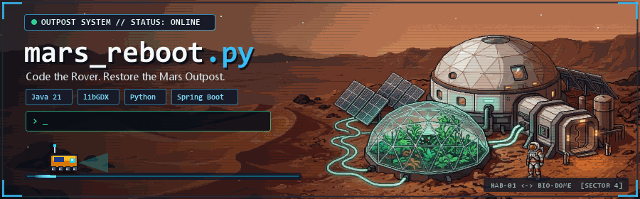

# mars_reboot.py — MarsReboot



Repository utama tim: game Java/libGDX, dokumentasi, aset, dan skill Codex–Antigravity berada dalam satu clone. Mulai dari **[TEAM_GUIDE.md](TEAM_GUIDE.md)** untuk memahami game, struktur, pembagian empat orang, urutan pengerjaan dan workflow review. Gunakan **[TEAM_PROMPTS.md](TEAM_PROMPTS.md)** untuk prompt onboarding dan tugas tiap peran.

## Status dan target

Target lengkap 9 puzzle dalam 3 misi, tahap awal puzzle 1–4. Per 19 November 2026, puzzle 1–4 panen, sensor dan irigasi sudah terhubung ke Python nyata, UI baru, replay dan progres sesi. P2 terbuka setelah P1, P3 setelah P2, P4 setelah P3; draf dan pencapaian tiap puzzle terpisah. Python 3.15.2 disertakan pada ZIP Windows; Java 21+ diperlukan. Backend, puzzle 5–9, save lintas restart dan komputer kedua belum selesai. Penggunaan loop belum dinilai otomatis.

## Progres pengerjaan

Pembaruan status P1–P4: **19 November 2026**. Handoff terakhir di TASKS dan bukti terbaru di VERIFICATION menjadi acuan; tabel di bawah mencakup gate produk yang lebih luas.

**Legenda:** ✅ selesai untuk cakupan tertulis · 🟡 sebagian · ⬜ belum selesai/menunggu keputusan · ⛔ terhambat.

| Status | Pekerjaan / hasil yang dituju | Penanggung jawab | Bukti saat ini / yang masih perlu dilakukan |
| --- | --- | --- | --- |
| ✅ | Dokumen perencanaan, panduan tim, prompt, dan paket skill tersedia dalam repo | Semua; satu editor dokumen | Konteks telah dikonsolidasikan; keputusan teknis bertanda Usulan tetap perlu dipilih. Discovery skill pada laptop anggota belum diuji. |
| ✅ | Arah visual dan referensi layar | 3 — Dunia/UI | Referensi desain tersedia di docs/mars/design-refs; bukan persetujuan seluruh aset produksi. |
| 🟡 | Fondasi proyek libGDX dan toolchain tim | 1 + 4 | Modul core/lwjgl3 serta launcher tersedia; keberhasilan Wrapper/JDK pada seluruh komputer belum dibuktikan. |
| ✅ | Habitat, gerak astronaut, collision, dan interaksi dasar dalam cakupan test existing | 3 — Dunia/UI | Catatan 40 assertion kontrol dan 29 assertion desktop lulus; bukan klaim seluruh pengujian keyboard/mouse manual selesai. |
| ✅ | Panel inspeksi dan terminal editor sementara | 3 — Dunia/UI | Buka/tutup, fokus dan draf sesi telah diperiksa; terminal kini mengeksekusi Python nyata pada p1; editor penuh masih perlu penerimaan manusia. |
| 🟡 | UI outpost, HUD, log, peta misi, bantuan dan pengaturan | 3 — Dunia/UI | Layar/preview tersedia; perlu dihubungkan ke state gameplay nyata dan pemeriksaan manual lengkap. |
| ✅ | Test fokus dan paket desktop melalui Gradle Wrapper | 1 + 4 | 19 Nov: build, verifyDesktopDemo dan bundleWindows lulus pada mesin ini. Gate menjalankan domain, editor, lifecycle, Python nyata dan 139 pemeriksaan desktop. Komputer kedua belum diuji. |
| 🟡 | Konfirmasi bahasa pemain dan keputusan runtime | Tim + aslab; pemilik 1 | CPython bundel dipilih/teruji untuk eksperimen p1; konfirmasi bahasa ke aslab masih terbuka. M-01/M-04. |
| 🟡 | Kontrak API robot, fixture, batas, skor, dan HTTP | 1 + 2 + 4 | Draft tersedia; finalisasi dan validasi bersama pemilik UI sebelum implementasi paralel. M-07/M-09. |
| ✅ | Domain robot Java untuk kandidat P1–P4 | 1 — Simulasi/runtime | Gerak/panen/sensor/siram, air, reset dan batas teruji. 81 pemeriksaan domain existing + 21 domain air. Penerimaan produk/fixture tetap dibedakan dari implementasi. |
| ✅ | Runtime Python P1–P4 serta Run/Stop/Reset/error/timeout | 1 — Simulasi/runtime | P4 memakai dua proses/skenario baru; 33 pemeriksaan integrasi/progres P4 dan 109 desktop P1–P4 lulus. Lingkup lokal Windows x64. |
| 🟡 | Puzzle 1 dan evaluator berhasil/gagal | 2 — Puzzle/evaluasi | Kandidat p1-a berjalan melalui terminal Python, replay dan progres sesi; review fixture/penerimaan tim belum selesai. M-16. |
| ⬜ | Registrasi, login dan sesi backend | 4 — Backend/distribusi | Implementasi Spring Boot dan test autentikasi nyata. M-12. |
| ⬜ | Penyimpanan/pengambilan skor dan rekor | 4 — Backend/distribusi | Uji isolasi akun, persistensi, validasi dan retry tanpa duplikasi. M-13. |
| ⬜ | Satu alur terintegrasi dari login sampai skor tersimpan | Semua | Login → panel → terminal → robot → evaluasi → simpan/ambil skor; bukan mock/preview. M-17. |
| 🟡 | Puzzle 2–4 dan latihan konsep yang dipilih | 2 + 3, integrasi 1 | P2 panen/loop, P3 sensor/young dan P4 irigasi dua skenario terintegrasi; verifikator konsep/penerimaan tim masih terbuka. M-18–20. |
| 🟡 | Progres dan pemulihan habitat dari hasil puzzle nyata | 1 + 2 + 3 | P1 selesai selama sesi setelah replay sah; seluruh habitat/misi belum terhubung. Before/After tetap preview. M-21. |
| ⬜ | Save kode/progres lintas sesi dan retry skor, jika dipilih | 1 + 4 | Pilih kebijakan dahulu, lalu uji buka ulang, data rusak, profil dan jaringan. M-22. |
| 🟡 | Empat pilar OOP dan minimal enam pattern pada kode/demo | Semua | [Audit source](docs/mars/OOP_AUDIT.md): Command dan Strategy terimplementasi/teruji lokal. Empat kandidat lain, validasi materi dan demo masih terbuka. M-23. |
| 🟡 | Aset, audio, aksesibilitas dan UX produksi | 3 — Dunia/UI | Placeholder dan visual dasar ada; font ukuran kecil, audio serta validasi lengkap masih terbuka. M-24/M-30. |
| ⬜ | Puzzle 5–9, misi pompa, dan penutup | 2 + 1 + 3 | Rinci kontrak/fixture lanjutan lalu uji seluruh skenario. Target tetap 9 puzzle. M-26–29. |
| ⬜ | Playtest manusia dan perbaikan berdasarkan observasi | Semua; pencatat 2 | Belum ada hasil playtest nyata. M-25/M-31. |
| ⬜ | Paket rilis pada komputer anggota lain | 4, didukung semua | Uji artefak final, runtime dan koneksi backend dengan panduan yang dapat diikuti. M-06/M-32. |
| ⬜ | Kelengkapan dan pengumpulan luaran SOP | Semua; editor 2 | Proposal/PMP/GDD, laporan, kontribusi, video dan kredit; status pengumpulan belum dibuktikan. M-33. |
| ⬜ | Publikasi game dan pemeriksaan tautan rilis | 4 + otorisasi pengguna | Bedakan paket lokal, push source GitHub, dan rilis game yang benar-benar dapat dimainkan. M-34. |

**Prioritas berikutnya:** tim mencoba P1–P4, meninjau fixture/keterbacaan editor dan mengonfirmasi bahasa ke aslab. Selesaikan kekurangan [audit OOP/pattern](docs/mars/OOP_AUDIT.md) menjelang tenggat SOP 22 November; backend dilanjutkan pemilik peran 4 sesuai handoff. Alur login/skor lengkap belum selesai.

**Cara memperbarui:** ubah simbol dan catatan setelah ada deliverable serta bukti; perbarui TASKS/VERIFICATION dalam perubahan yang sama. Jangan mencentang pekerjaan hanya karena mockup, preview, atau rencana tersedia. Checklist rinci tetap di TASKS; tabel ini ringkasan yang terbaca di halaman GitHub, tanpa persentase kemajuan rekaan. Penanggung jawab masih nomor peran sampai nama anggota ditetapkan.

## Menjalankan game

Buka root repository ini di IntelliJ sebagai proyek Gradle. Gunakan **JDK 21** sesuai source/target dan toolchain existing. Versi existing: libGDX 1.14.2, LWJGL 3.4.3, Wrapper 9.8.0, app version 1.0.0; jangan menurunkan/mengupgrade versi sepihak.

Dari root clone pada Windows:

```powershell
# Gate P1–P4 tanpa window OpenGL (Windows x64, memakai Python bundel):
.\gradlew.bat verifyDemo
.\gradlew.bat :lwjgl3:run
# Gate lengkap termasuk dua suite desktop/OpenGL:
.\gradlew.bat verifyDesktopDemo
# Paket Windows + Python:
.\gradlew.bat :lwjgl3:bundleWindows
```

Di IntelliJ jalankan task lwjgl3/application/run; task ini menyiapkan Python bundel otomatis. Untuk Run launcher langsung, jalankan `:lwjgl3:preparePython` sekali dahulu; runtime dicari dari lokasi kelas, tanpa PATH. Sinkronisasi pertama membutuhkan jaringan, cache tidak ikut clone. Paket uji ada di `lwjgl3/build/distributions/MarsReboot-1.0.0-windows-x64.zip`: ekstrak seluruhnya dan buka run.bat (Java 21+). Test paket dengan PATH tanpa Python sistem sudah lulus pada mesin ini; komputer kedua belum diuji. Detail: [kontrak runtime](docs/mars/PYTHON_RUNTIME.md) dan [VERIFICATION](VERIFICATION.md).

verifyDesktopDemo mencakup verifyDemo. Build biasa hanya menjalankan suite Java tanpa proses Python/window desktop; gunakan gate di atas untuk regresi P1–P4. Paket pemain dibuat dengan bundleWindows; ZIP/TAR generik dari task build tidak menyertakan runtime Python.

Kontrol awal: WASD/panah, E interaksi, Esc menutup panel/editor; source draf dipertahankan pada sesi layar, bukan otomatis tersimpan lintas restart. Periksa fitur/shortcut terbaru di DESIGN dan source existing.

## Peta dokumentasi

| Dokumen | Acuan |
| --- | --- |
| [AGENTS](AGENTS.md) | Instruksi kerja manusia/AI dan batas otorisasi. |
| [TEAM_GUIDE](TEAM_GUIDE.md) / [TEAM_PROMPTS](TEAM_PROMPTS.md) | Onboarding tim, urutan milestone, ownership, kontribusi dan prompt. |
| [PROJECT](PROJECT.md) | Keputusan pengguna, SOP dan strategi kolaborasi. |
| [PRD](PRD.md) / [RULES](RULES.md) | Kebutuhan serta aturan/fixture kandidat. |
| [ARCHITECTURE](ARCHITECTURE.md) / [DESIGN](DESIGN.md) | Kontrak teknis dan UX/visual. |
| [TEST_PLAN](TEST_PLAN.md) / [VERIFICATION](VERIFICATION.md) | Rencana pemeriksaan versus bukti aktual. |
| [TASKS](TASKS.md) | Backlog, dependensi, dan handoff terbaru. |
| [BACKEND_HANDOFF](BACKEND_HANDOFF.md) | Batas akun/skor, pembagian backend, prompt tugas. |
| [Audit OOP/pattern](docs/mars/OOP_AUDIT.md) | Bukti source, kekurangan enam kandidat, dan langkah kerja tim. |
| [SKILLS](SKILLS.md) / [skills-lock.json](skills-lock.json) | Paket skill bersama; dependencies/discovery aplikasi masih perlu diperiksa. |
| [PROTOTYPE](PROTOTYPE.md) | Referensi Farm Code Lab, source opsional di prototype-web/. |

Referensi visual berada di docs/mars/design-refs/. Arsip prototype di docs/prototype/, salinan SOP lokal di docs/references/sop/. Kontrak runtime dan audit di docs/mars melengkapi spesifikasi root; penunjuk dokumen lama di sana bukan sumber spesifikasi kedua. Source prototype tidak berada di root core/; npm dijalankan hanya dari prototype-web/ bila memang mengerjakan referensi web.

## Kerja bersama

Tetapkan satu tugas kecil per anggota, pemilik file, reviewer dan kontrak yang sama. Pakai clone/worktree terpisah, branch per tugas, test fokus, review silang, lalu integrasi/demo. Setiap anggota memahami kodenya dan melakukan kontribusi Git dengan identitas sendiri sesuai otorisasi; jumlah push bukan ukuran tunggal pemerataan. Tidak ada commit/push/merge/deployment yang dilakukan oleh sesi konsolidasi.

Buka Codex/Antigravity pada root clone agar AGENTS.md dan .agents/skills terbaca. Jangan menginstal ulang seluruh koleksi, menjalankan script skill otomatis, atau berbagi credential. Folder build/.gradle/.idea bukan konteks tim. Bahasa/runtime, database/deployment serta usulan gameplay tetap mengikuti keputusan dokumen pemilik.

### Mencoba puzzle 1

Dekati terminal atau klik Rover untuk membuka editor. Starter P1 saat ini berisi solusi referensi panen → gerak east → panen; klik Run lalu coba ubah kodenya. Robot bergerak pada dua petak kebun. Stop menghentikan program, Reset memulihkan petak tanpa menghapus draf, Esc menutup terminal dan Run tetap berjalan. Kelulusan hanya dicatat selama sesi; preview Before/After tidak memengaruhi progres. Folder runtime dan semua build diabaikan Git; jangan hanya membagikan JAR tanpa folder runtime.

### Mencoba puzzle 2 — 19 November 2026

Selesaikan P1, lalu pilih **P2 Loop** pada terminal Rover. Empat tanaman di x=0..3 harus dipanen, maksimal 12 aksi. [?] API memuat contoh; kode tiap puzzle dipertahankan terpisah selama sesi. Kembali ke P1 lewat tombol P1 Panen. P3/P4 terbuka berurutan; puzzle 5–9 belum tersedia.

```python
for x in range(4):
    harvest()
    if x < 3:
        move("east")
```

Referensi: empat panen + tiga gerak = tujuh aksi. Ini latihan penggunaan for; hasil saat ini menilai tujuan dunia, **belum memverifikasi penggunaan loop**. Test fokus tambahan: `.\gradlew.bat :core:puzzleProgressTest`.

### Mencoba puzzle 3 — Sensor tanaman

Selesaikan P2, lalu pilih **P3 Sensor** pada terminal. Grid berisi tanaman matang di x=0,2 dan muda di x=1,3. Panen hanya yang matang; mencoba panen muda membuat percobaan tidak lulus, meskipun semua target matang sudah habis. Batas 12 aksi; referensi memakai 5 aksi (dua panen + tiga gerak). Tanaman muda tidak tumbuh selama Run.

```python
for x in range(4):
    if can_harvest():
        harvest()
    if x < 3:
        move("east")
```

Draf/progres P1–P3 dipertahankan selama sesi; P5–P9 belum tersedia. Pemenuhan konsep Python (misalnya benar-benar memakai loop) belum dinilai otomatis.

### Bantuan mengetik di editor Python

- Ketik `(`, `[` atau `{`: pasangan penutup langsung ditambahkan, kursor di tengah. Tanda kutip tunggal/ganda juga berpasangan.
- Enter setelah baris berakhir `:` (misalnya if/for/def) meneruskan ke baris baru dengan tambahan empat spasi. Baris biasa mempertahankan indentasi; tanda `:` dalam string/komentar tidak dianggap pembuka blok.
- Tab: spasi ke kolom kelipatan empat berikutnya. Seleksi beberapa baris lalu Tab untuk mengindentasi semuanya.
- Shift+Tab: kurangi indentasi sampai empat spasi per baris terpilih/baris aktif.
- Backspace pada indentasi menghapus ke batas empat spasi sebelumnya; di tengah pasangan kosong menghapus kedua tanda.
- Mengetik penutup yang sudah ada akan melewatinya; seleksi teks dan ketik pembuka untuk membungkusnya. Ctrl+Z tetap memakai Undo bawaan editor.

Ini bantuan pengetikan lokal pada editor game, bukan pemeriksa sintaks/auto-complete nama fungsi. Esc, Run/Stop/Reset, draf per puzzle dan aturan Python tidak berubah. Test fokus: `.\gradlew.bat :core:editorTest :lwjgl3:puzzleDesktopTest`.

### Mencoba puzzle 4 — Dua skenario irigasi

Selesaikan P3, lalu pilih **P4 Irigasi**. Kode yang sama harus lulus p4-a (kering x=0,2) dan p4-b (kering x=1,3). Tiap skenario mulai dari fixture/proses Python baru, air 2 unit, batas 12 aksi. Sensor `needs_water()` tidak memakai aksi. Menyiram petak lembap tetap membuang 1 air; `water()` saat air habis mengembalikan false dan tetap memakai satu aksi.

```python
for x in range(4):
    if needs_water():
        water()
    if x < 3:
        move("east")
```

Referensi: 5 aksi/2 air per skenario, **10 aksi/4 air total**. Hasil/pencapaian baru berlaku setelah dua skenario dan replay lulus; posisi hardcode untuk p4-a saja tidak cukup. UI menunjukkan sisa air, skenario aktif dan petak KERING/LEMBAP. Reset kembali ke skenario pertama; draf/progres sesi tidak dihapus. Ini penilaian tujuan dunia, bukan pemeriksaan source yang memaksa sensor/loop. P5–P9 dan backend belum tersedia.

Test fokus: `.\gradlew.bat :core:waterSimulationTest :core:waterPuzzleTest :lwjgl3:puzzleDesktopTest`. Domain air ikut `:core:check`; test interpreter/desktop tetap opt-in.
