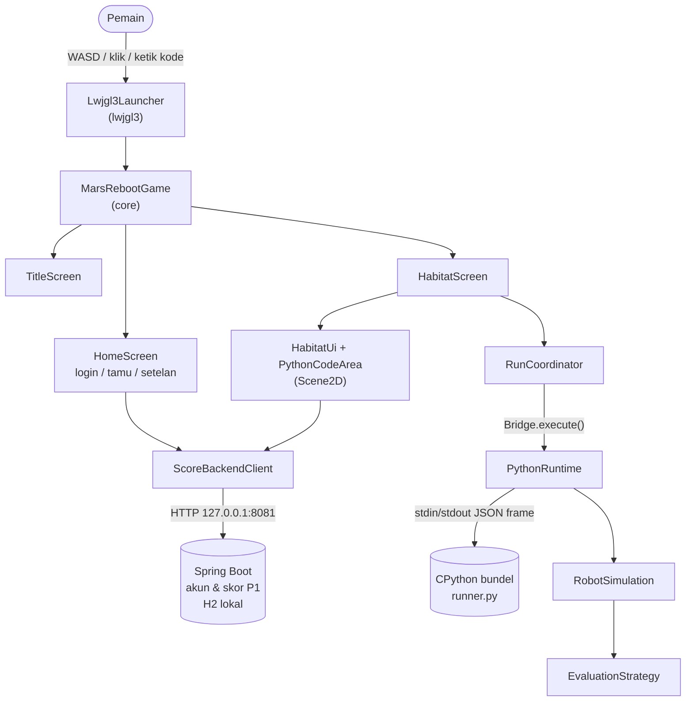
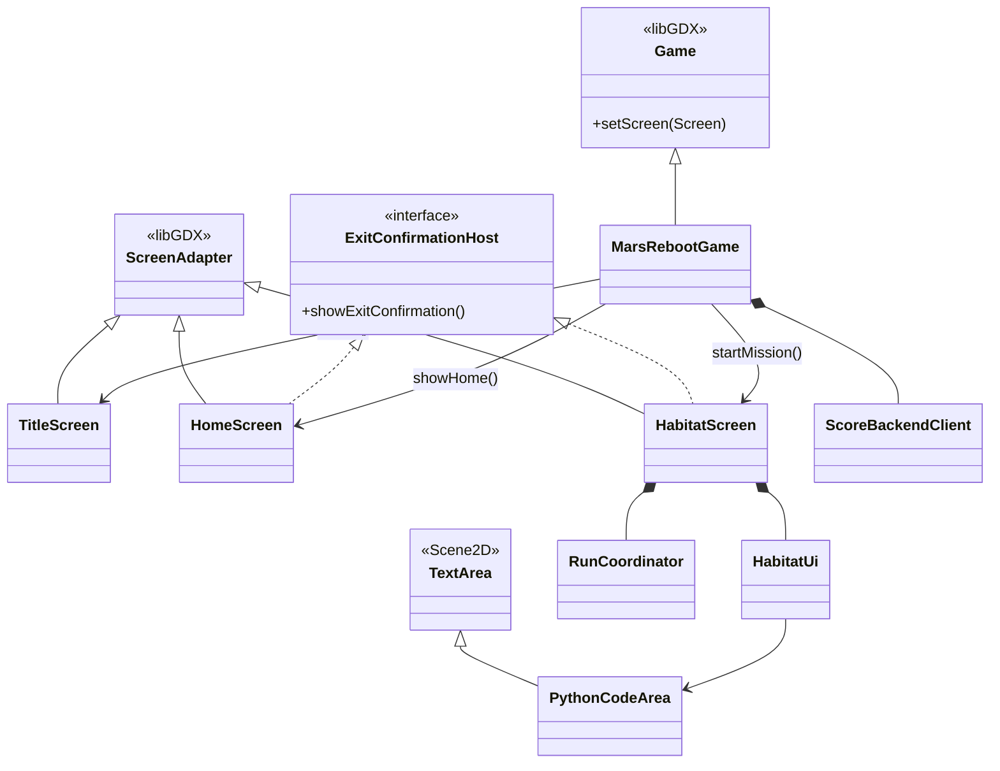
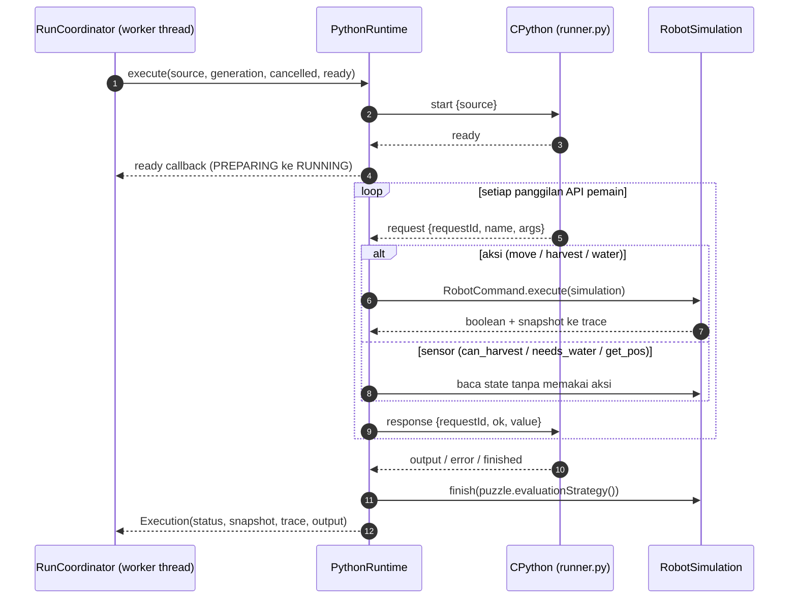
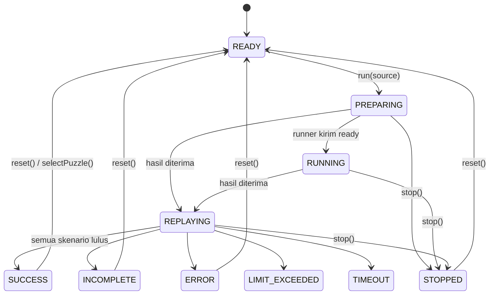
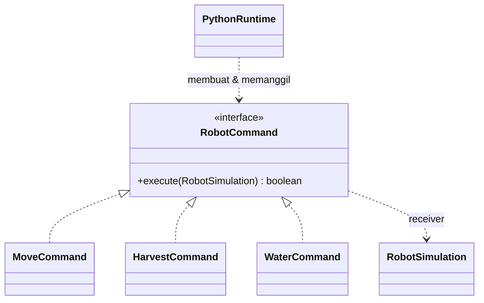
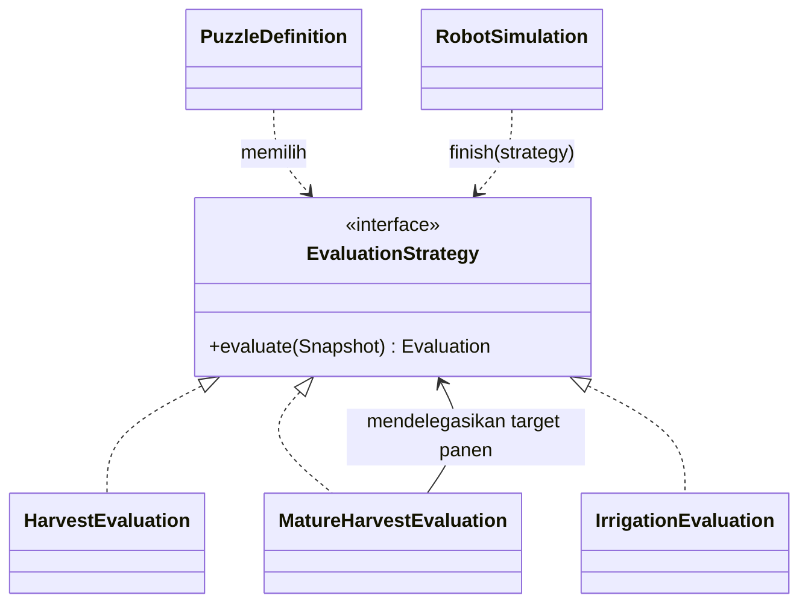
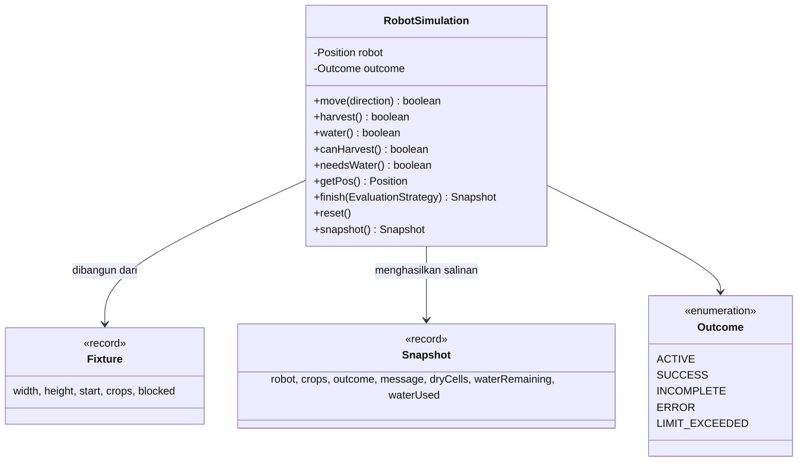
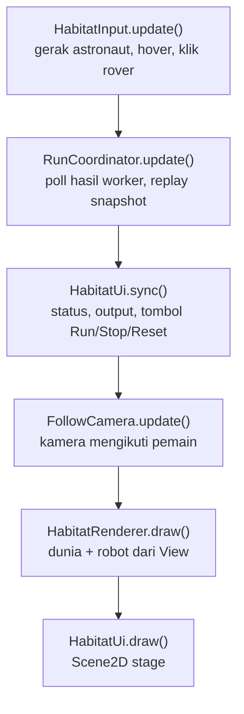
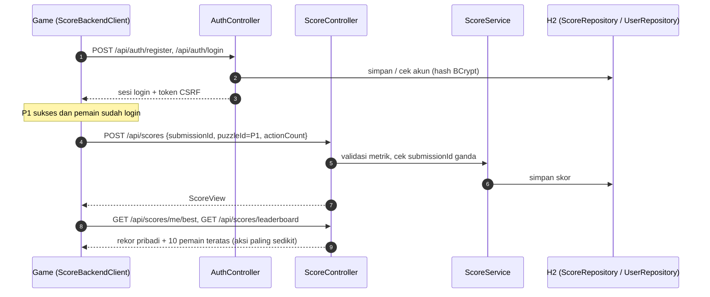

# mars_reboot.py — Dokumentasi Arsitektur Teknis


**mars_reboot.py** adalah game puzzle pemrograman 2D: pemain menulis kode Python untuk mengendalikan rover yang memulihkan habitat di Mars. Repository ini berisi game Java/libGDX, dokumentasi, aset, dan skill Codex–Antigravity tim dalam satu clone. Proyek terbagi menjadi tiga modul utama:

1. **Klien desktop (libGDX, Java 21)** — modul `core` (game, domain robot, runtime) dan `lwjgl3` (launcher desktop, paket Windows).
2. **Runtime Python bundel (CPython)** — proses terisolasi yang menjalankan kode pemain dan berkomunikasi dengan Java melalui protokol frame JSON.
3. **Backend lokal (Spring Boot)** — modul `backend` untuk akun, sesi login, dan papan skor P1.

Anggota tim baru mulai dari **[TEAM_GUIDE.md](TEAM_GUIDE.md)** dan **[TEAM_PROMPTS.md](TEAM_PROMPTS.md)**.

---

## Daftar Isi

1. [Gambaran Sistem & Stack Teknologi](#1-gambaran-sistem--stack-teknologi)
2. [Lifecycle Game & Screen (Pewarisan)](#2-lifecycle-game--screen-pewarisan)
3. [Runtime Python & Protokol Frame](#3-runtime-python--protokol-frame)
4. [RunCoordinator: State Percobaan & Replay](#4-runcoordinator-state-percobaan--replay)
5. [Aksi Robot (Command Pattern)](#5-aksi-robot-command-pattern)
6. [Evaluasi Puzzle (Strategy Pattern)](#6-evaluasi-puzzle-strategy-pattern)
7. [Domain Robot & Enkapsulasi State](#7-domain-robot--enkapsulasi-state)
8. [Habitat: Input, Kamera, Renderer & UI](#8-habitat-input-kamera-renderer--ui)
9. [Backend Akun & Papan Skor](#9-backend-akun--papan-skor)
10. [Cara Bermain: Puzzle P1–P4 & Editor Python](#10-cara-bermain-puzzle-p1p4--editor-python)
11. [Menjalankan & Memverifikasi Game](#11-menjalankan--memverifikasi-game)
12. [Status & Progres Pengerjaan](#12-status--progres-pengerjaan)
13. [Peta Dokumentasi & Kerja Bersama](#13-peta-dokumentasi--kerja-bersama)

---

## 1. Gambaran Sistem & Stack Teknologi



*   **Engine**: libGDX 1.14.2, LWJGL 3.4.3, Scene2D untuk UI.
*   **Bahasa & build**: Java 21 (source/target dan toolchain), Gradle Wrapper 9.8.0, app version 1.0.0. Jangan menurunkan/mengupgrade versi sepihak.
*   **Runtime pemain**: CPython bundel dalam ZIP Windows; konfigurasi di [runtime/python-runtime.json](runtime/python-runtime.json), kontrak di [PYTHON_RUNTIME](docs/mars/PYTHON_RUNTIME.md).
*   **Backend**: Spring Boot 4.1.2, Spring Security (sesi + CSRF, BCrypt), Spring Data JPA, database H2 file lokal di `backend/data`. Detail di [backend/README.md](backend/README.md).

---

## 2. Lifecycle Game & Screen (Pewarisan)

Alur layar memakai kelas dasar libGDX: [`MarsRebootGame`](core/src/main/java/com/marsreboot/MarsRebootGame.java) membuka [`TitleScreen`](core/src/main/java/com/marsreboot/TitleScreen.java), lalu [`HomeScreen`](core/src/main/java/com/marsreboot/HomeScreen.java) (masuk, daftar, tamu, setelan, papan skor), lalu [`HabitatScreen`](core/src/main/java/com/marsreboot/habitat/HabitatScreen.java). Layar sebelumnya selalu di-dispose. Satu `ScoreBackendClient` dipakai bersama dari Home sampai Habitat.



*   **`show()`** memasang `InputMultiplexer` (input dunia + stage UI).
*   **`hide()` / `dispose()`** menutup `RunCoordinator` (membatalkan percobaan aktif), melepas input, serta membuang UI dan renderer.
*   **Konfirmasi keluar**: tombol Keluar dan tombol tutup jendela memanggil `requestExitConfirmation()`; layar yang mengimplementasikan `ExitConfirmationHost` menampilkan [`ExitConfirmationDialog`](core/src/main/java/com/marsreboot/ExitConfirmationDialog.java).

---

## 3. Runtime Python & Protokol Frame

[`PythonRuntime`](core/src/main/java/com/marsreboot/runtime/PythonRuntime.java) menyalin [`runner.py`](assets/python/runner.py) ke folder sementara, lalu menjalankan CPython bundel dengan flag `-I -X utf8 -u -B` dan environment yang dikosongkan. Setiap frame dibungkus [`RuntimeProtocol`](core/src/main/java/com/marsreboot/runtime/RuntimeProtocol.java) (`protocolVersion`, `generation`, `runId`, `scenarioId`, `sequence`, `type`, `payload`).



> [!NOTE]
> Frame dari generation lama, `sequence` yang melompat, `requestId` tidak berurutan, atau frame setelah `finished` ditolak. Watchdog menghentikan proses saat Stop atau batas waktu (startup 15 s, komputasi 5 s). Batas lain: source 16 KiB, frame 16 KiB, trace 256 aksi, stderr 8 KiB. Proses Python **bukan** sandbox aman untuk script bermusuhan.

Puzzle multi-skenario (P4) menjalankan setiap skenario pada fixture dan proses Python baru.

---

## 4. RunCoordinator: State Percobaan & Replay

[`RunCoordinator`](core/src/main/java/com/marsreboot/runtime/RunCoordinator.java) berjalan di render thread. Eksekusi Python dikirim ke satu worker thread; hasilnya diputar ulang per snapshot (0,35 s per aksi), sehingga kecepatan animasi tidak memengaruhi hasil.



*   **Generation counter**: `stop()`/`reset()` menaikkan `generation` dan menyetel token pembatalan, sehingga hasil lama tidak pernah mengubah dunia atau progres baru.
*   **Progres sesi**: puzzle ditandai selesai hanya bila status akhir `SUCCESS` dan seluruh skenario wajib lulus. P2 terbuka setelah P1, P3 setelah P2, P4 setelah P3.
*   **Abstraksi**: `RunCoordinator.Bridge` memisahkan coordinator dari pengelolaan proses; test memakai implementasi tiruan, produksi memakai `PythonRuntime`.
*   **View**: UI dan renderer hanya membaca record `View` yang immutable.

---

## 5. Aksi Robot (Command Pattern)

`PythonRuntime` memvalidasi nama/argumen request, membuat objek command, lalu mengeksekusinya terhadap receiver `RobotSimulation`. Sensor tidak menjadi command dan tidak menambah trace.



Source: [`RobotCommand`](core/src/main/java/com/marsreboot/robot/RobotCommand.java), [`MoveCommand`](core/src/main/java/com/marsreboot/robot/MoveCommand.java), [`HarvestCommand`](core/src/main/java/com/marsreboot/robot/HarvestCommand.java), [`WaterCommand`](core/src/main/java/com/marsreboot/robot/WaterCommand.java).

---

## 6. Evaluasi Puzzle (Strategy Pattern)

[`PuzzleDefinition`](core/src/main/java/com/marsreboot/runtime/PuzzleDefinition.java) memilih kebijakan penilaian; `RobotSimulation.finish(strategy)` mengevaluasi snapshot immutable.



| Puzzle | Strategi | Aturan inti |
| --- | --- | --- |
| P1, P2 | `HarvestEvaluation` | Semua target matang terpanen. |
| P3 | `MatureHarvestEvaluation(HarvestEvaluation)` | Seperti dasar, tetapi gagal bila pernah memanen tanaman muda. |
| P4 | `IrrigationEvaluation` | Semua petak kering tersiram dalam batas air. |

> [!NOTE]
> Command dan Strategy sudah diimplementasikan dan diuji lokal ([`PatternBehaviorTest`](core/src/test/java/com/marsreboot/robot/PatternBehaviorTest.java)). Kandidat pattern lain (State, Observer, Factory Method, Template Method) masih usulan; status lengkap ada di [audit OOP/pattern](docs/mars/OOP_AUDIT.md).

---

## 7. Domain Robot & Enkapsulasi State

[`RobotSimulation`](core/src/main/java/com/marsreboot/robot/RobotSimulation.java) adalah satu-satunya pemilik mutasi dunia puzzle. State bersifat private; dunia hanya berubah melalui aksi.



*   **Fixture deterministik**: fixture sama pada setiap Run; tidak ada random, wall clock, atau FPS dalam mekanik.
*   **Salinan defensif**: `Fixture` dan `Snapshot` menyalin collection agar UI/renderer tidak bisa mengubah domain.
*   **Batas aksi**: melewati batas menghasilkan `LIMIT_EXCEEDED`; pemanggilan API setelah skenario selesai ditolak.

---

## 8. Habitat: Input, Kamera, Renderer & UI

Satu frame `HabitatScreen.render()` mengikuti urutan tetap; renderer tidak menghitung aturan, hanya menggambar `View`.



*   [`HabitatWorld`](core/src/main/java/com/marsreboot/habitat/HabitatWorld.java): posisi astronaut, collision, dan interaksi dasar.
*   [`HabitatInput`](core/src/main/java/com/marsreboot/habitat/HabitatInput.java) + [`FollowCamera`](core/src/main/java/com/marsreboot/habitat/FollowCamera.java): kontrol WASD/panah, E untuk interaksi, klik rover; reduced motion dihormati.
*   [`HabitatUi`](core/src/main/java/com/marsreboot/habitat/HabitatUi.java): panel inspeksi, terminal editor, pemilih puzzle, log, dan pengaturan.
*   [`PythonEditing`](core/src/main/java/com/marsreboot/habitat/PythonEditing.java) + [`PythonCodeArea`](core/src/main/java/com/marsreboot/habitat/PythonCodeArea.java): bantuan mengetik di editor.
*   [`SoundBank`](core/src/main/java/com/marsreboot/habitat/SoundBank.java): efek suara game; panduan dan pekerjaan audio terbuka di [AUDIO](docs/mars/AUDIO.md).

---

## 9. Backend Akun & Papan Skor

Modul [`backend`](backend/README.md) adalah aplikasi Spring Boot lokal di `127.0.0.1:8081`. Game memanggilnya lewat [`ScoreBackendClient`](core/src/main/java/com/marsreboot/habitat/ScoreBackendClient.java); alurnya controller → service → repository.



*   **Hanya P1**: backend dan klien saat ini memakai `puzzleId=P1`, `fixtureVersion=p1-a`. Hasil P2–P4 tidak dikirim, supaya tidak tercampur ke papan skor P1.
*   **Kirim ulang aman**: `submissionId` yang sama tidak membuat skor ganda.
*   **Batas**: database H2 berada di komputer yang menjalankan backend, jadi papan skor belum dibagi antarkomputer. Kontrak API draf ada di [`backend/openapi.yaml`](backend/openapi.yaml).

---

## 10. Cara Bermain: Puzzle P1–P4 & Editor Python

Dari Home, masuk/daftar akun atau pilih bermain sebagai tamu, lalu **Mulai misi**. Di habitat, dekati terminal atau klik Rover untuk membuka editor. **Run** menjalankan kode, **Stop** menghentikan program, **Reset** memulihkan fixture tanpa menghapus draf, **Esc** menutup terminal. **[M]** membuka Peta Misi (rekor pribadi dan **Muat skor** untuk papan skor P1). Draf dan progres disimpan per puzzle selama sesi, belum lintas restart. Target lengkap 9 puzzle dalam 3 misi; saat ini P1–P4 tersedia.

| Tombol | Aksi |
| --- | --- |
| WASD / panah | Bergerak |
| E | Berinteraksi dengan terminal atau objek |
| Esc | Menutup panel atau editor |
| M | Membuka Peta Misi dan papan skor |

| Puzzle | Konsep | Batas aksi | Referensi |
| --- | --- | --- | --- |
| P1 Panen | Pemanggilan fungsi | 6 | 3 aksi (panen → `move("east")` → panen) |
| P2 Loop | `for` | 12 | 7 aksi (4 panen + 3 gerak) |
| P3 Sensor | `if` + `can_harvest()` | 12 | 5 aksi (2 panen + 3 gerak) |
| P4 Irigasi | Sensor + sumber daya | 12 per skenario | 10 aksi / 4 air total (dua skenario) |

<details>
<summary><b>P2 — Loop</b>: panen empat tanaman di x=0..3</summary>

```python
for x in range(4):
    harvest()
    if x < 3:
        move("east")
```

Hasil menilai tujuan dunia; **penggunaan loop belum diverifikasi otomatis**. Test fokus: `.\gradlew.bat :core:puzzleProgressTest`.
</details>

<details>
<summary><b>P3 — Sensor tanaman</b>: panen hanya yang matang</summary>

Tanaman matang di x=0,2 dan muda di x=1,3. Memanen tanaman muda membuat percobaan tidak lulus walaupun semua target matang habis. Tanaman muda tidak tumbuh selama Run.

```python
for x in range(4):
    if can_harvest():
        harvest()
    if x < 3:
        move("east")
```
</details>

<details>
<summary><b>P4 — Dua skenario irigasi</b>: kode yang sama harus lulus p4-a dan p4-b</summary>

p4-a kering di x=0,2; p4-b kering di x=1,3. Tiap skenario mulai dari fixture/proses baru dengan 2 unit air. `needs_water()` tidak memakai aksi; menyiram petak lembap tetap membuang 1 air; `water()` saat air habis mengembalikan `False` dan tetap memakai satu aksi.

```python
for x in range(4):
    if needs_water():
        water()
    if x < 3:
        move("east")
```

Pencapaian berlaku setelah kedua skenario dan replay lulus; hardcode posisi p4-a tidak cukup. Test fokus: `.\gradlew.bat :core:waterSimulationTest :core:waterPuzzleTest :lwjgl3:puzzleDesktopTest`.
</details>

<details>
<summary><b>Bantuan mengetik di editor</b></summary>

*   `(`, `[`, `{`, dan tanda kutip langsung berpasangan, kursor di tengah.
*   Enter setelah baris berakhir `:` menambah indentasi empat spasi; baris biasa mempertahankan indentasi.
*   Tab/Shift+Tab mengindentasi atau mengurangi indentasi (juga untuk beberapa baris terpilih).
*   Backspace pada indentasi menghapus ke batas empat spasi; di tengah pasangan kosong menghapus keduanya.
*   Mengetik penutup yang sudah ada akan melewatinya; seleksi teks lalu ketik pembuka untuk membungkusnya. Ctrl+Z memakai Undo bawaan.

Ini bantuan pengetikan lokal, bukan pemeriksa sintaks atau auto-complete. Test fokus: `.\gradlew.bat :core:editorTest :lwjgl3:puzzleDesktopTest`.
</details>

---

## 11. Menjalankan & Memverifikasi Game

Buka root repository di IntelliJ sebagai proyek Gradle dengan **JDK 21**. Untuk daftar/masuk dan simpan skor, jalankan backend dulu di terminal terpisah dan biarkan tetap berjalan (tanpa backend, game tetap bisa dimainkan sebagai tamu):

```powershell
.\backend\gradlew.bat bootRun
```

Lalu dari root clone pada Windows:

```powershell
# Gate P1–P4 tanpa window OpenGL (Windows x64, memakai Python bundel):
.\gradlew.bat verifyDemo
# Menjalankan game:
.\gradlew.bat :lwjgl3:run
# Gate lengkap termasuk dua suite desktop/OpenGL:
.\gradlew.bat verifyDesktopDemo
# Paket Windows + Python:
.\gradlew.bat :lwjgl3:bundleWindows
```

*   Di IntelliJ jalankan task `lwjgl3/application/run`; task ini menyiapkan Python bundel otomatis. Untuk menjalankan launcher langsung, jalankan `:lwjgl3:preparePython` sekali dahulu. Sinkronisasi pertama membutuhkan jaringan.
*   Paket uji: `lwjgl3/build/distributions/MarsReboot-1.0.0-windows-x64.zip`. Ekstrak seluruhnya lalu buka `run.bat` (Java 21+). Jangan hanya membagikan JAR tanpa folder runtime.
*   `verifyDesktopDemo` mencakup `verifyDemo`. Build biasa hanya menjalankan suite Java tanpa proses Python/window desktop. ZIP/TAR generik dari task `build` tidak menyertakan runtime Python.

> [!NOTE]
> Suite adalah program JavaExec, bukan JUnit; kegagalan assertion tetap menggagalkan Gradle. Bukti aktual ada di [VERIFICATION](VERIFICATION.md). Paket sudah diuji pada satu mesin; komputer kedua belum diuji.

---

## 12. Status & Progres Pengerjaan

Pembaruan: **23 November 2026** (gabungan branch P1–P4 dan backend/Home). Python 3.15.2 disertakan pada ZIP Windows. Puzzle 5–9, save lintas restart, papan skor lintas komputer dan komputer kedua belum selesai. Handoff terakhir di [TASKS](TASKS.md) dan bukti di [VERIFICATION](VERIFICATION.md) menjadi acuan.

**Legenda:** ✅ selesai untuk cakupan tertulis · 🟡 sebagian · ⬜ belum selesai/menunggu keputusan · ⛔ terhambat.

| Status | Pekerjaan / hasil yang dituju | Penanggung jawab | Bukti saat ini / yang masih perlu dilakukan |
| --- | --- | --- | --- |
| ✅ | Dokumen perencanaan, panduan tim, prompt, dan paket skill tersedia dalam repo | Semua; satu editor dokumen | Konteks telah dikonsolidasikan; keputusan teknis bertanda Usulan tetap perlu dipilih. Discovery skill pada laptop anggota belum diuji. |
| ✅ | Arah visual dan referensi layar | 3 — Dunia/UI | Referensi desain tersedia di docs/mars/design-refs; bukan persetujuan seluruh aset produksi. |
| 🟡 | Fondasi proyek libGDX dan toolchain tim | 1 + 4 | Modul core/lwjgl3 serta launcher tersedia; keberhasilan Wrapper/JDK pada seluruh komputer belum dibuktikan. |
| ✅ | Habitat, gerak astronaut, collision, dan interaksi dasar dalam cakupan test existing | 3 — Dunia/UI | Catatan 40 assertion kontrol dan 29 assertion desktop lulus; bukan klaim seluruh pengujian keyboard/mouse manual selesai. |
| ✅ | Panel inspeksi dan terminal editor sementara | 3 — Dunia/UI | Buka/tutup, fokus dan draf sesi telah diperiksa; terminal kini mengeksekusi Python nyata pada p1; editor penuh masih perlu penerimaan manusia. |
| 🟡 | UI outpost, HUD, log, peta misi, bantuan dan pengaturan | 3 — Dunia/UI | Layar/preview tersedia; perlu dihubungkan ke state gameplay nyata dan pemeriksaan manual lengkap. |
| ✅ | Test fokus dan paket desktop melalui Gradle Wrapper | 1 + 4 | 19 Nov: build, verifyDesktopDemo dan bundleWindows lulus pada mesin ini. Gate menjalankan domain, editor, lifecycle, Python nyata dan 139 pemeriksaan desktop. Komputer kedua belum diuji. |
| 🟡 | Konfirmasi bahasa pemain dan keputusan runtime | Tim + aslab; pemilik 1 | CPython bundel dipilih/teruji untuk eksperimen p1; konfirmasi bahasa ke aslab masih terbuka. M-01/M-04. |
| 🟡 | Kontrak API robot, fixture, batas, skor, dan HTTP | 1 + 2 + 4 | Draft tersedia; finalisasi dan validasi bersama pemilik UI sebelum implementasi paralel. M-07/M-09. |
| ✅ | Domain robot Java untuk kandidat P1–P4 | 1 — Simulasi/runtime | Gerak/panen/sensor/siram, air, reset dan batas teruji. 81 pemeriksaan domain existing + 21 domain air. Penerimaan produk/fixture tetap dibedakan dari implementasi. |
| ✅ | Runtime Python P1–P4 serta Run/Stop/Reset/error/timeout | 1 — Simulasi/runtime | P4 memakai dua proses/skenario baru; 33 pemeriksaan integrasi/progres P4 dan 109 desktop P1–P4 lulus. Lingkup lokal Windows x64. |
| 🟡 | Puzzle 1 dan evaluator berhasil/gagal | 2 — Puzzle/evaluasi | Kandidat p1-a berjalan melalui terminal Python, replay dan progres sesi; review fixture/penerimaan tim belum selesai. M-16. |
| 🟡 | Registrasi, login dan sesi backend | 4 — Backend/distribusi | Spring Boot lokal + Home login/daftar/tamu tersedia; register/login pernah dicoba manual lewat PowerShell. Test autentikasi otomatis belum ada. M-12. |
| 🟡 | Penyimpanan/pengambilan skor dan rekor | 4 — Backend/distribusi | Skor P1, rekor pribadi dan papan skor 10 teratas tersedia; uji isolasi multiakun, persistensi dan retry belum dibuktikan. M-13. |
| ⬜ | Satu alur terintegrasi dari login sampai skor tersimpan | Semua | Source alur login → terminal → robot → evaluasi → simpan skor P1 sudah ada; belum diuji ujung ke ujung pada desktop. M-17. |
| 🟡 | Puzzle 2–4 dan latihan konsep yang dipilih | 2 + 3, integrasi 1 | P2 panen/loop, P3 sensor/young dan P4 irigasi dua skenario terintegrasi; verifikator konsep/penerimaan tim masih terbuka. M-18–20. |
| 🟡 | Progres dan pemulihan habitat dari hasil puzzle nyata | 1 + 2 + 3 | P1 selesai selama sesi setelah replay sah; seluruh habitat/misi belum terhubung. Before/After tetap preview. M-21. |
| ⬜ | Save kode/progres lintas sesi dan retry skor, jika dipilih | 1 + 4 | Pilih kebijakan dahulu, lalu uji buka ulang, data rusak, profil dan jaringan. M-22. |
| 🟡 | Empat pilar OOP dan minimal enam pattern pada kode/demo | Semua | [Audit source](docs/mars/OOP_AUDIT.md): Command dan Strategy terimplementasi/teruji lokal. Empat kandidat lain, validasi materi dan demo masih terbuka. M-23. |
| 🟡 | Aset, audio, aksesibilitas dan UX produksi | 3 — Dunia/UI | Placeholder dan visual dasar ada; font ukuran kecil, audio serta validasi lengkap masih terbuka. M-24/M-30. |
| ⬜ | Puzzle 5–9, misi pompa, dan penutup | 2 + 1 + 3 | Rinci kontrak/fixture lanjutan lalu uji seluruh skenario. Target tetap 9 puzzle. M-26–29. |
| ⬜ | Playtest manusia dan perbaikan berdasarkan observasi | Semua; pencatat 2 | Belum ada hasil playtest nyata. M-25/M-31. |
| ⬜ | Paket rilis pada komputer anggota lain | 4, didukung semua | Uji artefak final, runtime dan koneksi backend dengan panduan yang dapat diikuti. M-06/M-32. |
| ⬜ | Kelengkapan dan pengumpulan luaran SOP | Semua; editor 2 | Proposal/PMP/GDD, laporan, kontribusi, video dan kredit; status pengumpulan belum dibuktikan. M-33. |
| ⬜ | Publikasi game dan pemeriksaan tautan rilis | 4 + otorisasi pengguna | Bedakan paket lokal, push source GitHub, dan rilis game yang benar-benar dapat dimainkan. M-34. |

**Prioritas berikutnya:** tim mencoba P1–P4, meninjau fixture/keterbacaan editor dan mengonfirmasi bahasa ke aslab. Selesaikan kekurangan [audit OOP/pattern](docs/mars/OOP_AUDIT.md); backend dilanjutkan pemilik peran 4 sesuai handoff.

**Cara memperbarui:** ubah simbol dan catatan setelah ada deliverable serta bukti; perbarui TASKS/VERIFICATION dalam perubahan yang sama. Jangan mencentang pekerjaan hanya karena mockup, preview, atau rencana tersedia. Penanggung jawab masih nomor peran sampai nama anggota ditetapkan.

---

## 13. Peta Dokumentasi & Kerja Bersama

| Dokumen | Acuan |
| --- | --- |
| [AGENTS](AGENTS.md) | Instruksi kerja manusia/AI dan batas otorisasi. |
| [TEAM_GUIDE](TEAM_GUIDE.md) / [TEAM_PROMPTS](TEAM_PROMPTS.md) | Onboarding tim, urutan milestone, ownership, kontribusi dan prompt. |
| [PROJECT](PROJECT.md) | Keputusan pengguna, SOP dan strategi kolaborasi. |
| [PRD](PRD.md) / [RULES](RULES.md) | Kebutuhan serta aturan/fixture kandidat. |
| [ARCHITECTURE](ARCHITECTURE.md) / [DESIGN](DESIGN.md) | Kontrak teknis dan UX/visual. |
| [TEST_PLAN](TEST_PLAN.md) / [VERIFICATION](VERIFICATION.md) | Rencana pemeriksaan versus bukti aktual. |
| [TASKS](TASKS.md) | Backlog, dependensi, dan handoff terbaru. |
| [BACKEND_HANDOFF](BACKEND_HANDOFF.md) / [backend/README](backend/README.md) | Batas akun/skor, endpoint, dan cara membaca kode backend. |
| [Audit OOP/pattern](docs/mars/OOP_AUDIT.md) | Bukti source, kekurangan enam kandidat, dan langkah kerja tim. |
| [Kontrak runtime Python](docs/mars/PYTHON_RUNTIME.md) | Protokol, batas, dan paket runtime bundel. |
| [Panduan audio](docs/mars/AUDIO.md) | Lokasi SFX, cara menambah suara/musik, dan pekerjaan audio yang masih terbuka. |
| [SKILLS](SKILLS.md) / [skills-lock.json](skills-lock.json) | Paket skill bersama. |
| [PROTOTYPE](PROTOTYPE.md) | Referensi Farm Code Lab, source opsional di prototype-web/. |

Referensi visual berada di `docs/mars/design-refs/`, arsip prototype di `docs/prototype/`, dan salinan SOP lokal di `docs/references/sop/`.

### Kerja bersama

*   Tetapkan satu tugas kecil per anggota, pemilik file, reviewer, dan kontrak yang sama.
*   Pakai clone/worktree terpisah, branch per tugas, test fokus, review silang, lalu integrasi/demo.
*   Setiap anggota memahami kodenya dan melakukan kontribusi Git dengan identitas sendiri; jumlah push bukan ukuran tunggal pemerataan.
*   Buka Codex/Antigravity pada root clone agar `AGENTS.md` dan `.agents/skills` terbaca. Jangan menginstal ulang seluruh koleksi skill, menjalankan script skill otomatis, atau berbagi credential.
*   Folder `build/`, `.gradle/`, dan `.idea/` bukan konteks tim.
