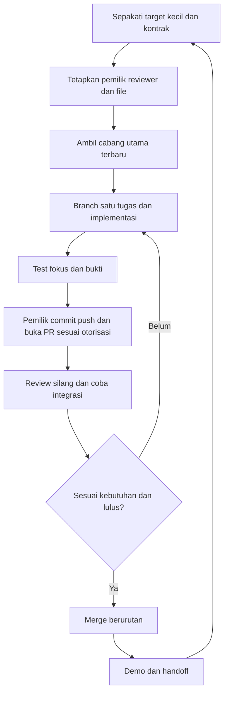

# TEAM_GUIDE — Mulai kerja bersama mars_reboot.py

Panduan tim, 13 November 2026. Buka **root clone MarsReboot**: folder yang memuat settings.gradle, gradlew, core/, lwjgl3/, dan AGENTS.md. Dokumentasi, source game, aset, dan skill sekarang berada pada satu repo. Nama orang/koordinator dan assignment tugas masih harus diisi tim; empat peran di bawah adalah pembagian yang disarankan, bukan nama kontributor rekaan.

## 1. Game yang sedang dibuat

Pemain menjadi astronaut yang menyelidiki kerusakan habitat Mars. Dari panel/inspeksi, pemain memahami masalah, lalu menulis program di terminal untuk robot. Robot memanen, menyiram dan mencari jalan; keberhasilan program memulihkan habitat. Target **9 puzzle dalam 3 misi**, dikerjakan mulai **puzzle 1–4**.

- **Sudah tersedia berdasarkan bukti terdahulu:** habitat, gerak/collision astronaut, interaksi, panel, terminal multiline sementara, visual outpost dan layar preview. Periksa source/handoff terbaru sebelum mengklaim status lebih jauh.
- **Belum tersedia sebagai gameplay nyata:** simulasi/evaluator robot, runtime Python, alur Run/Stop puzzle, autentikasi/skor backend serta progres puzzle lengkap. Tampilan akun/hasil/Before–After dapat berupa preview, bukan integrasi.
- **Keputusan terbuka:** konfirmasi Python ke aslab, runtime, kontrak API/skor, backend/database/sesi, paket final, dan rincian konten. Rancangan bertanda Usulan bukan keputusan final pengguna.

Sumber: [PROJECT](PROJECT.md), [PRD](PRD.md), [RULES](RULES.md), dan [bukti aktual](VERIFICATION.md). Jangan menambah combat, crafting, survival timer, multiplayer, atau engine baru dari ide AI sendiri.

## 2. Peta folder dan acuan

| Lokasi | Tanggung jawab |
| --- | --- |
| core/src/main/java/com/marsreboot/ | Game Java; habitat/ berisi state, input, renderer, UI dan lifecycle existing. |
| lwjgl3/ | Launcher dan bagian desktop serta smoke test existing. |
| assets/ | Skin dan aset game; pertahankan asal/lisensi/manifest. |
| gradle/, gradlew, gradlew.bat | Wrapper/toolchain existing; ikut repo, jangan memakai versi Gradle global sembarang. |
| Dokumen root | Kebutuhan, aturan, rancangan, task, handoff dan bukti utama Mars. |
| docs/mars/design-refs/ | Referensi visual yang dibundel; berguna tanpa akses Figma. |
| .agents/skills/ + skills-lock.json | Paket skill yang sama untuk Codex/Antigravity; tool eksternal tidak otomatis terpasang. |
| prototype-web/ + docs/prototype/ | Source dan arsip web lama untuk referensi; bukan game Mars atau backend. |

Backend belum dibuat/disatukan build; jangan menganggap ada folder backend aktif atau membuat backend kedua tanpa membaca handoff. Batas root/modul ditetapkan pada tugas bootstrap terkait.

## 3. Pertama kali clone

1. Clone URL repo yang diberikan koordinator, lalu buka root MarsReboot di IntelliJ dan AI. Saat dokumen ini dibuat belum ada commit/push konteks dari sesi konsolidasi; teman baru mendapat file setelah pemilik meninjau dan memublikasikannya melalui Git.
2. Gunakan identitas Git sendiri. Pastikan email author terhubung ke akun GitHub masing-masing; jangan memakai akun/token bersama. Periksa cabang utama serta remote repo yang sebenarnya, jangan mengasumsikan namanya.
3. Ikuti versi existing: source/target **Java 21**, libGDX **1.14.2**, LWJGL **3.4.3**, Wrapper **9.8.0**, app version **1.0.0**. File Gradle menjadi acuan aktual. JDK 17 tidak dapat mengompilasi target 21; jangan mengubah target/dependency sepihak. Project SDK dan toolchain daemon perlu cocok. Runtime 25 dengan javac --release 21 pernah dipakai sebagai pemeriksaan alternatif, bukan bukti runtime 21 atau Wrapper lulus.
4. Tunggu import/sync Gradle. Unduhan Wrapper/toolchain/dependency memerlukan jaringan pada mesin yang belum punya cache. Jangan berharap cache .gradle-local milik pembuat ikut clone atau memasang software global otomatis.
5. Jalankan dari root clone:

```powershell
.\gradlew.bat :core:controlTest
.\gradlew.bat :lwjgl3:run
# Opsional setelah desktop tersedia:
.\gradlew.bat :lwjgl3:desktopSmokeTest
```

Untuk build: `.\gradlew.bat :lwjgl3:jar` atau `.\gradlew.bat build`. Di IntelliJ gunakan task lwjgl3/application/run atau launcher Lwjgl3Launcher dengan working directory assets. Jangan Run kelas game core langsung. Semua command di atas adalah petunjuk dari task existing; cek [VERIFICATION](VERIFICATION.md): Wrapper pernah terhambat unduhan, jadi hasil mesin masing-masing harus dicatat, bukan dianggap otomatis PASS.

6. Coba berjalan, panel/terminal, Esc, fokus editor dan resize. Laporkan masalah sebelum mengerjakan fitur besar. Source dan UI existing tidak perlu digenerate ulang.
7. Buka sesi baru Codex/Antigravity pada root clone. Baca [SKILLS](SKILLS.md) dan minta AI membaca satu skill relevan. Bedakan file tersedia, discovery aplikasi, dependency tool, dan uji menjalankan tugas. Tidak perlu memasang Node/npm untuk game desktop; itu diperlukan hanya jika mengerjakan prototype atau tool skill yang relevan.

## 4. Pembagian empat anggota dan urutan hasil

| Peran | Hasil kode utama | Bukti dan pasangan integrasi |
| --- | --- | --- |
| 1 Simulasi/runtime | Grid robot, aksi/sensor, coordinator, Python dan pembatalan | Unit domain/runtime; kontrak dengan 2 dan 3. |
| 2 Puzzle/progres | Fixture, evaluator, tutorial, reference test, progres | Referensi benar/salah, variasi skenario; hasil untuk 3 dan 4. |
| 3 Dunia/UI | Kontrol, renderer, terminal/HUD, visual/audio | Desktop nyata, fokus/resize, state mengikuti Java; tidak menghitung aturan sendiri. |
| 4 Backend/distribusi | Akun/sesi, skor, HTTP client, paket/panduan | Isolasi akun, retry dan persistensi, mesin kedua; baca [BACKEND_HANDOFF](BACKEND_HANDOFF.md). |

Tiap anggota mendapat satu tugas kode yang sebanding kompleksitasnya, bukti pengujian, satu review silang, dan demo penjelasan. Bagikan tugas kecil tambahan jika beban runtime/UI membesar; kepemilikan bisa dialihkan secara eksplisit. Banyak push atau baris kode bukan ukuran tunggal kontribusi. AI membantu, tetapi manusia pemilik wajib memahami dan menjelaskan kodenya.

Urutan bersama mengikuti [TASKS](TASKS.md):

1. Konfirmasi keputusan penting dan kontrak, periksa build/runtime/editor (M-01–09), gunakan hasil existing dan jangan mengulang bootstrap libGDX.
2. Selesaikan satu puzzle panen: domain robot → evaluator/reference → runtime → terminal nyata. Backend bisa membangun autentikasi/skor paralel dengan kontrak yang sama; integrasi login → panel → terminal → hasil → simpan/ambil skor menjadi gerbang berikutnya (M-10–17).
3. Lengkapi puzzle 2–4, progres, ketahanan, OOP/pattern, dan playtest demo (M-18–25).
4. Setelah demo stabil, lengkapi konten 5–9, aset/UX, distribusi dan luaran SOP (M-26–34). Proposal/GDD/laporan serta bukti pattern dimulai sejak awal sesuai tenggatnya, bukan menunggu game selesai.

## 5. Satu tugas sampai menjadi kontribusi bersama



- Gunakan clone/worktree sendiri ketika paralel, bukan satu folder OneDrive yang diedit bersama. Branch per tugas, misalnya codex/M-10-robot-command; nama cabang utama mengikuti repo.
- Satu editor untuk build/settings, DTO/OpenAPI, fixture/aturan, dan dokumen bersama per tugas. Perubahan kontrak diumumkan dahulu; pemilik sisi pemakai meninjau contoh payload yang sama.
- Reviewer berbeda dari penulis, mencoba kasus sukses/gagal dan dapat menjelaskan input/output. Review AI tidak menggantikan penjelasan manusia.
- Jangan force push, menimpa edit orang lain, atau menggabungkan fitur gagal untuk mengejar jumlah kontribusi. Commit/push/merge/deployment dilakukan hanya sesuai otorisasi sesi; sesi konsolidasi ini tidak melakukannya.
- PR menyebut tugas, perilaku berubah, file/kontrak terdampak, cara mencoba, hasil test aktual, keterbatasan, dan reviewer. Handoff TASKS mencatat yang sama untuk AI sesi berikutnya.

## 6. Kapan boleh disebut selesai

Kode terimplementasi, unit test, integrasi nyata, desktop teruji, dan deployment adalah status berbeda. Mock/preview tidak boleh menggantikan bukti. Jaga determinisme, Stop/Reset/error mempertahankan source, hasil lama tidak mengubah run baru, dan animasi tidak mengubah skor. Source/output pemain tidak dikirim backend. Jangan mengklaim runtime aman untuk script bermusuhan.

Gunakan [TEST_PLAN](TEST_PLAN.md) dan catat hasil di [VERIFICATION](VERIFICATION.md). Paket build/cache lokal/screenshot di build/ dapat tidak ikut clone; referensi visual docs dibundel, bukti yang dibagikan harus benar-benar tersedia. Pilih satu tugas berikutnya bersama koordinator; prompt siap pakai ada di [TEAM_PROMPTS](TEAM_PROMPTS.md).
