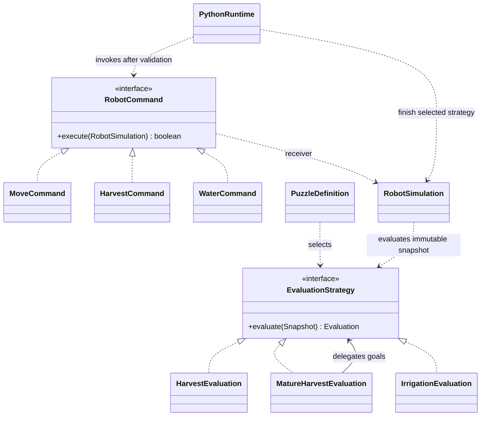

# Audit OOP dan design pattern — 19 November 2026

Status: **audit source lokal**, bukan persetujuan aslab atau bukti enam pattern telah terpenuhi. Target tetap 9 puzzle/3 misi; kode yang diperiksa mencakup kandidat P1–P4. Keputusan dan kewajiban tetap di [PROJECT §8–9](../../PROJECT.md); rancangan pattern di [ARCHITECTURE](../../ARCHITECTURE.md). Audit ini tidak mengganti kedua spesifikasi tersebut.

## Empat pilar: bukti yang tersedia

| Pilar | Bukti source | Perilaku / pemeriksaan | Batas bukti |
| --- | --- | --- | --- |
| Enkapsulasi | [RobotSimulation](../../core/src/main/java/com/marsreboot/robot/RobotSimulation.java): state private, mutasi melalui aksi; Fixture/Snapshot menyalin collection | robotTest: sensorsAndSnapshots, partialAndReset, invalidFixtures; waterSimulationTest: air/target/batas | Terbukti pada domain robot; tidak otomatis membuktikan save/backend. |
| Abstraksi | [RunCoordinator.Bridge](../../core/src/main/java/com/marsreboot/runtime/RunCoordinator.java): kontrak execute/forPuzzle; coordinator tidak mengelola pipe proses | runtimeTest memakai implementasi tiruan; pythonIntegrationTest memakai proses CPython nyata | Nama Bridge adalah nama interface, bukan klaim pattern GoF Bridge. |
| Pewarisan | [MarsRebootGame](../../core/src/main/java/com/marsreboot/MarsRebootGame.java) extends Game; [HabitatScreen](../../core/src/main/java/com/marsreboot/habitat/HabitatScreen.java) extends ScreenAdapter; [PythonCodeArea](../../core/src/main/java/com/marsreboot/habitat/PythonCodeArea.java) extends TextArea | desktopSmokeTest menjalankan screen/lifecycle; puzzleDesktopTest memeriksa input editor turunan TextArea | Pewarisan framework nyata; hierarki jenis misi yang direncanakan belum ada. Kesesuaian rubrik perlu dicocokkan tim/aslab. |
| Polimorfisme | [PythonRuntime](../../core/src/main/java/com/marsreboot/runtime/PythonRuntime.java) implements Bridge; coordinator memanggil execute melalui kontrak tersebut; callback Screen/TextArea di-override | runtimeTest mengganti implementasi Bridge; integrasi Python dan desktop menjalankan implementasi produksi | Implementasi tiruan adalah bukti substitusi saat test, bukan fitur runtime alternatif produksi. |

## Enam kandidat: dua terimplementasi, empat masih terbuka

| Kandidat dipilih dalam rancangan | Yang benar-benar ada | Kekurangan terhadap rancangan | Usulan langkah kecil / pemilik |
| --- | --- | --- | --- |
| Command | PythonRuntime memvalidasi frame/argumen, membuat MoveCommand/HarvestCommand/WaterCommand, lalu mengeksekusi melalui RobotCommand.execute(receiver) | Terimplementasi lokal; tidak mencakup query sensor atau undo | patternTest memeriksa hasil/biaya/error setara domain langsung; integrasi Python/desktop membuktikan pemakaian produksi. Peran 1. |
| State | RunCoordinator.Status enum dan kondisi lifecycle | FSM manual sudah bekerja, tetapi belum state object yang menentukan perilaku sesuai kandidat GoF State | Peran 1 + 3: pisahkan perilaku fase saat memang diperlukan; pertahankan pembatalan generation, cleanup dan commit sesudah replay. |
| Observer | HabitatUi.onAction memasang ChangeListener Scene2D | Ada listener framework, tetapi sinkronisasi hasil domain/HUD masih membaca coordinator.view(); belum observer perubahan domain milik game | Peran 3 + 1: kontrak notifikasi snapshot yang lifecycle-nya jelas, unsubscribe saat dispose; event lama tetap ditolak. Jangan hitung listener tombol sebagai seluruh rancangan domain. |
| Factory Method | PuzzleDefinition.fixture(index) membuat fixture dengan percabangan enum | Ini pembuatan sederhana; belum creator dengan factory method yang dioverride jenis pembuat misi | Peran 2: buktikan kebutuhan jenis misi/creator berbeda dahulu, lalu creation point melalui kontrak; switch saja tidak cukup. |
| Strategy | PuzzleDefinition memilih HarvestEvaluation (P1/P2), MatureHarvestEvaluation(HarvestEvaluation) (P3), IrrigationEvaluation (P4) melalui EvaluationStrategy | Terimplementasi lokal; persetujuan materi/aslab belum dibuktikan | patternTest membuktikan satu snapshot diterima kebijakan dasar tetapi ditolak kebijakan strict; runtime nyata memakai strategi puzzle sesudah exit sukses. Peran 1–2. |
| Template Method | PythonRuntime punya pipeline private executeScenario | Metode private di kelas final bukan template berisi hook override untuk variasi misi | Peran 2: bila variasi evaluasi misi memerlukannya, buat template alur skenario dengan hook terbatas; jangan campur ownership proses Python dan evaluasi misi. |

Command dan Strategy telah diimplementasikan serta diuji lokal; langkah untuk empat kandidat lain tetap **usulan, belum implementasi**. Tidak ada klaim persetujuan aslab. Jangan menambah hierarki kosong hanya untuk mengejar jumlah. Adapter proses Python tidak otomatis menggantikan kandidat yang tercatat. Catat perubahan pilihan pattern/material sesuai SOP sebelum mengklaim pemenuhan.

### Relasi implementasi dan demo dua pattern



Source: package [robot](../../core/src/main/java/com/marsreboot/robot/), [runtime](../../core/src/main/java/com/marsreboot/runtime/). Test: [PatternBehaviorTest](../../core/src/test/java/com/marsreboot/robot/PatternBehaviorTest.java), dijalankan lewat core:patternTest dan core:check. Demo: P1 menjalankan tiga command; P3 menolak percobaan panen young meskipun target matang selesai; P4 memakai evaluasi irigasi pada dua skenario. Ini petunjuk demo, bukan catatan playtest manusia.

Evaluation hanya boleh menghasilkan SUCCESS/INCOMPLETE. RobotSimulation pemilik mutasi hasil; finish tidak mengevaluasi ulang state selesai/error/limit. Overload finish() dan finish(boolean) tetap kompatibel, termasuk pemilihan pesan irigasi. Sensor tidak menjadi command dan tidak menambah trace aksi; protokol/batas/replay tidak berubah.

## Urutan kerja tim berikutnya

1. Semua anggota membaca hasil audit; peran 2 mencocokkan enam kandidat dengan materi kelas. Tenggat implementasi pada SOP: **22 November 2026**; status pengumpulan/persetujuan belum dibuktikan.
2. Peran 1 dan 2 meninjau implementasi Command/Strategy di atas, kemudian menyiapkan empat kandidat yang tersisa satu tugas per perubahan. Tulis relasi dan perilaku yang dibuktikan, kemudian jalankan ulang test regresi. Nama anggota tetap ditetapkan tim.
3. Peran 3 menjaga tampilan dan lifecycle UI; koordinasikan Observer/State dengan peran 1. Jangan mengubah renderer untuk menghitung aturan.
4. Peran 4 melanjutkan [BACKEND_HANDOFF](../../BACKEND_HANDOFF.md) setelah lokasi repo/ownership/kontrak disepakati. Belum ada implementasi backend di repo yang diaudit; jangan membuat implementasi kedua tanpa mengetahui pekerjaan anggota.
5. Demo tim menunjukkan P1 → P2 → P3 → P4, kasus gagal dan Stop/Reset. Review fixture, keterbacaan, komputer kedua dan pemahaman tiap anggota masih terbuka. Tidak ada hasil playtest manusia dalam audit ini.

## Memeriksa baseline sebelum dan sesudah perubahan

Dari root repo pada Windows x64, JDK 21, jaringan diperlukan saat cache pertama diisi:

```powershell
.\gradlew.bat verifyDemo
# Desktop/OpenGL nyata; membuka window pengujian:
.\gradlew.bat verifyDesktopDemo
# Paket untuk pemain; Java 21+ tetap diperlukan:
.\gradlew.bat :lwjgl3:bundleWindows
```

verifyDemo menjalankan suite domain/kontrol/editor/lifecycle melalui core:check, integrasi CPython bundel, progres P1–P3 dan dua skenario P4, serta check dan JAR desktop. verifyDesktopDemo menambahkan dua suite desktop existing. Build biasa tidak menjalankan proses Python maupun window OpenGL; gunakan gate sesuai kebutuhan. Suite adalah program JavaExec, bukan test JUnit; kegagalan assertion tetap menggagalkan Gradle. Bukti aktual ada di [VERIFICATION](../../VERIFICATION.md), handoff di [TASKS](../../TASKS.md).
