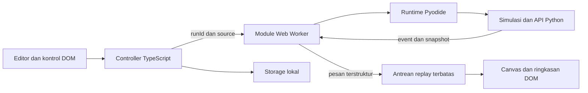

# ARCHITECTURE — Prototype web

Status: implementasi v0.1 berjalan lokal; typecheck, unit test, serta integrasi Pyodide Chrome/Edge lulus. Detail di [VERIFICATION.md](VERIFICATION.md).

## 1. Keputusan utama

| Keputusan | Alasan dan batas |
| --- | --- |
| Web statis, desktop dahulu | Mudah dibagikan untuk playtest; tidak membutuhkan akun atau installer. |
| HTML/CSS + TypeScript + Vite | Cukup untuk satu layar; belum perlu framework UI. |
| Canvas 2D | Kebun 36 petak tidak membutuhkan engine atau physics. |
| Pyodide dalam module Web Worker | Python asli berjalan di browser tanpa mengerjakan komputasi script pada thread UI. |
| Simulasi otoritatif ditulis dalam Python | API pemain dapat langsung memperbarui state dan membaca sensor secara sinkron. |
| Snapshot/event ke UI | TypeScript merender hasil; tidak menghitung ulang aturan pertanian. |
| Tanpa backend | Kode pemain dan state tidak perlu dikirim ke server. |
| Vitest + pengujian Python | Kontrak lifecycle diuji di TS; mekanik dan baseline diuji pada simulasi Python. |

Pin versi dependency dan distribusi Pyodide ketika bootstrap. Loader, WASM, standard library, dan path runtime harus berasal dari versi Pyodide yang sama. Pilih satu jalur deployment runtime dan buktikan pada build produksi; jangan mencampur CDN versi berbeda. Hanya paket standard library yang dibutuhkan prototype.

## 2. Batas komponen



Python memegang posisi, tick, tanaman, hasil panen, dan aturan sukses. Worker mengurus runtime dan transport. Controller memegang lifecycle, watchdog, dan pembatalan. Renderer memegang snapshot yang sudah ditampilkan dan interpolasi visual.

Jangan membagi otoritas state antara Python dan TypeScript. Worker tidak mengakses DOM. Jangan menunggu permintaan sensor dibalas dari main thread: `can_harvest()` membaca simulasi lokal di Worker.

## 3. Struktur file yang dituju

```text
index.html
package.json
tsconfig.json
src/
  main.ts                 # bootstrap dan pengikatan UI
  controller.ts           # lifecycle, worker, watchdog, pembatalan
  protocol.ts             # union pesan, snapshot, versi protokol
  renderer.ts             # grid, drone, dan replay
  storage.ts              # kode dan best score, validasi data lokal
  styles.css
  python.worker.ts        # load Pyodide, namespace, transport
  python/
    simulation.py         # aturan dan API; tanpa DOM/Pyodide
    runner.py             # namespace script, output, pelaporan error
    starter.py
tests/
  simulation_test.py
  controller.test.ts
  storage.test.ts
```

Struktur ini sudah diimplementasikan; test browser tambahan berada di `tests/browser/`. Hindari class atau interface tambahan sebelum ada kebutuhan. State dan fungsi biasa cukup; class Python seperti `FarmSimulation` masuk akal untuk menyatukan state dan invariannya.

## 4. Eksekusi dan protokol

Semua pesan memiliki `protocolVersion: 1`; pesan percobaan juga memiliki `runId` unik. Pesan dari instance Worker lama ditolak menggunakan identitas instance/generation, termasuk pesan loading yang tidak memiliki runId.

| Arah | Pesan | Data utama |
| --- | --- | --- |
| UI → Worker | `init` | Versi protokol dan aturan. |
| Worker → UI | `ready` | Versi runtime/aturan yang berhasil dimuat. |
| Worker → UI | `init_error` | Pesan kegagalan runtime yang dapat ditampilkan. |
| UI → Worker | `run` | runId, source, versi aturan. |
| Worker → UI | `started` | runId; titik awal watchdog komputasi. |
| Worker → UI | `events` | runId, urutan batch, daftar event aksi dan snapshot. |
| Worker → UI | `stdout` | runId, teks output yang dibatasi. |
| Worker → UI | `finished` | runId, outcome, snapshot akhir, statistik, lokasi error bila tersedia. |

Stop/Reset tidak bergantung pada pesan kooperatif ke Python. Controller memanggil `worker.terminate()`, membatalkan antrean, dan mengganti identitas Worker. Jangan mengirim `stop` lalu berharap loop Python memberikan giliran pada handler pesan.

Snapshot berisi `tick`, posisi drone, jumlah panen, dan 36 keadaan petak. Event aksi memiliki nomor urut, nama aksi, argumen, berhasil/gagal, tick sebelum/sesudah, dan snapshot sesudah aksi. Data lintas Worker berupa objek/array/primitive yang dapat di-clone; jangan mengirim Python proxy.

Validasi bentuk pesan dan domain angka sebelum dirender. Tolak protocolVersion berbeda serta runId, urutan batch, atau generation yang tidak cocok.

## 5. Python runner

1. Muat modul simulasi dan runner milik aplikasi.
2. Buat instance simulasi baru dan namespace baru untuk setiap Run.
3. Sediakan API RULES.md sebagai fungsi bound ke instance tersebut.
4. Compile source dengan nama file tetap `player.py`, lalu jalankan dengan Python asli.
5. Tangkap output dan error; pisahkan error user dari error internal aplikasi.
6. API aksi menghasilkan snapshot setelah state diperbarui; flush event dalam batch maksimal 16 aksi dan flush sisa sebelum finished.
7. Saat tujuan/batas tick tercapai, runner menghentikan percobaan melalui sentinel kontrol internal, bukan error yang ditampilkan sebagai kegagalan pemain.
8. Pulihkan pengalihan output/hook runner dalam blok finally untuk jalur normal.

Runner tidak menganalisis program dengan regex atau mengganti arti sintaks Python. Pembatasan seluruh ekspresi Python dan debugger per baris tidak termasuk v0.1. Sentinel internal bukan mekanisme keamanan terhadap script yang sengaja mencoba menghindari runner.

## 6. Simulasi versus animasi

Simulasi komputasi dapat selesai lebih cepat dari animasinya. Worker mengirim event berurutan; main thread memutarnya pada kecepatan visual yang dipilih pemain.

- Durasi dasar satu tick animasi: 160 ms pada 1×; pilihan 1×, 2×, dan 4×.
- Animasi tidak mengubah tick, nilai sensor, atau kematangan.
- Maksimal 200 event aksi diterima per Run karena setiap aksi menghabiskan setidaknya satu tick. Batasi antrean juga pada UI; pelanggaran protokol menjadi error internal.
- Ringkasan panen dan tick mengikuti snapshot yang sedang terlihat, bukan state akhir yang masih menunggu replay.
- Setelah finished diterima, tunggu event terdahulu habis sebelum menampilkan outcome dan menyimpan rekor.
- Saat Stop, batalkan animasi/antrean dan pertahankan snapshot terakhir yang sudah dikomit ke tampilan. Batalkan rekor yang masih pending.
- Dengan reduced motion, hindari interpolasi gerakan; tetap tampilkan urutan state. Bila antrean diringkas, state akhir dan skor wajib sama.

## 7. Lifecycle

```text
loading → ready
loading → init_error → loading (Coba lagi)
ready / outcome → running
running → replaying (komputasi selesai, event masih tersisa)
running / replaying → outcome
running / replaying → stopped (Stop)
running → timeout
any state → reset → ready atau loading
```

Outcome: success, incomplete, budget_exceeded, error, timeout, stopped. Runtime startup failure (`init_error`) berbeda dari error script.

Run hanya aktif ketika runtime siap dan tidak ada percobaan aktif. Editor terkunci saat running/replaying; source diambil sebagai snapshot saat Run. Stop aktif selama running/replaying. Reset aktif di semua state dan tidak menghapus kode/rekor. Jika Worker tidak tersedia sesudah Stop/timeout/Reset aktif, tampilkan loading sampai Worker pengganti siap.

## 8. Batas sumber daya dan pemulihan

| Batas | Kebijakan awal |
| --- | --- |
| Tick simulasi | 200; kontrak RULES.md. |
| Waktu komputasi | 10 detik sejak started sampai finished; tidak termasuk loading atau replay. |
| Startup runtime | Setelah 60 detik, hentikan instance dan tampilkan Coba lagi. |
| Source | Maksimal 32 KiB UTF-8; tolak sebelum Run, jangan memotong source diam-diam. |
| Output | Maksimal 200 baris atau 16 KiB UTF-8 total, mana lebih dahulu. |
| Pesan output | Gabungkan fragmen; kirim batch, bukan satu pesan per karakter. |
| Backpressure output | Setelah batas, buang output berikutnya dan tampilkan satu pemberitahuan pemotongan. |

Watchdog berjalan pada main thread dan menghentikan Worker jika komputasi tidak selesai. Pesan stdout atau event tidak memperpanjang deadline. Error syntax/runtime tidak menghapus source. Untuk error script, replay event yang sudah sah lalu tampilkan hasil error. Kegagalan Worker menghentikan percobaan, memberi pesan yang bisa dipahami, dan menyediakan pemulihan runtime.

Timeout browser bersifat best effort, terutama di tab background. Terminasi Worker adalah kontrol pembatalan, bukan jaminan batas memori keras; script yang mengalokasikan memori berlebihan masih dapat mengganggu tab/perangkat.

## 9. Storage dan deployment

- Simpan source dan best score lokal dengan key berversi, misalnya `farm-code-lab:v1:source` dan `farm-code-lab:rules-v1:best`.
- Rekor hanya disimpan setelah replay sukses selesai. Validasi angka, versi aturan, dan batas tick ketika membaca storage.
- Storage error/quota/private mode menjadi pemberitahuan ringan; bermain tetap dapat berjalan di memori.
- Reset tidak menghapus source/rekor. Ganti starter code harus tindakan eksplisit yang melindungi source yang sudah diubah.
- Gunakan server Vite pada pengembangan dan hosting statis HTTP/HTTPS untuk build. Membuka index.html lewat file:// bukan cara menjalankan yang didukung.
- Runtime awal boleh diunduh dari CDN yang versinya dipin. Tidak ada janji offline; periksa CORS, Worker, MIME WASM, dan semua asset pada deployment sebenarnya.

## 10. Batas kepercayaan

Script pemain dieksekusi lokal di browser, tidak dikirim ke server aplikasi. Pyodide/Worker bukan sandbox untuk kode bermusuhan: Python dapat memakai kemampuan yang diekspos lingkungan browser, termasuk network pada kondisi tertentu.

Karena itu: jangan letakkan secret/token/data sensitif di origin prototype, jangan mengklaim isolasi keamanan, jangan menjalankan script kiriman orang otomatis saat membuka link, jangan merender output sebagai HTML, dan jangan membuat endpoint server untuk menjalankan Python. Distribusi awal ditujukan untuk playtest terbatas atas kode yang diketik/dipilih pemain.

## 11. Pengujian dan kelanjutan

- Python: jalankan aturan dan starter melalui runner yang sama menggunakan standard library unittest di lingkungan pengembangan; periksa kembali integrasinya pada Pyodide.
- TypeScript: uji lifecycle, timer, antrean, penolakan pesan lama, dan storage dengan Vitest serta Worker tiruan.
- Browser: buktikan Run, Stop loop tanpa aksi, Reset saat aktif, recovery, error, timeout, dan kesamaan hasil 1×/4× pada build produksi.
- Dokumentasikan versi runtime/browser serta hasil sebenarnya; jangan menganggap unit test membuktikan kompatibilitas WASM.
- Jika pindah engine, port aturan dan fixture lebih dahulu; pertahankan kontrak API bila sesuai. UI Canvas dan jembatan Pyodide tidak diasumsikan dapat dipakai langsung pada Godot.

## 12. Referensi teknis

- [Pyodide dalam Web Worker](https://pyodide.org/en/stable/usage/webworker.html)
- [Pyodide: integrasi namespace dan JavaScript](https://pyodide.org/en/stable/usage/faq.html)
- [Worker.terminate()](https://developer.mozilla.org/en-US/docs/Web/API/Worker/terminate)

Referensi mendukung pilihan teknologi; implementasi dan versi spesifik proyek masih perlu diverifikasi.

## 13. Catatan implementasi 2 November 2026

- Runtime dipin ke **Pyodide 0.29.3**, satu path CDN `https://cdn.jsdelivr.net/pyodide/v0.29.3/full/`. Source simulasi/runner dimasukkan sebagai string ke bundle module Worker; tidak ada fetch source pemain ke server. Python mengirim snapshot fixture awal setelah siap, sehingga renderer juga tidak menduplikasi fixture kematangan.
- Dependency pengembangan: TypeScript 5.9.3, Vite 7.2.2, Vitest 3.2.4, Playwright 1.56.1; seluruhnya lokal dan dikunci.
- **Pilihan pemulihan implementasi:** Stop dan timeout mengakhiri Worker dan menampilkan outcome beserta tombol **Muat ulang Python**. Pemulihan runtime dilakukan setelah tindakan eksplisit itu; Reset saat Worker tidak tersedia/aktif langsung memuat ulang. Ini memperinci rancangan awal yang mengasumsikan loading Worker pengganti segera sesudah Stop/timeout, dan belum divalidasi melalui playtest. Kode, rekor, serta snapshot terakhir tetap dipertahankan.
- Batas output menyisakan ruang untuk satu pemberitahuan pemotongan dalam total 200 baris/16 KiB. Error internal Worker dibedakan dari error user `player.py`; pesan startup ke pemain menggunakan copy Indonesia.
- Verifikasi produksi saat ini menggunakan HTTP loopback, bukan hosting publik. Lihat [README.md](README.md) dan [VERIFICATION.md](VERIFICATION.md).
